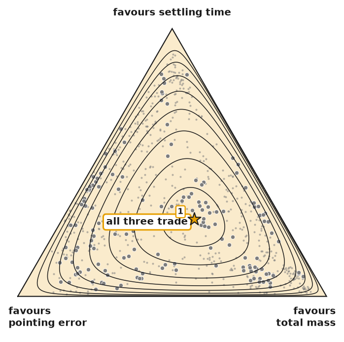

# WP19 D-5: the figure review record (per figure: recipe, reads, five tests, disposition)

Method: `docs/superpowers/notes/figure-review.md`; personas and depths: `docs/superpowers/notes/reader-grid.md`;
slots: `WP19-slots.md`. Order per figure (R-5): the recipe is committed before any read; the reads, tests and
disposition follow in a later commit.

Standing reminder (R-3), repeated in every reader's brief: "i want you to remind our team to look at
images/screenshots not just code and text because we're building this for humans." Every judgement below
names the image file opened and the viewer.

Readers: fresh Sonnet subagents, no repository access, no other read, no answer key; each gets the image
file alone, says what it shows and what they take from it, then gets the caption and says whether it
changed the reading.

---

## 19a

### C-a5: the n-lemma on the simplex (slot S-a5, Section 4 beside Definition 5)

**Recipe (written before any read).**

- Question it answers: what does "n-lemma" mean, geometrically, for a facet's exponent vector?
- Data: a synthetic table of three metrics with three planted facets, two on edges and one inside
  (`make_frontier_data(900, 3, exponents=[[0, 0.35, 0.65], [0.5, 0.25, 0.25], [0.7, 0.3, 0]],
  n_terms=3, random_state=0)`), fitted at K = 3, τ = 50. The n-lemma of each facet is the tension
  report's (the support of the exact-maximum fit on the facet's rows, `tension_report`); the markers
  are the fitted exponent vectors; open rings the planted ones. Generator: `paper/figures/nlemma.py`.
- Intended takeaway: an exponent vector is a point of the triangle; the face it sits in names the
  n-lemma (a corner: one metric binds; an edge: a dilemma of the two metrics at its ends; the
  interior: a trilemma); here two facets are dilemmas on two different edges and one is a trilemma,
  each recovered where it was planted.
- The sentence (test 2): "An exponent vector lies on the simplex, and the smallest face holding it
  names the n-lemma: a corner, an edge, the interior for one, two, three contending metrics."
- Identity used: exponents lie on the simplex (assumption A2, `derivation/axioms.py`) and the
  contending set is the support (Definition 5, `def-nlemma`); the face of a point of the simplex is
  its support. No new lemma. The weight the three metrics carry is printed (1.00, since d = 3).
- Hypothesis H-a5 (falsifiable): a P2 reader at L-B, from the image alone, says that a facet on an
  edge trades two metrics and one inside trades all three, and names the two metrics of at least one
  edge facet; a P5 reader at L-C reads the triangle as the simplex of exponents and the face as the
  support. It fails if either reader takes the markers for designs or cannot say what the position
  means without the caption.
- Shows / does not show / good for (draft for placement): shows each facet's exponent vector as a
  point of the simplex and the face that names its n-lemma; does not show designs, levels or the
  surface, and with more than three metrics a triangle is one face of a larger simplex (exchange
  rates among three, with the weight they carry printed); good for reading a facet's contending set
  by eye before the case's heatmaps.

## 19b

### C-b1: the assembly view (slot S-b1, Section 8)

**Recipe (written before any read).**

- Image: `docs/superpowers/notes/spike-sysml-diagrams/out/r1/assembly_view.png` at 9fc3952 (WP22 round 3),
  generated by the spike's projection of the model (`project.py`, PlantUML text beside it). Not
  regenerated here (PlantUML and Java are system tools; WP22d is moving the views to the model's
  documentation folder; the path at placement is that folder's).
- Question: what is a configuration of the cubesat?
- Intended takeaway: the cubesat is an assembly of parts; a configuration swaps the wheel (three
  classes) and the star tracker (three grades) and tunes the panel span, the battery capacity and two
  controller gains within ranges read from the model.
- The sentence: "The configuration swaps one of three wheels and one of three trackers and tunes the
  panel span, the battery capacity and two gains within ranges."
- Analyst's readings in the image (R-11): none in the assembly view; every name and range is read from
  the model (spike report, revision 2).
- Hypothesis H-b1: a P3 modeller at L-B, image alone, names the two swapped parts and at least three of
  the four tuned parameters and says a configuration is a choice of parts plus tuned parameters; a P1
  reader at L-B says what can be changed in the design. Fails if a reader cannot tell swap from tune or
  reads the tree as a process.

### C-b2: the behavioural view (slot S-b2, Section 8)

**Recipe (written before any read).**

- Image: `docs/superpowers/notes/spike-sysml-diagrams/out/r1/behavioural_view.png` at 9fc3952.
- Question: which of the traded metrics does a requirement read, in which subsystem, and which are
  traded with no requirement on them?
- Intended takeaway: requirements sit in three functional subsystems (controls, power and energy,
  mass); six of the ten traded metrics are read by a requirement; control effort, pointing error, peak
  slew power and total mass are traded with none; three requirements read no traded metric; the
  analysis computes seven metrics and the measured slew supplies the rest.
- The sentence: "Six of the ten traded metrics are read by a requirement; control effort, pointing
  error, peak slew power and total mass are traded with none."
- Analyst's readings in the image (R-11; the image's legend says the first): which subsystem a
  requirement sits in (the case groups metrics, not requirements); the line from the slew measurement
  to the metrics it supplies rests on the experiment's prose.
- Hypothesis H-b2: a P1 reader at L-B, image alone, names at least two traded metrics with no
  requirement and says that requirements group by subsystem; a P3 modeller at L-B says that each
  orange line ties a requirement to the metric it reads. Fails if a reader cannot find the metrics
  without a requirement or takes the lines for data flow.

---

## Reads, tests and dispositions (after the recipes at 4c91675; candidate image at 009e96e)

Images given to readers (copies with neutral names in the session scratchpad, byte-identical to the
committed images; SHA-1 shown): `figure-A.png` = `paper/figures/fig-nlemma.png` at 009e96e (201d8b9);
`figure-B.png` = `docs/superpowers/notes/spike-sysml-diagrams/out/r1/assembly_view.png` at 9fc3952
(11a449d); `figure-C.png` = `.../out/r1/behavioural_view.png` at 9fc3952 (82e5587). Each reader opened
the one PNG with the Read tool (image view), answered, then was sent the caption. My own judgements
(tests 3 and 4) were made from the same PNGs opened in the Read tool, and from copies resampled to the
700 px column (`col700-A.png`, `col700-C.png`; B is 699 px native). Browser check: not done. The
built-in browser shows a local file only as a static snapshot it cannot act on, and a local server
could not be started in this environment (uv refused an unrelated egg-info outside the project); the
column check is therefore the resampled image in the image view, a limit recorded here.

### C-a5: the n-lemma on the simplex

Read 1, P2 practitioner, L-B. Image alone: "It plots three 'facets' as markers in a triangle whose
corners are metric 1, 2 and 3. Each facet has a weight vector w, and a ring marks a 'planted' (known)
answer." Take-away: "the method sorts each tradeoff into a single metric binding alone (corner), a
two-way dilemma (edge), or a three-way trilemma (interior). It also seems to check this against known
answers: each planted ring sits close to its recovered marker (facet 2's ring is slightly offset)."
Position: "the share of weight on each metric (barycentric coordinates). On an edge, one metric has
weight 0." Unclear: "what 'facet', 'exponent vector' and 'planted' mean in practice ... The footer line
'1.00, 1.00, 1.00 (all of it: d = 3)' is cryptic. Facet 1 and facet 3 labels read like duplicates. No
decoration." With caption: "Changed: 'facet' is a piece of the fitted surface, the weights are its
exponent vector, and the open ring is the planted truth ... Still unclear: 'n-lemma' and
'exact-maximum fit' are undefined for a practitioner; facet 2's ring is visibly offset from its marker,
so I can't tell if that is fine; the footer ... should say 'weight carried by these metrics'."

Read 2, P5 optimization reader, L-C. Image alone: "the 2-simplex of exponent vectors w (nonnegative,
summing to 1) over three metrics, with corners, edges and interior marking how many metrics get
nonzero weight ... I read this as a recovery test." "The face a marker sits in gives the support of w,
meaning which metrics are active and trade off at that facet." Unclear: "'Facet' is never defined ...
'Planted' is unexplained ... Marker 2 is visibly offset from its circle ... The '1.00, 1.00, 1.00' line
is cryptic ... The sum of w for facet 2 is 0.99, a rounding artifact ... Nothing here ties w to the
geometric program." With caption: "'Facet' is now defined ... the open ring is the planted truth ...
That makes marker 2's offset a visible recovery error, not a drawing flaw ... The '1.00, 1.00, 1.00'
line is explained." Still unclear: "'Exact-maximum fit' is undefined here ... a fitted point lying
exactly on a face boundary is a measure-zero event."

Five tests. (1) Cold read: both readers reached the intended takeaway from the image alone (face to
n-lemma; recovery of the planted vectors); neither took a marker for a design; P5 named the support.
H-a5 holds (P2 stated the corner/edge/interior reading; the edge facets' metrics are named in the key).
(2) Sentence test: passes, narrowly. The sentence states the rule; the image let a reader with no
convex analysis place a facet by eye and see the fit land on the planted answer, which the sentence
does not give. (3) Ink: the triangle and key carry the content; about a fifth of the frame is margin;
no label covers a marker. (4) Legible at the 700 px column (`col700-A.png`): every label readable, the
smallest about 9 px tall; light scheme only (the paper has no dark scheme). (5) Lines below.
Friction, triaged: the footer "1.00, 1.00, 1.00" (both readers) is resolved by the caption's last
sentence (both said so): caption, no redraw. "Exact-maximum fit" and "n-lemma" are defined in
Definition 5 beside the figure (L-C), so not a figure fix. Facet 2's offset is a true recovery error
(fitted 0.44 against planted 0.50 on metric 1 at τ = 50; the exact-maximum support is the planted
trilemma), which P5 read correctly from the caption. P5's measure-zero point is answered by the fit:
the exact-maximum fit has exact zeros (the tension report's support), stated in the caption.
**Disposition: keep, with the caption. Ready for placement.**

### C-b1: the assembly view

Read 1, P3 modeller, L-B. Image alone: "a SysML-style block diagram of a 'Cubesat' part definition ...
with design variables marked on parts and a legend listing their levels and ranges." Take-away: "the
design space is defined by a small number of explicit knobs on a spacecraft model. Two kinds are
marked: 'swap' (categorical choice among variants) and 'tune' (continuous parameter in a range)."
Named: WheelClass, TrackerGrade; panelSpan, batteryCapacity, Kp, Kd with ranges; "Bus, Antenna and Imu
are fixed." Unclear: "'Dataset' (baseline vs aggressive) is not explained ... Whether the swaps
interact with the tuned parameters ... Units for Kp and Kd ... The legend text is small but legible.
Nothing looks like decoration." With caption: resolves the notation and "dataset"; "The legend says
'baseline' where the caption says 'stock', so the labels don't match."

Read 2, P1 decision maker, L-B. Image alone: "a structure diagram of a 'Cubesat' satellite design,
showing its parts and which ones are the design choices ... the design space is 2 categorical choices
plus about 4 continuous ones." Could change: "wheel class and tracker grade, and set panel size,
battery capacity and the controller gains within the ranges shown. Bus, antenna and IMU are fixed."
Unclear: "SysML-like 'part def', 'abstract' ... The tiny text is hard to read. The diamond and arrow
notation is not explained." With caption: notation decoded; "The caption calls the second regime
'stock' and the figure says 'baseline', so I would unify those two words"; still unclear "what 'SysML
v2' is and why it matters, the small text, and where the trade-offs appear."

Five tests. (1) Both readers named the two swapped parts and all four tuned parameters from the image
alone and read a configuration as parts chosen plus parameters tuned: H-b1 holds. (2) Sentence test:
passes; the image adds where each variable sits in the assembly and which parts are fixed, which both
readers took and the sentence does not give. (3) Ink: compact; the legend box is about a third of the
frame and carries the levels and ranges. (4) 699 px native, at the column without scaling; the
smallest text (stereotypes) is small, legible for P3, "hard to read" for P1; not redrawn (a phone is
not the target, and the labels that carry the intent, swap/tune and the names, are larger).
(5) Lines below. Friction, triaged: the regime words. The model and the image say "baseline" and
"aggressive"; the paper says "primary regime (aggressive controller gains)" and "stock gains (the
baseline)". Caption fix: name both as the paper does. R-11: the assembly view carries no analyst's
reading (spike report, revision 2); text identity over three runs is WP22's check at 9fc3952, not
rerun here (PlantUML and Java are system tools). **Disposition: keep, with the caption. Ready for
placement.**

### C-b2: the behavioural view

Read 1, P1 decision maker, L-B. Image alone: "a systems-model diagram ... It links requirements
(orange boxes) to the quantities they constrain (green boxes), grouped by subsystem, with two sources
... feeding the quantities." Take-away: "most quantities we care about (settling time, slew time,
energy balance, power margin, depth of discharge, eclipse reserve) have a requirement tied to them.
Several others (control effort, pointing error, peak slew power, total mass) have none. They are
tradable, but nothing pins them. Three requirements (slew band, power, momentum) don't map to any
quantity. The whole thing hangs together traceably, which builds some trust." Unclear: "'traded
metric', 'satisfy/verify' stereotypes, 'cubesatBaseline', and the odd note that SlewTimeRequirement
repeats SlewBandRequirement ... The text is small ... I'm not sure what '7 of the 10 metrics' counts."
With caption: "explains the 'traded metric' idea ... the seven-of-ten count"; still "'SysML v2',
'satisfy', 'verify' and 'cubesatBaseline' mean nothing to me ... I can't check the 'seven' from the
picture ... The text is small."

Read 2, P3 modeller, L-B. Image alone: "a SysML-style diagram mapping requirements (orange boxes) to
quantities called metrics (green boxes), grouped by subsystem, with two sources feeding the metrics."
Named the same six with a requirement, the four without, three requirements with no metric, the
analysis computing seven of ten. Lines: "Orange arrows: a requirement reads a metric, and the label is
the shared quantity. Grey arrows: where metrics come from ... Dashed boxes: metrics nobody requires."
Unclear: "'traded metric', 'CaseSpec' ... The 'same statement as SlewBandRequirement' note is cryptic.
The legend text is small and dense. The grey and lilac arrow distinction is hard to follow." With
caption: settles "traded metric", the seven-of-ten split, the dashed and top boxes; still unclear "How
a requirement 'reads' a metric in the method ... Which source feeds which metric ... The cryptic 'same
statement' note ... The legend, which is small and dense." (Process note: this reader also sent its
answer to another agent id by message; it received no other read, so the read stands.)

Five tests. (1) Both readers found the four metrics with no requirement and the subsystem grouping
from the image alone; P3 read the orange lines as a requirement reading a metric: H-b2 holds. (2)
Sentence test: passes; the image adds the grouping by subsystem, the requirements with no traded
metric and where each metric comes from (the chain from model to metric the supervisor asked for),
all taken by both readers. (3) Ink: dense but data; the dashed top box and the legend take about a
quarter. (4) 700 px native; the box text and legend are small (all readers) but read correctly; not
redrawn here. (5) Lines below. Friction, triaged: the "same statement as SlewBandRequirement" note
(both readers of C) and the SysML stereotypes are in the model's projection (WP22's files, not
this package's): a finding for the model stream, not a caption. **Disposition: keep, with the caption.
Ready for placement.**

Note for the supervisor's review (the PM's ruling on Q-2: the WP22 loop is closed by the driver and the
caption carries the figure): the readers stalled on the "same statement as SlewBandRequirement" note
inside the SlewTimeRequirement box (both readers of this view) and on the
«satisfy» and «verify» lines, which a decision maker cannot read. Options for a later round of the
model's projection: drop or explain the note; leave the stereotype lines out of the paper's version.

---

## 19c, 19d, 19e: recipes and sentence-test verdicts (written before any read of this round)

Images: the committed outputs `paper/figures/fig-*.png` (last regenerated at 03189c5), opened in the
Read tool (image view). The paper's current captions are quoted from `paper/paper.ipynb` at 125360f.

### C-c1: Figure 1, the temperature sweep (S-c1); keep, read

- Intended takeaway: the temperature is chosen where the fraction of designs above V = 1 reaches the
  target; the effective sample shrinks as τ grows; the exponents change little across τ, so the
  reading does not hang on the choice.
- Sentence: "The selected τ puts the target fraction of designs above V = 1, at the cost of a small
  effective sample, and the exponents move little across τ."
- Hypothesis H-c1: a P2 reader at L-B says from the image that the vertical bar marks a chosen
  temperature where the top-left curve crosses its line, and that the exponents' pattern holds across
  τ; a P1 reader at L-B says a setting was chosen by a rule. Fails if neither connects the bar to the
  crossing.
- Caption: unchanged.

### C-d1: Figure 2, planes at K = 1 (S-d1); keep, read

- Intended takeaway: designs fall along a downward line: slew time is traded for control effort; the
  facet's line is the reference surface in this plane.
- Sentence: "At K = 1 slew time and control effort trade along one line."
- Hypothesis H-d1: P1 and P2 at L-B name the two metrics and the downward trade-off from the image
  alone. Caption: unchanged.

### C-d2: Figure 3, planes at K = 3 (S-d2); caption clause, read

- Intended takeaway: with three facets the surface bends; different facets carry different pairs;
  the bottom panel's bands are the discrete alternatives, not noise.
- Data check for the clause (`case.load_study("primary").feasible`, grouped by `wheel_class` and
  `st_grade`): with the small or the medium wheel, peak slew power takes one value per wheel class and
  tracker grade (six values: 1.30, 1.50, 1.80, 2.00, 2.40, 2.60 W); with the large wheel it varies
  (5.5 to 7.4 W). So the six horizontal bands at the top of the bottom panel are those six
  combinations, and the low cloud is the large wheel.
- Caption (current, plus the clause): "Log-metric planes of the K = 3 fit with the near-frontier band;
  designs coloured by facet, lines the facets. In the bottom panel peak slew power is set by the
  discrete choices: with the small or medium wheel it takes one value per wheel class and tracker grade
  (the six horizontal bands); the large wheel's designs form the lower cloud."
- Hypothesis H-d2: P3 and P6 at L-B, after the caption, attribute the bands to the wheel and tracker
  choices and do not infer an unnamed variable; from the image alone at least one says the lines bend
  or differ between facets.

### C-d3: Figure 4, the chart at K = 3 (S-d3); sentence test, then drop

- Intended takeaway: designs of different facets occupy different regions of the chart's position.
- Sentence: "Designs dominated by different facets occupy different regions of the chart's position."
- Evidence already in: round 1, 4 of 6 readers "coloured dots on unexplained Z coordinates"; round 1b,
  least helpful for 2 of 6, "I saw clusters by colour but took nothing from it I could repeat". The
  image (opened): three colours overlap heavily in both panels; the regions are not separable by eye;
  the coordinates have no meaning alone.
- Verdict: the sentence carries all a reader took; a caption cannot make overlapping clouds separate,
  and a redraw would need a new intent (no coordinate of the chart has a meaning a reader can name).
  **Drop; the sentence stays** (the paper stream decides whether the sentence enters the K = 3
  paragraph; the facet shares are in Appendix D.3). No new read is spent on it.

### C-d4: Figure 5, tensions at K = 3 (S-d4); keep, read

- Intended takeaway: each facet trades a different set of metrics (orange cells: tension), and the
  outlined diagonal cells are its contending set; w grades each member.
- Sentence: as the slot list.
- Hypothesis H-d4: P5 at L-C and P2 at L-B, after the caption, read negative association as tension,
  the outlines as the contending set and w as the fitted exponent, and name one pair in tension on one
  facet. Caption: unchanged (its "w" clause landed before WP11 round 1b).

### C-d5: Figure 6, the two regimes (S-d5); caption clause, read

- Intended takeaway: the two regimes' contending sets differ (mass contends with aggressive gains,
  not with stock gains), so the gains change what trades.
- Caption (current, plus the "w" clause CR-4 asks for): "The two regimes: association among
  near-frontier designs at K = 1, primary (aggressive controller gains) above, stock (stock gains)
  below; outlined: the contending set; w is the fitted exponent of each metric."
- Hypothesis H-d5: P1 and P6 at L-B, after the caption, say the outlined sets differ between the
  panels and name one metric in one set and not the other.

### C-d6: the ternary on the shared metrics (S-d6); sentence test, no figure

- Sentence: "On the three metrics both regimes share, the one-facet fit sits between the three
  facets: one facet blends what three separate."
- Verdict: **no figure**. Drawn, it is five markers in an otherwise empty triangle with their weights
  in a legend, the form of the docs' cubesat triangle that the supervisor called "pretty vacuous"
  and of which `figure-review.md` makes the worked failure; the sentence and Figures 5 and 6 carry the
  point. Nothing is drawn.

### C-d7: Figure 7, predicted against measured (S-d7); sentence test, then drop

- Intended takeaway (the paper's own finding, generated sentence `num-predict`): the regressor
  predicts each proposal's level within its band for 3 of 3, but its position within the band for 0 of
  3 (errors 1.4 to 3.1 bands).
- The image (opened): open circles and diamonds sit a fraction of a unit apart on axes spanning four
  units, so every pair looks close; nothing in the image gives the band as a scale, and the level, the
  part the regressor gets right, is not drawn. The bottom panel's vertical axis reads "Z1" while it
  plots Z2 (a defect in `case.predict_check_figure`, passed to the PM).
- Evidence already in: round 1, "could not tell good from bad" (4 of 6); round 1b, all six read
  "predictions matched measurements", which is the opposite of the finding for position.
- Verdict: the figure conveys a belief the text contradicts; a caption cannot rescale it, and a
  redraw belongs to `examples/adcs/case.py` (outside this package's files). **Drop; the generated
  sentence `num-predict` stays** and the Appendix D.10 table carries the numbers. No new read.

### C-e1: stability of the several-term fit (S-e1); sentence test, no figure

- The appendix's stability results are tables (D.11 jitter, D.12 conditioning, D.13 refit on a
  facet's rows); no resampling of the K = 3 fit exists in the paper. The spike's 40-resample triangle
  is the grouped (by subsystem) form, which is dropped, and an ungrouped version would add a new
  analysis with new numbers (a non-goal). **No figure**; noted for the supervisor as a possible
  appendix item.

### C-d2, caption step 2 (written after the first reads of Figure 3, before the second)

Why: both first readers of Figure 3 (P3, P6) read the bands from the caption correctly, and both were
left with points above the line ("looks like a fit through the cloud, not an envelope", P6) and an
opaque "facets 1, 2 drawn". Both are said by the code: `examples/adcs/k_terms._slice` draws a facet's
line in the plane of two metrics with the other eight held at the median of that facet's
near-frontier designs, and draws a facet only where it weighs both metrics; designs are coloured by
the facet whose term is largest for them (`plotting.facet_labels`). So a design can lie above the line
in this plane and still be inside the surface. The same holds for Figure 2 (one facet).

Caption, step 2 (Figure 3): "Log-metric planes of the K = 3 fit, each a slice: a facet's line holds the
other eight metrics at the median of that facet's near-frontier designs, so a design can lie above the
line here and still be inside the surface. Designs are coloured by the facet whose term is largest for
them; a facet is drawn only where it weighs both plotted metrics; grey: the near-frontier band. In the
bottom panel peak slew power is set by the discrete choices: with the small or medium wheel it takes
one value per wheel class and tracker grade (the six horizontal bands); the large wheel's designs form
the lower cloud."

Caption, step 2 (Figure 2, the same clause): "Log-metric plane of the K = 1 fit (primary regime) in the
two metrics with the facet's largest exponents. The line is a slice of the surface: the other eight
metrics are held at the median of the near-frontier designs, so designs off that median fall on either
side of it; grey: the near-frontier band."

Hypothesis H-d2b: fresh P1 and P6 readers at L-B, given the image and then this caption, no longer
read the line as a fit through the cloud and say why points lie above it. Figures 5 and 6 add
"(association: the Pearson correlation of the log-metrics)", the measure `tension_report` uses by
default and the case does not change.

### 19c and 19d reads, tests and dispositions (after the recipes at a6f0dfe and c399dd1)

Images given (copies with neutral names, byte-identical, SHA-1 prefix): `figure-D.png` = `fig-tau-sweep.png`
(94eca94), `figure-E.png` = `fig-plane-k1.png` (c8b828c), `figure-F.png` = `fig-plane-k3.png` (aee7fdc),
`figure-G.png` = `fig-tensions-k3.png` (e98910f), `figure-H.png` = `fig-regimes.png` (18e4fbd), all as
committed at 03189c5. I opened each one in the Read tool (native width 783 to 792 px, about the paper's
column) for tests 3 and 4. Light scheme only, which is all the paper has. Process note: two readers
(Figure E, P1, and the P3 reader of C-b2 earlier) also sent their answer to another agent by message.
They received nothing from it, so their reads stand.

**C-c1, Figure 1 (P2 L-B, P1 L-B).** P2, image alone: "The grey bar at tau of about 40 looks like a
chosen or recommended operating point, where the fraction crosses the 0.1 line ... [the bottom panel]
changes little after the bar"; unclear "the colourbar has no label". P1, image alone: "The grey line at
tau about 40 looks like the chosen value, sitting where the fraction crosses the 0.1 line. But there is
no text saying how or why. The heatmap suggests the weights barely depend on tau". With caption, both:
the bottom panel is the exponents; the bar is "where the fraction first meets the target, so the choice
is not arbitrary" (P2); "the result does not depend much on the setting" (P1). Still unclear to both:
why 0.1, why an effective sample of about 10 is acceptable, what V is. Those are the text's job, not
the figure's. Tests: (1) H-c1 holds for both; (2) the exponent path and the crossing are visible facts
the sentence only asserts: pass; (3) dense, all data; (4) legible at native width. **Keep as is.**

**C-d1, Figure 2 (P1 L-B, P2 L-B).** P1, image alone: "Slew time and control effort pull against each
other ... I'd treat it as a rough frontier, not a hard limit." P2: "this is a fitted trade-off line
through design samples ... Most points sit below the line, so I suspect it is an upper bound or
envelope". With caption: the band is identified; P1: "the caption implies several panels but I see
one"; both still ask why points lie above the line. Tests: (1) H-d1 holds (both named the two metrics
and the trade); (2) pass (the anchor); (3) and (4) pass. Friction: the line read as a trend through
the cloud, the same as in Figure 3. **Caption**: step 2, the slice clause, tested on Figure 3 below,
where it removed exactly this reading. Figure 2 was not re-read with it.

**C-d2, Figure 3 (P3 L-B, P6 L-B; then fresh P6 L-B, P1 L-B on caption step 2).** Step 1, the band
clause. P3: the bands mean "peak slew power takes only a few discrete values ... (probably a discrete
design choice or a few operating modes)". With caption: "The bottom bands now make sense: six bands come
from wheel class and tracker grade". P6, image alone: "Many points sit above the line in the top panel,
so it looks like a fit through the cloud, not an envelope". With caption: "The bottom-panel bands are
now explained. They come from discrete design choices". Still: "Points far above the line ... look odd
for a frontier. Perhaps ... only projections"; "'Drawn' in the panel titles is still opaque". Step 2,
the slice clause, fresh readers. P6, image alone: "Points above it must mean the line is a smooth
approximation, not a hard envelope." With caption: "The lines are not frontiers of these two metrics.
They are slices of one K = 3 posynomial surface ... So points above a line are not violations ... That
removes my 'smooth approximation or regression' worry." P1, image alone: "Points above or beyond the
line would be designs that beat the fitted boundary". With caption: "A point above a line can still be
inside the surface, because its other metrics differ. That removes my worry that points above the line
mean the fit failed." Still unclear to both: why facets 1 and 2 are drawn while three colours appear;
P6 calls the claim "unfalsifiable from this picture alone". Tests: (1) H-d2 and H-d2b hold; (2) the
bend and the bands are visible facts: pass; (3) pass; (4) the bottom panel's axis labels are long but
legible. **Caption step 2. Ready for placement.**

**C-d4, Figure 5 (P5 L-C, P2 L-B).** P5, image alone: "Negative cells (orange) are tradeoffs ... Facet
3 puts pointing error against peak slew power at -0.96"; outlines "look like a diagonal accent".
With caption: "The outlined diagonal cells mark the contending set ... w is the fitted exponent ...
That explains the outlined cells with tiny w". P2, image alone: "Pairs in tension: settling time vs
control effort (-0.93 in facet 1) ... The pattern shifts between facets". With caption: "Outlined cells
are the contending set ... w is a fitted exponent". Both still ask "Which statistic 'association' is,
for example Pearson or Spearman" and what "6-lemma" means (Definition 5 at L-C). Tests: (1) H-d4 holds;
(2) pass; (3) dense, all data; (4) cell numbers legible at native width; the figure is tall (three
panels). Not resized: the supervisor's "you can resize it but don't rework it" leaves that to him.
**Caption: add the association clause. Ready for placement.**

**C-d5, Figure 6 (P1 L-B, P6 L-B; caption with the "w" clause).** P1, image alone: the two panels
differ "in which metrics are picked and their weights. Primary: slew time, pointing error, mass,
control effort, energy balance and depth of discharge. Stock: settling time, slew time, pointing error,
control effort, power margin and eclipse reserve"; and "the method seems to pick a few representative
metrics and drop redundant ones". P6, image alone: "The boxed ones look like one representative per
cluster, so I read this as a redundancy-pruning step". With caption: P6 says "w is a fitted model
parameter, not a selection weight ... aggressive gains move which metrics contend ... That is a finding
beyond correlation"; P1 says "the trade-off structure changes with gain regime". Both still ask what
"association" is. Tests: (1) H-d5 holds (each named metrics in one set and not the other); the
"representative per cluster" reading from the image alone is a near-wrong belief, and the caption
moved both readers off it; (2) pass; (3) and (4) as Figure 5. **Caption: the "w" clause (CR-4) and the
association clause. Ready for placement.**

**C-d3 (Figure 4) and C-d7 (Figure 7): dropped by the sentence test** (recipes above), with the WP11
evidence of round 1 and round 1b. No read was spent.

**C-d6 and C-e1: no figure** (recipes above).

---

## After the supervisor's verdict on Figures 3 and 4 (`WP19-decisions.md`, 2026-11-09 20:55)

The new principle in `figure-review.md`: no borrowed idiom with a false analogy; the model is drawn as
the model, and the analysis is named as analysis or not drawn. This **supersedes** C-d2's caption steps
(P-6) and C-d3's drop (P-7), which are kept above as history. All candidates below are drawn on the
current committed data to settle the design only; WP23 (slew time leaves the metrics) regenerates
every case figure.

### C-d2 redraw 1: Figure 3 without facet colouring (recipe, before any read)

- Generator: `paper/figures/planes.py` (`fig-planes-k3.png`). It reads the case's data through
  `case.py` and uses its slice (`k_terms._slice`); `case.py` itself is unchanged. Designs are one
  neutral grey. In each slice the surface is the black line (the lowest facet line, as the package
  draws it), with each facet named on its own segment, plus the near-frontier band. There is no
  legend by facet and no outline of near-frontier designs: the sentence does not need them.
- Intended takeaway: the surface bends; each straight piece of it is a facet; different pairs of
  metrics trade on different pieces; the bottom panel's bands are discrete choices.
- Sentence: "At K = 3 the surface bends: each facet is one straight piece of it, and different pairs
  trade on different pieces."
- Caption: "Log-metric planes of the K = 3 fit, each a slice: the black line is the surface in the
  plane of two metrics, one straight segment per facet (named on it), with the other eight metrics held
  at the median of that facet's near-frontier designs, so a design can lie above the line here and
  still be inside the surface; grey: the near-frontier band. In the bottom panel peak slew power is set
  by the discrete choices: with the small or medium wheel it takes one value per wheel class and
  tracker grade (the six horizontal bands); the large wheel's designs form the lower cloud."
- Hypothesis H-d2r: fresh P1 and P4 readers at L-B (P4 is the reader most at home with the cluster
  idiom), image first, call a facet a piece or segment of the line or surface and not a group of
  designs. Fails if either calls a facet a group or cluster of designs.

### C-d3 redraw 1: Figure 4 as position against level (sentence test result, recipe, before any read)

- Sentence test against the ruling: the chart has one sentence that no log-metric plane carries,
  "in the chart the surface is one flat line, log V = 0, whatever a design's position: level is read
  apart from position". A scratch drawing of Z0 against log V (opened:
  `scratchpad/wp19/chart-z-logv.png`) shows it, and also something the sentence does not give: where
  along the surface the designs reach it, and where they lie deep inside. **So a redraw, not a drop.**
- Generator: `paper/figures/chart_level.py` (`fig-chart-level.png`): Z0 against log V, designs grey,
  the surface as the line log V = 0, the near-frontier band; no facet colouring.
- Intended takeaway: the chart flattens the surface; a design's level (its energy differential) is
  its height below the line, read apart from its position; many designs sit at the surface across the
  range of positions, and a deep tail lies inside at one end.
- Sentence: "In the chart the surface is the flat line log V = 0, and each design's level is read apart
  from its position along it."
- Caption: "The chart of the K = 3 fit: each design's position along the surface (Z0, the first of
  nine position coordinates, meaningless alone) against its level log V, the energy differential. The
  surface is the flat line log V = 0; grey: the near-frontier band; a design above the line lies beyond
  the surface."
- Hypothesis H-d3r: P2 and P4 readers at L-B, image first, say the black line is the surface and a
  design's vertical distance from it is its level, independent of where it sits left to right. Fails
  if either reads Z0 as a metric or the line as a fit through the points.

### The principle check, once, on every current figure (findings only; nothing changed beyond Figures 3 and 4)

Each image was opened in the Read tool: paper `paper/figures/*.png`; index `paper/figures/figure1.png`;
docs `scratchpad/wp19/docsfigs/*-light.png`, built by `scripts/build_figures.py` at 363019f with the
docs unchanged since.

| Figure | Finding | Proposed disposition |
|---|---|---|
| Paper Fig. 1, temperature sweep | The model (exponents along τ) is drawn as the model; the selection diagnostics are named. No borrowed idiom. | Keep. |
| Paper Fig. 2, planes K = 1 | The designs are one colour, but the legend labels them "facet 1", the facet-membership idiom in a one-facet form; the line is a slice. | Redraw with `planes.py` (designs as "designs", the segment named), the same function as Figure 3. Not done; for the supervisor. |
| Paper Fig. 3, planes K = 3 | The cluster idiom (the ruling). | Redrawn: C-d2 redraw 1. |
| Paper Fig. 4, chart K = 3 | The cluster idiom; draws no model. | Redrawn: C-d3 redraw 1. |
| Paper Fig. 5, tensions per facet | The rows of each panel are the designs the analysis assigns to the facet. The cells are a correlation matrix, a statistics idiom read as "negative = trade-off", and the package states that closure forces some negative association among participating metrics (`tensions.py`, `closure_note`). The model's part (contending set, w) is on the outlines and labels. | Keep the drawing (liked). The caption names the cells as analysis: "association among the designs the analysis assigns to facet k", not "of each facet". Not done; for the supervisor. |
| Paper Fig. 6, regimes | The same correlation idiom, at K = 1 (no assignment). | The same caption naming; keep. |
| Paper Fig. 7, predict-check (dropped) | No facet idiom. Defect for WP23 (`case.py`): the bottom panel plots Z2 with a "Z1" axis label (`case.predict_check_figure` sets no labels). | Stays dropped; the defect goes to WP23. |
| n-lemma ternary (P-1) | The coloured markers are facets' exponent vectors (the model); no design is coloured. | Keep. |
| Assembly and behavioural views (P-2, P-3) | SysML's own notation for its own model; no borrowed analogy. | Keep. |
| Index three-pane figure (`figure1.png`) | Designs coloured by facet in all three panes, and "facets as regions" of the chart: the cluster idiom on the index page. The coloured facet lines and normals are the model. | Redraw the designs in one colour and keep the coloured lines. A third pane with the facets as regions of Z is exact only at d = 2, so it is named as analysis or dropped. For the supervisor (index page, not the paper). |
| Docs Fig. 1, first fit | One colour, the line and the band as the model. | Keep. |
| Docs Fig. 2, three facets (fitting page) | Designs coloured by facet: the cluster idiom. This is the default of `plotting.plot_log_plane` for K > 1, so the package's plotting example teaches it. | Redraw in one colour with the segments named; consider changing the package default (an API change, outside WP19). For the supervisor. |
| Docs Fig. 3 and Fig. 6, tension heatmaps | As paper Figure 5 and 6: the correlation idiom. | Same naming in the captions. |
| Docs Fig. 4, log plane | One colour; model as model. | Keep. |
| Docs Fig. 5, chart holes | The analysis (hole positions) drawn and named in the caption. | Keep. |
| Docs Fig. 7, adcs coordinates | One colour, near-frontier ringed, coverage only (WP8a caption). | Keep. |
| Docs Fig. 8, planted ternary ("this one is great") | Regions tinted by the dominating facet (an analysis the plot's documentation names). Near-frontier designs are coloured by facet: the cluster idiom on the designs. | His figure. Option: designs in one colour, regions kept and named as analysis. For the supervisor; not changed. |

### Reads of the two redraws (after the recipes at 141653c)

Images: `figure-J.png` = `paper/figures/fig-planes-k3.png` (41b9f7d); `figure-K.png` =
`paper/figures/fig-chart-level.png` (0794b5d), both as committed at 141653c, 800 px native and opened
in the Read tool.

**C-d2 redraw 1 (P1 L-B, P4 L-B).** P1, image alone: "A facet looks like one straight piece of the
boundary. The line is built from several pieces, each labelled." P4, image alone: "A facet looks like
one linear segment of the frontier ... The facets appear to be pieces of one surface". With caption,
P1: "A facet is now one flat piece of the fitted surface. It shows up as one straight segment in each
slice"; the dots above the line "are not violations, just designs whose other metrics differ". P4:
"there are three linear pieces in a 10-metric space. Each panel is a 2-D slice ... A point can be
outside the slice and still be inside the surface"; "Facet now: one linear piece (a monomial-like
patch) of the fitted surface". Neither reader called a facet a group of designs, before or after the
caption. By contrast, on the facet-coloured figures of WP11 round 1b, P1 read a facet as "a sub-group of designs" and P2 and P4 half so.
Still unclear: the band is nearly invisible (it is 0.026 wide in log V: the data, not the drawing);
the label "facet 2" sits inside the cloud in the top panel; "conditioned". Tests: (1) H-d2r holds;
(2) the bend, the named pieces and the discrete bands are visible facts: pass; (3) all data, with one
grey for the designs; (4) labels at 9 pt, legible at 800 px. **Disposition: redraw 1 passes. Ready
for placement (P-6, revised).** The label position is left as is (no overtuning).

**C-d3 redraw 1 (P2 L-B, P4 L-B).** P2, image alone: "The line looks like a ceiling or frontier ... A
design's height is its level. Negative means inside the surface ... left-to-right position does not
matter for that gap. It only shows where along the surface a design sits"; and "On the right ...
designs spread far below the line". P4: "A design's height is how far below it the design falls ...
Left-to-right position does not matter for that ... the frontier is well populated in some regions
and sparse in others." With caption, both confirm the line as the surface, the height as the level and
Z0 as meaningless alone. Still unclear: "energy differential" in their own terms (P2 first took V
itself for it); the band's width; why the shortfall is largest at one end. Tests: (1) H-d3r holds;
neither read Z0 as a metric or the line as a fit; (2) the sentence states the separation, and the
image adds where designs reach the surface and where they lie deep inside, which both readers took and
the sentence does not give: pass, narrowly, since much of the reading comes from the axis labels;
(3) all data; (4) legible at 800 px. **Disposition: redrawn, not dropped (the ruling's first branch).
Ready for placement (P-7, revised).**

Item for WP23 (`examples/adcs/case.py`), recorded as the PM asked: Figure 7's bottom panel plots Z2
against Z0 with a "Z1" axis label (`case.predict_check_figure` sets no axis labels, so the package
default shows). The figure is dropped here; the fix matters only if it returns.

---

## Ready for placement (for the paper stream; R-14: the PM routes them; nothing here edits the notebook)

Common to all three: they are static images, so they enter as figure directives on the image file,
not as `fig-` code cells (the cell test admits only `case.` calls). The paper stream also owns: the
float counts in `tests/test_paper.py` (`len(floats) == 8` in the reference test and `>= 8` in the
remove-cell test become 11 if all three are placed), the length-ledger rows for each caption and its
three lines, a `{numref}` from the text to each, and the vocabulary check on the captions.

### P-1. The n-lemma on the simplex (S-a5), in Section 4 after Definition 6 (`def-nlemma`)

Image `paper/figures/fig-nlemma.png` at 009e96e, generated by `paper/figures/nlemma.py`
(`uv run python scripts/build_figures.py` regenerates it byte-identically).

    :::{figure} figures/fig-nlemma.png
    :label: fig-nlemma
    The n-lemma on the simplex, for three metrics (a synthetic table with three planted facets). A facet is one piece of the fitted surface; its exponent vector is a point of the triangle, drawn beside the planted one (open ring). The face that holds the point names the facet's n-lemma: a corner, one metric binds alone; an edge, a dilemma of the two metrics at its ends; the interior, a trilemma. The n-lemma printed is the support of the exact-maximum fit, not read off the marker. With more than three metrics a triangle is one face of a larger simplex, and the weight the three carry is printed (here all of it).
    :::

Three lines. Shows: each facet's exponent vector as a point of the simplex, in the face that names
its n-lemma, beside the planted vector the fit recovers. Does not show: designs, their levels or the
surface; with more than three metrics, anything beyond the three drawn. Good for: reading by eye how
many and which metrics contend on a facet before the case's association maps.

### P-2. The assembly view (S-b1), in Section 8 after its first paragraph

Image `paper/figures/fig-assembly-view.png`: a byte-identical copy of the model's view
`examples/adcs/model_v2/views/assembly_view.png` (WP22d, ff717ed; identical to the read image at
9fc3952, SHA-1 11a449d), made by `uv run python scripts/build_figures.py` and checked by
`tests/test_paper_static_figures.py`.

    :::{figure} figures/fig-assembly-view.png
    :label: fig-assembly
    The assembly view of the cubesat model: its parts and how they assemble (filled diamond: part of; open arrow: an alternative of an abstract part). A configuration swaps a part for one of its alternatives (swap: the wheel class, the tracker grade) and tunes a parameter of a part within a range (tune: panel span, battery capacity and the controller gains Kp and Kd, whose ranges differ between the baseline regime, stock gains, and the primary regime, aggressive gains). Every name and range is read from the SysML v2 model.
    :::

Three lines. Shows: every part of the cubesat and how it assembles, the two kinds of configuration
variable and their levels and ranges, read from the model. Does not show: the physics, the
attributes and metrics a configuration is evaluated into, or which configurations were sampled or are
feasible. Good for: mapping the case's design variables onto one's own system model.

### P-3. The behavioural view (S-b2), in Section 8 after the regimes paragraph

Image `paper/figures/fig-behavioural-view.png`: a byte-identical copy of
`examples/adcs/model_v2/views/behavioural_view.png` (WP22d, ff717ed; identical to the read image,
SHA-1 82e5587), made and checked as P-2.

    :::{figure} figures/fig-behavioural-view.png
    :label: fig-behavioural
    The behavioural view of the cubesat model: its requirements by functional subsystem (controls, power and energy, mass), an orange line from each to the traded metric it reads (the ten metrics are what the trade study trades), and grey lines from what supplies each metric: the analysis computes seven from the configuration, the measured slew supplies the controls metrics. Dashed: a metric traded with no requirement on it (control effort, pointing error, peak slew power, total mass); top: requirements that read no traded metric. Names are read from the SysML v2 model; the placement of a requirement in a subsystem is the analyst's reading.
    :::

Three lines. Shows: which traded metrics a requirement reads, grouped by functional subsystem, which
are traded with no requirement on them, and what supplies each. Does not show: requirement
thresholds or which designs pass them, the conditioning or the fit; the subsystem of a requirement is
the analyst's reading. Good for: tracing each traded metric back to the model's requirements and
seeing which trades no requirement constrains.

### P-4 to P-10 (19c and 19d): caption changes and removals, all in the paper's figure directives

Floats after P-1 to P-10: eight figures (n-lemma, assembly view, behavioural view, temperature
sweep, planes K = 1, planes K = 3, tensions K = 3, regimes) plus the family table, so **nine floats**,
where the tests count eight now. The two removed figure cells (`fig-chart-k3`, `fig-predict-check`) also
leave Appendix F.4, so its generated rows need regenerating, and the text's `{numref}`s to
`fig-chart-3` and `fig-predict-check-1` need replacing.

- **P-4, Figure 1 (`fig-tau`): no change.** Three lines. Shows: the fraction above V = 1 and the
  effective sample against τ, the target and the selected τ, and each metric's exponent along τ. Does not
  show: whether the selected τ suits any other purpose, the fit's quality, the K > 1 fits. Good for:
  seeing that the temperature is chosen by a rule and that the exponents hardly depend on it.
- **P-5, Figure 2 (`fig-plane-1`), new caption:** "Log-metric plane of the K = 1 fit (primary regime) in
  the two metrics with the facet's largest exponents. The line is a slice of the surface: the other
  eight metrics are held at the median of the near-frontier designs, so designs off that median fall on
  either side of it; grey: the near-frontier band." Three lines. Shows: the designs in the plane of the
  facet's two heaviest metrics and the facet's line there. Does not show: the other eight metrics (a
  design above the line here can be inside the surface) or the Pareto boundary. Good for: seeing the
  one-facet trade-off as a line with a slope.
- **P-6, Figure 3 (`fig-plane-3`), new caption:** the step-2 caption of C-d2 above, verbatim. Three
  lines. Shows: three slices of the K = 3 surface, the kink where two facets meet, and the designs by
  their largest facet. Does not show: that a facet is a set of designs; any metric outside the drawn
  pair. Good for: seeing that the surface bends and different pairs trade on different facets.
- **P-7, Figure 4 (`fig-chart-3`): remove the figure and its cell.** The sentence it carried, for the
  K = 3 paragraph if the stream wants it: "Designs dominated by different facets occupy different regions
  of the chart's position." The facet shares are in Appendix D.3.
- **P-8, Figure 5 (`fig-tensions-3`), new caption:** "Association (the Pearson correlation of the
  log-metrics) among the near-frontier designs of each K = 3 facet (negative: tension). Outlined: the
  contending set, the support of the exact-maximum fit; w is the fitted exponent, small for some
  members." Three lines. Shows: which metrics trade on each facet and the contending set with its
  exponents. Does not show: causation, the exponents' uncertainty, designs. Good for: naming what trades
  against what on each facet.
- **P-9, Figure 6 (`fig-regimes-1`), new caption:** "The two regimes: association (the Pearson
  correlation of the log-metrics) among near-frontier designs at K = 1, primary (aggressive controller
  gains) above, stock (stock gains) below; outlined: the contending set; w is the fitted exponent of each
  metric." Three lines. Shows: the contending sets and associations of the two regimes side by side.
  Does not show: the K = 3 facets, or a selection of representative metrics (the outlines are the
  metrics that trade, not a pruning). Good for: seeing that the controller gains change what trades.
- **P-10, Figure 7 (`fig-predict-check-1`): remove the figure and its cell.** The generated sentence
  `num-predict` stays and carries the finding (levels predicted within the band for 3 of 3, positions
  for 0 of 3). The Appendix D.10 table keeps the numbers. Defect, if the figure is ever restored: the
  bottom panel plots Z2 with a "Z1" axis label (`case.predict_check_figure`).

### Revised after the supervisor's verdict (supersede P-6 and P-7 above)

- **P-6 revised, Figure 3 (`fig-plane-3`):** replace the cell's image with
  `paper/figures/fig-planes-k3.png` (`paper/figures/planes.py`, regenerated by
  `uv run python scripts/build_figures.py`). The paper's cell test admits only `case.` calls, so either
  it is placed as a figure directive on the static image or, at WP23, the function moves into
  `case.py`; the stream's choice. Caption: the C-d2 redraw-1 caption above, verbatim. Three lines.
  Shows: three slices of the K = 3 surface, each facet a named straight piece of it, the kink where two
  meet, the band. Does not show: any grouping of designs, or metrics outside the drawn pair. Good for:
  seeing that the surface bends and that each facet is a piece of it.
- **P-7 revised, Figure 4 (`fig-chart-3`):** replace with `paper/figures/fig-chart-level.png`
  (`paper/figures/chart_level.py`), placed the same way. Caption: the C-d3 redraw-1 caption above,
  verbatim. Three lines. Shows: each design's level against its position along the surface, the
  surface as the flat line log V = 0. Does not show: what a position coordinate means (none alone),
  facets, or any grouping. Good for: reading a design's level apart from where it sits, and seeing
  where the designs reach the surface. The text's `{numref}` to `fig-chart-3` stays.
- Float count with P-7 revised: nine figures plus the family table, so **ten floats**.
- Both are drawn on the current data to settle the design; WP23 regenerates them.

## Paper Figure 2 redraw (fourth PM)

Disposition of the principle check (`WP19-decisions.md`): redraw the K = 1 plane with the generator of
Figure 3. Done in `paper/figures/planes.py` (additive: `planes_figure(n_terms=1)`; `main()` writes
`fig-planes-k1.png` beside `fig-planes-k3.png`, whose bytes are unchanged). The notebook cell
`fig-plane-k1` still writes `fig-plane-k1.png` on execution, so the redraw has its own file, as
Figure 3's does; the paper stream places it (P-5 revised, below). Drawn on the current data; WP23
regenerates it. Image: `paper/figures/fig-planes-k1.png`, 800 by 460 px, opened in the Read tool
before the caption was read.

- What changed: the designs are one grey, the surface is the black line, there is no "facet 1" on
  the designs or on the line (one facet, one line; the legend says "the surface in this slice"), the
  panel title is the two metrics' names alone. Labels at 9 pt, legible at 800 px.
- Cold sentence (the author's, image alone): the designs scatter along a downward band and one
  straight line runs through them from upper left to lower right: more of one costs the other.
- Shows: the designs in the plane of slew time and control effort and the K = 1 surface sliced
  there, one black line.
- Does not show: the other eight metrics (a design above the line here can be inside the surface),
  any facet structure (one facet, one line), the Pareto boundary.
- Good for: seeing the one-facet trade-off as one line with a slope.
- The band: not visible. It is 0.026 in log V (`fits[1].band`, 1/τ at τ = 38) on a vertical range of
  about six, under two pixels at 800 px; the legend entry "near-frontier band" is the only sign of
  it. The paper's caption says "grey: the near-frontier band": the clause has nothing to point at
  on this image, so its owner drops it (or the legend entry goes with it at placement; the
  generator is shared with Figure 3, where the band is equally thin and the C-d2 reads called it
  "nearly invisible").

**P-5 revised, Figure 2 (`fig-plane-1`), for the paper stream:** replace the cell's image with
`paper/figures/fig-planes-k1.png` (regenerated by `uv run python scripts/build_figures.py`), placed
as Figure 3's redraw is. Caption: "Log-metric plane of the K = 1 fit (primary regime) in the two
metrics with the facet's largest exponents. The line is the surface in this slice: the other eight
metrics are held at the median of the near-frontier designs, so designs off that median fall on
either side of it." The three lines as the cell `fig-plane-k1-lines` has them.

## Index figure (fourth PM)

Disposition of the principle check (`WP19-decisions.md`): designs in one colour in every pane; the
chart pane that drew "facets as regions" (tinted vertical bands of Z, exact only with two metrics)
passes the sentence test as analysis named in its caption or is dropped. Generator
`paper/figures/figure1.py`; images `figure1.png` and `figure1.svg` beside it, the PNG opened in the
Read tool before the caption was re-read. The data (`figure1_data`, its pinned hash) are unchanged.

- Designs: one grey (`DESIGN = "0.5"`) in all three panes; the coloured lines, normals and the
  pane-2 legend (the facets as pieces of the surface) stay: they are the model.
- The sentence test on the regions pane. The one sentence the tinted bands alone carried: "which
  facet supports a design is fixed by its position along the frontier, not by its level". The
  caption would have to add that this holds as bands only with two metrics, and on the index page
  the tints would be the first thing a visitor sees that reads as groups of designs. **Dropped**: not
  the pane, the regions. The pane keeps its job in the arc (sheets, the kinked envelope, the
  chart) and now draws the model in it: the frontier is the one flat line log V = 0, drawn as three
  coloured pieces laid end to end, the same colours as the surface's pieces in panes 1 and 2, each
  named above its piece; the designs hang below in grey. Title: "Chart (Z, log V): facets laid
  flat". Nothing in the pane is analysis, so nothing needs naming as analysis in the caption.
- Cold sentence (the author's, image alone, before the caption): the same three coloured pieces are
  a bent surface in the first pane, a kinked line in the second and one flat line in the third,
  with the grey designs always below them and the black arrow the one step up to the surface.
- Shows: one trade space three ways; the fitted surface as three facets in metric space, log space
  and the chart; one design's energy differential as the same arrow in each pane.
- Does not show: any grouping of designs (none is drawn), what a position Z means with more than two
  metrics (here it is one coordinate), or any data from the case.
- Good for: the story arc on the index page: sheets, the kinked envelope, the chart where the
  frontier is a line.
- Legibility: unchanged type (10.5 pt base, 9 pt floor), 1640 by 720 px as before.
- Caption and alt text (`site/index.html`, the file the assembled site copies): the alt text now
  says the facets are laid end to end along the frontier line and the designs are grey points; the
  caption adds that the coloured pieces are the three facets of the fitted surface, the same three
  in each pane.

## Docs Figures 3 and 6, the tension heatmaps (fourth PM)

Disposition of the principle check: keep the drawing; the caption names the cells as analysis. Both
docs figures are K = 1 (`tension_report(ts, X)` on a one-term fit in `docs/user-guide/tensions.md`;
`case.fit_study(study, K=1)` in `docs/examples.md`), so there is no assignment to name; the cells
are named as what they are, the correlation of the log-metrics among the near-frontier designs
(`TensionReport.association`).

- Docs Figure 3 (`tensions.md`): the caption already says "association is the correlation of the
  log-metrics near the frontier". Unchanged.
- Docs Figure 6 (`examples.md`): the caption named only the outlines. Now: "The tension report of
  the one-term fit: cells, the correlation of the log-metrics near the frontier; outlined, the
  contending set; grey, metrics that do not participate." The page's word budget (650) left one word
  of room, so the table's name left the caption (the prose above names it) and the caption is at the
  budget exactly.

## Heatmap redraw (fourth PM, after WP23's rounds)

The paper's `fig-tau-sweep` (Figure 1, C-c1 above), redrawn in `case.tau_sweep_figure` on the
current frozen data to settle the design; WP23's regeneration redraws it on the new data, and the
committed `paper/figures/fig-tau-sweep.png` is written by the notebook's execution, not here. The
items executed are the round-1 and round-3 cold readers' findings on the drawing (`WP23-review.md`,
"Round 4", item 4, and the PM's disposition of group A). Renders looked at by the author at 700 px
before the caption was written: the session scratchpad's `heatmapfig/primary.png` and
`heatmapfig/baseline.png` (800 by 700 px), with the intent sentences in `heatmapfig/INTENT.md`.

- What changed in the drawing: the colourbar is named ("exponent w (white: at most 0.001)") and its
  scale runs from the floor 0.001 to the largest exponent of the sweep (0.25 primary, 0.43
  baseline on the current data), no fixed cap; a cell at or below 0.001 (the participation
  threshold) is white and the first step above it is a visible grey, so "zero at every tau" is
  told from "small" (the baseline's fades of the energy balance and the depth of discharge, 0.002
  to 0.04, now read); the fit temperature is a column of the grid (added to the sweep's twelve
  temperatures and the limit), outlined by a white-under-black ring and labelled with one decimal
  in bold, and marked on the top panels by a vertical line of the same black; rows are ordered by
  the exponent at the fit temperature, largest at the top; the last column is "∞ (limit)"; the
  three axes share one label, "fit temperature tau" (the glossary's one name for tau; "selected
  temperature" is on its avoid list, so the figure and this record say "fit temperature"); the
  target line is dashed and labelled "target 0.1"; the figure's title names the regime
  (`regime_word`: "primary" or "baseline"; a `title` argument overrides it). Signature:
  `tau_sweep_figure(study, fit, title=None)`.
- Intent, the grid: the outlined column read top to bottom is the n-lemma of the K = 1 fit at the
  fit temperature, which metrics carry an exponent in rank order and which are white at every
  temperature; along the rows the exponents move little, so the reading does not hang on tau.
- Intent, the top panels: the fit temperature is where the fraction above V = 1 first falls to the
  target 0.1, and by then the effective sample size has collapsed from hundreds of designs to tens.
  Kept: the shape of the curves (the collapse over one decade and the plateau after) is what makes
  the choice read as a rule and places the exponents' stability where the sample has thinned; the
  C-c1 reads connected the bar to the crossing from the image alone.
- Shows: which metrics carry the K = 1 exponent at each fit temperature of the sweep and their
  rank at the fit temperature; where the fit temperature sits on the fraction-above curve and what
  effective sample it leaves.
- Does not show: fit quality, the frontier or the designs near it, any K > 1 fit, why a metric has
  no exponent (carried by another metric, or a step function of the swaps: the n-lemma reading is
  the text's), nor the small values apart (the scale is linear; 0.002 and 0.03 are both the
  lightest greys).
- Good for: reading the n-lemma at the fit temperature and checking that it does not hang on the
  choice of tau; seeing what the fit temperature costs in effective sample.
- Proposed caption (three lines; the paper stream places it): "The K = 1 fit against the fit
  temperature tau, primary regime. Top: the fraction of designs above V = 1 with the target 0.1
  (dashed) and the effective sample size; the vertical line is the fit temperature, where the
  fraction first meets the target. Bottom: the K = 1 exponent w of each metric at each temperature
  of the sweep, the last column the tau = infinity limit, rows ordered by the exponent at the fit
  temperature (the outlined column); a white cell is an exponent at most 0.001 and the first grey
  step is visible, so a white row is a metric with no exponent at any temperature."
- Test: `tests/test_case.py::test_tau_sweep_figure_marks_the_fit_temperature_and_orders_the_rows`
  pins the fit column and its bold label, the row order, the colour scale's ends and the limit
  column's name; no existing pin changed.

### Redraw 2 (two fresh cold reads of redraw 1: a P2 at L-B on the 700 px render, a P4 at L-C on both regimes)

Nothing blocked; both read the top panels' intent off the image. The PM's dispositions, executed
in `case.tau_sweep_figure` (signature now `tau_sweep_figure(study, fit, title=None, vmax=None)`)
and looked at by the author at 700 px: the session scratchpad's `heatmapfig/primary2.png` and
`heatmapfig/baseline2.png` (800 by 700 px; redraw 1's `primary.png` and `baseline.png` kept beside
them), intents in `heatmapfig/INTENT.md`.

1. The intent and the caption no longer claim insensitivity to tau (the image contradicts it: in
   the primary regime total mass darkens from 0.18 to 0.22 while control effort lightens from 0.22
   to 0.14 and their ranks cross; in the baseline regime the energy balance and the depth of
   discharge switch off and the settling time on near the fit temperature). They claim what the
   image shows: the support and the order among the carrying metrics, and how each moves with tau.
2. The exponent is printed (two decimals; "<0.01" below 0.005) inside each non-white cell of the
   outlined column and nowhere else, white type on the dark cells, so the ranking the row order
   promises is read there; white cells print nothing.
3. The effective sample size at the fit temperature is written at the vertical line on the
   top-right panel ("n_eff = 16" primary, "n_eff = 14" baseline on the current data).
4. Row order: by the exponent at the outlined column, largest at the top; cells at or below the
   floor count as zero, so the white rows come last as one block, in the study's (the table's)
   order; stated in the caption.
5. `vmax` argument: the top of the colour scale, default the largest exponent of the sweep. The
   paper's one call draws the primary regime alone, so its scale is its own maximum (0.25 on the
   current data) and the caption says so. Where both regimes are drawn side by side (WP23's
   `diagnostic_pair.py`, not this unit's file), both calls must pass one `vmax` (the larger of the
   two sweeps' maxima) and the pair's caption state it; the docstring says so.
6. Caption language: "the first grey step is visible" dropped; tau glossed as the temperature of
   the soft maximum in the fit, V as the invariant value (above 1 is beyond the fitted reference
   surface), so the coefficient-path idiom is not supplied by the reader.
7. The ring is drawn above the grid lines and below the axis (zorder 2.0 and 2.1), so the tick
   under the bold label stays visible. A fit temperature within 2 % of a sweep temperature
   (`FIT_COLUMN_TOLERANCE`) is drawn as that sweep column, outlined and bold, with the sweep's
   label; otherwise a column is inserted and labelled with one decimal (`_sweep_with_fit`, with a
   doctest). On the current data the baseline's 41.7 is drawn as the sweep's 42 column (0.8 %
   apart; the two columns of redraw 1 were pixel-alike) and the primary's 38.1 is inserted.
8. The caption says "an exponent at most 0.001 (the glossary's participation threshold)", not
   "no exponent".

Proposed caption, superseding redraw 1's: "The K = 1 fit against the fit temperature tau (the
temperature of the soft maximum in the fit), primary regime. Top: the fraction of designs above
V = 1 (V is the invariant value; above 1 is beyond the fitted reference surface) with the target
0.1 (dashed), and the effective sample size with its value at the fit temperature; the vertical
line is the fit temperature, where the fraction first meets the target. Bottom: the K = 1 exponent
w of each metric at each temperature of the sweep, the last column the tau = infinity limit; rows
ordered by the exponent at the fit temperature (the outlined column, values printed), white rows
last in the table's order; a white cell is an exponent at most 0.001 (the glossary's participation
threshold); the scale tops at the largest exponent of the sweep."

Intent, the grid (superseding): the outlined column read top to bottom is the n-lemma of the K = 1
fit at the fit temperature, which metrics carry an exponent with the values in rank order and which
are white, the white rows last; along the rows, which metrics stay in the support across the sweep
and how the order among the carrying metrics changes with tau. Intent, the top panels: as redraw
1's, with the effective sample size at the fit temperature written at the line. Shows / does not
show / good for: as redraw 1's, with "the exponents' values at the fit temperature" added to shows
and "insensitivity to tau" struck from good for (the figure shows the dependence; it does not
certify its absence). The test is revised to the new requirements (the bold column within 2 % of
the fit temperature, the printed values in that column only, white rows last in the study's
order, the clim's top at `vmax`, the n_eff text); no pin weakened.

---

## Round 2 (WP11 CR-30 to CR-34)

Requests: `WP11` round 2 change requests CR-30 to CR-34 (the paper's Figures 7, 4, 6, 5 and 1 in the
numbering at c6d0fff). Generators owned here: `paper/figures/planes.py` (Figures 5 and 6),
`paper/figures/chart_level.py` (Figure 7); images regenerated on the host from the data of record
(`examples/adcs/data/v2/`, read through `case.load_study("primary")`; nothing regenerates the data) by
`uv run python scripts/build_figures.py`. Captions and the three lines live in `paper/paper.ipynb` (the
paper stream's); the proposals below are for the PM to route. Figures 4 and 1 are caption only, no
image changes (Figure 4's image is the notebook's `case.tau_sweep_figure` cell; Figure 1's generator
is untouched and its regenerated image is pixel-identical to the committed one, which is kept).

Readers: three fresh general-purpose agents (two on Sonnet, one on the parent model), no repository
access, no other read; each opened one PNG with a neutral name, answered on the image alone, then
got the proposed caption by message and answered again. Images read, SHA-1: `figure-L.png` =
`fig-planes-k1.png` (48858ef), `figure-M.png` = `fig-planes-k3.png` (180ea27), `figure-N.png` =
`fig-chart-level.png` (dcd5533). After the reads one change was made to the two planes figures, the
removal of the near-frontier band and its legend entry (triage below); the committed images are
`fig-planes-k1.png` 087e783, `fig-planes-k3.png` e344908 (the same drawings; the legend placement also counts the line as ink, so it covers neither designs nor line) and
`fig-chart-level.png` dcd5533 (byte-identical to the one read).

### CR-33, Figure 5 (`fig-plane-1`, `fig-planes-k1.png`): redrawn

- Problem (the request): four readers could not see the outer edge the abstract promises and
  concluded the slice cannot confirm or deny the fit.
- Why the old drawing could not show it: the line is the surface sliced at the median of the other
  six metrics; a design whose other metrics differ from that median falls on either side of the line
  wherever its level is, so the cloud spills past the line and the line reads as a fit through it.
- Design: the designs are two greys. Dark: the designs whose other six metrics, weighed by the
  term's exponents, lie within 0.1 (in log V) of the median the line is drawn at
  (`planes._near_median`, `NEAR_TOL = 0.1`), so for them the line is the surface to within 0.1 in
  log V; light: the rest. One hue, two intensities, by a stated criterion of the slice; no colouring
  by term or cell. The legend goes to the panel corner whose box covers the fewest designs
  (`_place_legend`). Data check (host, data of record): 197 of 706 designs are dark; 33 of them lie
  above the line (30 have V > 1; the fit leaves 0.092 of all designs above V = 1 by its target), the
  farthest 0.72 vertical units; of the 509 light designs 201 lie above the line. Slope of the line
  -1.94.
- Hypothesis H-33: a practitioner at depth B, image alone, says the dark designs stop at the line
  while the light ones lie on either side, and after the caption says why. Fails if the reader
  reads the line as a trend through the cloud after the caption.
- Sentence: "At K = 1 total mass and energy balance trade along one line, and the designs the slice
  is drawn for stop at it."

Read (P2 practitioner, L-B, Sonnet). Image alone: "(a) A scatter of designs in two log-scale
metrics, total mass (x, inverse kg) and energy balance (y, Wh), both larger-is-better, with a
diagonal black line running down across the cloud's upper right and a faint band along it. (b) The
best designs sit along a trade-off boundary between mass and energy balance, and designs with
otherwise median performance on the other six metrics lie mostly on or inside that boundary. (c)
Dark points are designs whose other six metrics are near the median (within 0.1 in log V). Light
points are all the other designs. The black line is labelled 'the surface in this slice', which I
read as a fitted frontier or trade-off boundary seen in this two-metric slice. The grey band is
'near-frontier', but it is so thin along the line that I can barely see it. (d) Unclear: what 'V'
is, what 'surface' means and how it was fitted, and how wide the near-frontier band is. The title
('total mass and energy balance') gives no claim. Dark points have no visible pattern against light
ones, so the point of the highlighting is lost. A few points lie beyond the line (upper right,
light), which contradicts a frontier unless the line is not a true bound. The legend overlaps the
data at lower left." With the caption: "Yes, the caption says what the image shows: the two metrics,
the line as a slice of the fitted surface, and the dark/light split. ... What changed: the dark
points are now 'designs near the median on the other six metrics', which the caption says reach the
line and stop there. That matches what I see. I had read the line as a frontier that bounds the
cloud, so I wrongly counted the points beyond it as a contradiction. The caption's 'a few beyond
it', tied to the temperature setting, explains them. The line is now a slice of a surface, with
slope as elasticity. Still unclear: what V is (the fit's overall score, I guess), 'weighed by their
exponents', 'temperature', and 'primary regime'. The near-frontier band is not explained and is
barely visible. The caption is long and dense for a plot reader."

Five tests. (1) The reader's own claim from the image alone, (b), is the sentence ("designs with
otherwise median performance on the other six metrics lie mostly on or inside that boundary"), even
while (d) said the highlighting's point was lost; with the caption the reading settled on the line
as the surface in a slice and the points beyond it as the temperature's doing: H-33 holds, narrowly
on the image alone and fully with the caption. (2) Sentence test: the slope is a number the text can
state; that the designs the slice is drawn for stop at the line while the rest spill past it is what
the image adds: pass. (3) Ink: the cloud and the line; the band was under two pixels and read as
"barely visible" (removed, below); the legend covers a few light designs at lower left, the corner
with the fewest. (4) Legible at 800 px (9 pt labels). (5) Lines below. Friction, triaged: V,
"temperature", "primary regime" are the text's (Section 5 and the regimes paragraph); the band
clause had nothing to point at (the fourth PM's note above) and the band is now not drawn; the
caption's length is the paper stream's to trim. **Disposition: redrawn; passes. Ready for placement.**

Proposed caption (Figure 5): "Log-metric plane of the K = 1 fit (primary regime) in its two
heaviest metrics, total mass and energy balance; the slope of the line is their elasticity. The line
is the surface in this slice: the other six metrics are held at the median of the near-frontier
designs. Dark: the designs whose other six metrics, weighed by their exponents, lie within 0.1 of
that median, so for them the line is the surface to within 0.1 in log V; they reach the line and
stop there, a few beyond it (the fit sets its temperature so that a tenth of all designs lie above
V = 1). Light: the other designs, which fall on either side of the line wherever their level is."

Three lines. Shows: the designs in the plane of the term's two heaviest metrics, the term's line
there, and that the designs near the slice's median stop at it. Does not show: the other six metrics
(a light design above the line can be inside the surface) or the Pareto boundary. Good for: seeing
the one-term trade-off as a line with a slope, and the line as the edge of the designs it is drawn
for.

### CR-32, Figure 6 (`fig-plane-3`, `fig-planes-k3.png`): redrawn

- Problem (the request): five readers saw two straight streaks in the top panel that the caption
  does not name; two saw no kink in any panel.
- The streaks, checked against the model and the data of record: `adcs_sim.py` clips the wheel
  torque at the usable torque and integrates its magnitude into the control effort
  (`case-model.md`: "the integral of the wheel torque magnitude over the slew"). A slew at the
  torque limit for its whole settling time therefore has control effort = usable torque x settling
  time, a line of slope one in the raw logs, one per wheel class (one usable torque each). On the
  data: 86 of the 191 small-wheel designs and 62 of the 248 medium-wheel designs have that ratio
  within 2 % of one (means 1.007 and 1.000, standard deviations 0.009 and 0.011); the large wheel has
  3 of 267. Those designs are the two streaks (small: settling times 72 to 506 s; medium: 21 to
  132 s). The model backs the caption's sentence; no number enters the caption.
- The kink: `k_terms._slice` draws a term only where it weighs both plotted metrics, and the pairs
  are each term's two heaviest (`slice_pairs`); on the data of record none of the three pairs is
  weighed by a second term, so each panel holds one line and no panel can show two terms meeting.
  The old caption's "one straight segment per term" and the "Shows" line's "kink where two meet"
  described a drawing that was not there. The panels now say what they are: each title names its
  term ("term 1: settling time and control effort"), the legend says "the term's line in this
  slice", and the in-cloud "term k" annotation is gone (it returns only where a panel holds two
  terms). Not done: a panel of a pair two terms share (settling time and energy balance, terms 1 and
  2), which would draw the kink; that is a new pair outside the case's rule and a question for the
  paper stream, not this request.
- The two greys as Figure 5 (per term: the median of that term's near-frontier cell). Dark counts
  220, 235 and 674 of 706 in the three panels (term 3 puts 0.161 of its weight on its other six
  metrics, so almost every design is within 0.1 of its median); dark designs above the line: 9, 12
  and 27 (at most 0.35 vertical units).
- Hypothesis H-32: a data scientist at depth B (the reader most at home with the cluster idiom),
  image alone, does not call a term a group of designs, and after the caption says what the streaks
  are and that no panel shows the surface bending.
- Sentence: "Each term trades its own pair of metrics along its own line: settling time against
  control effort, total mass against energy balance, pointing error against peak slew power."

Read (P4 data scientist, L-B, parent model). Image alone: "(a) Three scatter panels, each a 2-D
log-log slice of a design population on a pair of conditioned metrics, with a straight line and a
thin grey band laid over the cloud. (b) The claim it would support: in each metric pair, the best
designs pile up against a straight line in log space, so a product-of-powers (monomial) model
describes the frontier of this design population. (c) A 'term' appears to be one pair of metrics
that trade against each other, each term getting its own fitted line; the three panels are three
such pairs. Why those pairs are grouped as 'terms' is not visible. (d) The two diagonal streaks in
the top panel look like one-parameter families: subsets of designs where only one knob is varied
and both metrics scale together, so they trace a line (a sweep or a shared sub-component). They run
roughly perpendicular to the frontier line, which suggests they are sweeps that move along the
frontier rather than designs on it. (e) Dark points: designs whose other six metrics sit near the
median, so these panels are close to a true 2-D slice for them. Light points: everyone else,
projected. Black line: the term's fitted frontier in this slice. The grey band: a tolerance region
near the frontier. (f) Unclear: what 'near-frontier band' means numerically; why panel 3 is
quantised into horizontal rows and why most of its points sit far below the line; the legend hides
in panel 2 only; the slanted upper-left of panel 1 where the line leaves the data. Decoration: the
band is almost invisible and adds little." With the caption: "Yes, the caption describes what is
drawn, and it corrects my reading in three places. A 'term' is not a metric pair; it is one of K = 3
terms of a posynomial fit, and each panel shows the plane of that term's two heaviest metrics, so
the pairs are chosen by the fit, not by the author. The line is the term's own line in that slice
with the other six metrics pinned at a median, not a fitted 2-D frontier, and it coincides with the
surface only for the dark points. The streaks are physics, torque-limited slews at constant torque,
one per wheel class, not design sweeps; the caption also explains the quantised rows in panel 3. No
panel shows bending: the caption says so explicitly, and I saw none. Still unclear: what 'weighed
by the term's exponents' means for the 0.1 distance, what 'cell' is, and the grey band is still
unexplained."

Five tests. (1) The reader never called a term a group of designs (image: "one pair of metrics that
trade against each other, each term getting its own fitted line"; caption: "one of K = 3 terms of a
posynomial fit"); the streaks and the absent kink were read as the caption says: H-32 holds. (2)
Sentence test: the three slopes are numbers; the streaks, the bands and the dark designs stopping
at each line are what the image adds: pass. (3) Ink: the band removed (below); the legend in the
emptiest corner (panel 2's lower left, which the reader found odd but which covers no design);
"the slanted upper-left of panel 1 where the line leaves the data" is the term's line beyond the
designs, kept as the line's extent (0.1 of the range of padding, as before). (4) Legible at 800 px.
(5) Lines below. Friction, triaged: "cell" is glossed in the caption now ("the designs the term
scores highest"); "weighed by the term's exponents" is the criterion and stays, worded as the
caption below has it. **Disposition: redrawn; passes. Ready for placement.**

Proposed caption (Figure 6): "Log-metric planes of the K = 3 fit, one per term in the plane of its
two heaviest metrics; the black line is the term's line in that slice, the other six metrics held at
the median of the near-frontier designs in the term's cell (the designs the term scores highest).
Dark: the designs whose other six metrics, weighed by the term's exponents, lie within 0.1 of that
median, so for them the line is the surface to within 0.1 in log V (in the bottom panel nearly all:
term 3 puts little weight on its other six metrics); light: the rest. None of the three pairs drawn
is weighed by a second term, so no panel shows two terms meeting. In the top panel the two straight
streaks are torque-limited slews: the wheel runs at its usable torque for the whole settling time,
so the control effort is that torque times the settling time, one streak per wheel class (small and
medium; the large wheel is rarely at its limit). In the bottom panel the tracker grade places the
pointing error in three groups: two narrow columns (coarse at the left, then medium) and a wide
band for the fine grade; with the small or medium wheel peak slew power takes one value per wheel
class and tracker grade (the six horizontal bands); the large wheel's designs form the lower cloud."

Three lines. Shows: each term's slope in the plane of its two heaviest metrics, with the designs
near its slice's median stopping at its line. Does not show: the surface bending where terms meet
(no drawn pair is weighed by two terms), any grouping of designs, or metrics outside the drawn
pair. Good for: seeing each term's trade-off as its own line with its own slope in its own pair of
metrics.

### CR-30, Figure 7 (`fig-chart-3`, `fig-chart-level.png`): redrawn (the first branch)

- Problem (the request): eight readers took nothing from the horizontal axis ("Z0, the first of
  seven position coordinates, meaningless alone") and the figure's job did not survive.
- The two designs and the hypothesis each serves. (A) The horizontal axis earns its place: the
  position measured along the first principal direction of the near-frontier chart, the one
  Appendix D.16 reads (`case._reports(study, fit1)[0].tension_directions[0]`, the tension report's
  analysis of the K = 1 band, signed as D.16 signs it; the chart coordinates Z do not depend on the
  fit, checked: identical at K = 1 and K = 3, so the direction serves the K = 3 chart); hypothesis: a
  reader says what the axis is and reads the level apart from it, and the image adds where along
  the main trade-off the designs reach the surface and where they fall deepest inside. (B) The level
  distribution alone (a histogram of log V with the surface at 0 and the band); hypothesis: a reader
  says most designs are within 0.2 of the surface, a tenth above, a tail to -1. Both were drawn on
  the data of record (the session scratchpad's `wp11-figs/out/chart-A.png`, `chart-B.png`). (B)
  fails the sentence test: that sentence carries all of it. (A) went to the read.
- The axis label is generated from the report: "position along the surface: the chart's direction
  of most spread among the near-frontier designs (44% of it); to the right, better total mass and
  control effort; worse pointing error" (the three leading loadings, as D.16 lists them, split by
  sign; every metric is conditioned larger-is-better).
- Sentence: "Against position the surface is one flat line, log V = 0; along the direction of most
  spread the designs reach it over the whole range and fall deepest inside in the middle of it."

Read (P2 practitioner, L-B, Sonnet). Image alone: "(a) A scatter of roughly 600 grey dots
('designs') plotted by position along a horizontal axis against 'log V', with a black line at 0
labelled 'the surface' and a thin grey 'near-frontier band' just under it. Most dots sit between 0
and -0.3, and a few fall as low as -1.0. (b) The claim it would support is that most candidate
designs lie close to the frontier surface. A minority lie well inside it, and the spread is largely
sideways along the surface. (c) The horizontal axis is a coordinate along the surface. It is the
direction of greatest spread among near-frontier designs, and it holds 44% of that spread. Right
means better total mass and control effort but worse pointing error. Moving a point right makes it
a different trade-off, trading pointing error for mass and control effort. It does not make the
design better overall. (d) The black line is the frontier (surface) itself, where log V = 0. A
point's depth below it is how far inside the frontier the design sits. A deeper point is more
dominated, meaning it is worse across the board. Whether the depth is a ratio or a log-distance is
not clear to me. (e) The unclear parts are what V is, what the axis units are, and how wide the band
is. The band is barely distinguishable from the line. The y-axis label is wordy. Nothing looks like
pure decoration. The legend is fine." With the caption: "Yes, the caption says what the image shows.
It names the quantity (log V, the energy differential), the axis (position along the near-frontier
spread direction) and the flat surface at 0. What changed in my reading: The horizontal axis is now
clearly a principal direction taken from the sampled designs, not from the model. It is a
data-derived coordinate. Height is now 'level'. A design above the line lies beyond the surface.
Before, I read depth below the line as dominated by the frontier. The caption says a point can sit
above it. It also tells me the surface is a model fit (K = 3). What stays unclear: What 'energy
differential' means, and whether V is a ratio. The units of log V and of the axis. How the
near-frontier band is defined. It is still barely visible next to the line. Whether points above
the line are errors or genuine extrapolation, and whether that is good or bad. The '44%' is on the
axis label but not in the caption."

Five tests. (1) From the image alone the reader said what the axis is and what moving along it does
("a different trade-off ... not better overall"), read the line as the surface and the height as
the depth inside, and separated the two ("the spread is largely sideways along the surface"): the
hypothesis of (A) holds; the caption moved "dominated" to "level" and named the axis as analysis.
(2) Sentence test: the flat surface and the whole-range reach are the image's; pass. (3) Ink: all
data; the band is a visible strip here (0.026 on a range of 1.1) and stays. (4) Legible at 800 px;
the axis label is two lines. (5) Lines below. Friction, triaged: "energy differential" and V are
the text's (Section 3); the "44%" is generated on the axis and the caption points to D.16 for the
number rather than hand-typing it. **Disposition: redrawn; passes. Ready for placement.**

Proposed caption (Figure 7): "The chart of the K = 3 fit: each design's level log V, the energy
differential, against its position along the surface. The position is measured along the direction
in which the near-frontier designs spread the most, the first principal direction of the
near-frontier chart ({ref}`Appendix D.16 <sub-d-16>` gives its share of the spread and its
loadings; to the right, better total mass and control effort, worse pointing error), a reading of
the sampled designs and not part of the model. The surface is the flat line log V = 0 whatever the
position; grey: the near-frontier band; a design above the line lies beyond the surface."

Three lines. Shows: each design's level against its position along the direction of most spread,
the surface as the flat line log V = 0; where along that direction the designs reach the surface
and where they fall deepest inside. Does not show: terms, any grouping, or the other six directions
of position. Good for: reading a design's level apart from where it sits along the main trade-off.

### CR-31, Figure 4 (`fig-tau`): caption only

The rule as applied, checked in the package: `select_temperature(..., tol=0.01)` bisects until the
fraction above V = 1 is within `tol` of the target (0.10), which is how the fit temperature 38.1 has
0.092 (the generated sentence). The caption's "where the fraction first meets the target" is not
the rule. "Primary regime" is met here four figures before it is defined, so it is glossed.
Proposed caption, the two clauses changed and nothing else: "The K = 1 fit against the fit
temperature tau (the temperature of the soft maximum in the fit), primary regime (aggressive
controller gains; the stock regime is the second panel of {numref}`Figure %s <fig-regimes-1>`).
Top: the fraction of designs above V = 1 (V is the invariant value; above 1 is beyond the fitted
reference surface) with the target 0.1 (dashed), and the effective sample size with its value at
the fit temperature; the vertical line is the fit temperature, the temperature at which the fraction
is within 0.01 of the target (a convention, {numref}`Section %s <sect-method>`). Bottom: [unchanged]."
The section reference is the paper stream's to point at the section that states the convention.
Three lines: unchanged. No image change; no read.

### CR-34, Figure 1 (`fig-nlemma`): caption only, a clause dropped

The clause "The n-lemma printed is the support of the exact-maximum fit, not read off the marker"
did no work on this figure: every marker sits in the face its printed n-lemma names (term 1 on the
2-3 edge, a dilemma of 2 and 3; term 2 inside, a trilemma; term 3 on the 1-2 edge, a dilemma of 1
and 2), so the caveat warned of a disagreement the reader cannot find, with two unglossed words.
Dropped (the request's second branch). What the marker is goes into the sentence that introduces it.
Proposed caption: "The n-lemma on the simplex, for three metrics (a synthetic table with three
planted terms). A term is one piece of the fitted reference surface; its exponent vector at the fit
temperature is a point of the triangle, drawn beside the planted one (open ring). The face that
holds the point names the term's n-lemma: a corner, one metric binds alone; an edge, a dilemma of
the two metrics at its ends; the interior, a trilemma. With more than three metrics a triangle is
one face of a larger simplex, and the weight the three carry is printed (here all of it)." Three
lines: unchanged. No image change (the generator is untouched; its regenerated image is
pixel-identical to the committed one); no read.

### The band in the planes (after the reads)

All three readers of this round, and the readers of the C-d2 redraw and the fourth PM's note on
Figure 2, called the near-frontier band in the log-metric planes invisible or decoration: at 1/tau
= 0.026 in log V on a vertical range of five to six it is under two pixels at 800 px. It is not
drawn in `planes.py` any more and its legend entry is gone; the proposed captions above do not
mention it. The chart keeps it (a visible strip). The images read (48858ef, 180ea27) and the images
committed (087e783, e344908) differ in that and the legend position alone.

### For the paper stream (the PM routes)

1. The sentence in the K = 3 paragraph, "{numref}`Figure %s <fig-plane-3>` shows the surface
   bending where terms meet", describes a drawing the figure does not hold (no drawn pair is weighed
   by two terms); the figure shows each term's own line in its own pair. Option if the bend is
   wanted drawn: a panel of a pair two terms share (settling time and energy balance, terms 1 and 2),
   a new slice outside `slice_pairs`' rule.
2. The same sentence's "shows each design's level read apart from its position along the surface"
   still holds for Figure 7.
3. Captions and three lines above for Figures 5, 6, 7 (redrawn) and 4, 1 (caption only); the
   paper's cell `fig-plane-k1` legend/caption clause about the grey band has nothing to point at.
4. Figure 7's caption cites Appendix D.16 for the direction's share and loadings instead of
   hand-typing the 44 %.

## S-5 alternative: a real 3-lemma from the data of record (WP28, the supervisor's loop)

Origin, the supervisor's words, verbatim, said of the docs' planted ternary (Examples, Figure 6): "can we
rebuild the figure from a trilemma using data from the ADCS model? i like this figure a lot and i lean
towards keeping it but if the issue is that it feels made up we can do a real 3-lemma. don't swap in a new
figure but do a loop to build an alternative". Nothing on the page changes in this loop; the supervisor
chooses afterwards.

### Where a 3-lemma is, by the code's rule

The rule (`tensions.py`): a contending set is the support of the exact-maximum (`tau = inf`) exponents,
at K = 1 on the whole table, at K > 1 on each term's rows centred on their mean. The data of record is
`examples/adcs/data/v2`, read through `case.load_study` (primary 706 feasible designs, stock 780).

- **The fits of record have no 3-lemma.** The K = 3 fits of record (`case.k_fits`, temperature re-selected
  per K, certified on both regimes) have contending sets of 4, 5 and 5 metrics (primary) and 5, 6 and 4
  (stock); the K = 1 contending set is 5 metrics on each regime. No term's support is exactly three.
- **Three-metric sub-tables mostly are 3-lemmas.** For each of the 56 triples of the eight metrics, on
  each regime, the triple's three attributes are conditioned alone with the case's conditioning (per
  column: the sub-table equals the three columns of the eight-metric table, checked on all 112) and fitted
  with `case.fit_study` (the temperature for a tenth of designs above V = 1, the case's seed). Support of
  the K = 1 exact-maximum exponents, primary: 39 triples of 3, 14 of 2, 3 of 1; stock: 36 of 3, 15 of 2,
  5 of 1. 35 triples are 3-lemmas on both regimes. At K = 1 the certificate is `not_applicable` (one
  term); the table gives the K = 3 fit of each triple (certified wherever its temperature could be
  selected; on 1 primary and 10 stock triples the fraction-above target is not reached and no K = 3 fit
  is made).
- **Against the limits line.** "Eight metrics do not separate in three" is about the eight-metric fit:
  its contending sets are of four to six metrics, so no ternary draws it. It stands. The triples refine
  it, they do not contradict it: a 3-lemma here is a fit of a different, three-column model that leaves
  the other five metrics out, and the scan shows that most triples give one. Which triple is drawn is
  the analyst's choice, the page's other limit ("the choice of metrics can flatter the result"), and the
  scan is the evidence for it.
- **The triple drawn: settling time, pointing error, total mass**, primary regime. Chosen as the triple
  with support 3 on both regimes whose smallest exact-maximum exponent is largest among the triples
  inside the page's one-term contending set (0.226 primary, 0.239 stock; the only larger one over all
  triples, pointing error, total mass and power margin at 0.243, leaves that set), and whose K = 3 fit
  has three terms of support 3, certified. Primary: temperature 10.69, exact-maximum exponents 0.226,
  0.304, 0.470; working exponents 0.288, 0.285, 0.427; 57 near-frontier designs (the guard of ten holds);
  K = 3 on the triple certified. Stock: 0.239, 0.272, 0.489; K = 3 certified, supports 3/3/3.

The 56 triples (support in bold when 3; exponents in the order of the triple):

| triple | primary: support | primary: exact-maximum exponents | primary: K = 3 on the triple | stock: support | stock: exact-maximum exponents | stock: K = 3 on the triple |
|---|---|---|---|---|---|---|
| settling time, pointing error, total mass | **3** | 0.23 / 0.30 / 0.47 | certified, supports 3/3/3 | **3** | 0.24 / 0.27 / 0.49 | certified, supports 3/3/3 |
| settling time, pointing error, control effort | **3** | 0.31 / 0.26 / 0.44 | certified, supports 3/2/3 | **3** | 0.42 / 0.03 / 0.55 | certified, supports 3/3/3 |
| settling time, pointing error, power margin | **3** | 0.43 / 0.07 / 0.50 | certified, supports 2/3/2 | **3** | 0.24 / 0.11 / 0.65 | certified, supports 3/3/3 |
| settling time, pointing error, energy balance | **3** | 0.34 / 0.06 / 0.60 | certified, supports 2/3/2 | **3** | 0.09 / 0.10 / 0.81 | certified, supports 3/3/3 |
| settling time, pointing error, peak slew power | **3** | 0.08 / 0.21 / 0.70 | certified, supports 3/2/3 | **3** | 0.07 / 0.23 / 0.71 | certified, supports 3/2/3 |
| settling time, pointing error, depth of discharge | **3** | 0.35 / 0.07 / 0.58 | certified, supports 2/3/2 | 2 | 0.00 / 0.15 / 0.85 | certified, supports 3/2/3 |
| settling time, total mass, control effort | 2 | 0.53 / 0.00 / 0.47 | certified, supports 2/3/2 | 2 | 0.43 / 0.00 / 0.57 | certified, supports 2/2/2 |
| settling time, total mass, power margin | **3** | 0.21 / 0.49 / 0.30 | certified, supports 3/3/3 | **3** | 0.14 / 0.45 / 0.41 | certified, supports 3/3/2 |
| settling time, total mass, energy balance | **3** | 0.35 / 0.29 / 0.36 | certified, supports 3/3/3 | **3** | 0.11 / 0.41 / 0.48 | certified, supports 3/3/3 |
| settling time, total mass, peak slew power | 2 | 0.11 / 0.00 / 0.89 | certified, supports 2/2/1 | **3** | 0.15 / 0.02 / 0.82 | not reached |
| settling time, total mass, depth of discharge | **3** | 0.16 / 0.49 / 0.35 | certified, supports 3/3/3 | **3** | 0.23 / 0.51 / 0.26 | certified, supports 2/2/3 |
| settling time, control effort, power margin | **3** | 0.37 / 0.41 / 0.23 | certified, supports 3/3/3 | **3** | 0.36 / 0.48 / 0.16 | certified, supports 3/3/3 |
| settling time, control effort, energy balance | **3** | 0.35 / 0.39 / 0.26 | certified, supports 3/3/3 | **3** | 0.35 / 0.47 / 0.18 | certified, supports 3/3/3 |
| settling time, control effort, peak slew power | **3** | 0.30 / 0.33 / 0.37 | certified, supports 2/2/2 | 2 | 0.43 / 0.57 / 0.00 | certified, supports 2/1/2 |
| settling time, control effort, depth of discharge | **3** | 0.41 / 0.41 / 0.18 | certified, supports 3/3/3 | 2 | 0.43 / 0.57 / 0.00 | certified, supports 2/2/3 |
| settling time, power margin, energy balance | 2 | 0.50 / 0.00 / 0.50 | certified, supports 2/1/2 | 2 | 0.08 / 0.00 / 0.92 | certified, supports 2/2/2 |
| settling time, power margin, peak slew power | **3** | 0.46 / 0.25 / 0.29 | certified, supports 2/3/3 | **3** | 0.15 / 0.09 / 0.76 | certified, supports 1/3/2 |
| settling time, power margin, depth of discharge | **3** | 0.43 / 0.39 / 0.17 | certified, supports 3/3/3 | **3** | 0.28 / 0.56 / 0.17 | certified, supports 3/3/3 |
| settling time, energy balance, peak slew power | **3** | 0.44 / 0.28 / 0.27 | certified, supports 2/3/2 | **3** | 0.14 / 0.12 / 0.74 | certified, supports 3/1/3 |
| settling time, energy balance, depth of discharge | **3** | 0.37 / 0.49 / 0.14 | certified, supports 3/3/3 | **3** | 0.22 / 0.64 / 0.14 | certified, supports 2/3/3 |
| settling time, peak slew power, depth of discharge | **3** | 0.57 / 0.31 / 0.12 | certified, supports 3/3/3 | **3** | 0.13 / 0.85 / 0.02 | certified, supports 2/1/2 |
| pointing error, total mass, control effort | **3** | 0.40 / 0.41 / 0.19 | certified, supports 3/2/3 | **3** | 0.35 / 0.15 / 0.50 | certified, supports 3/2/2 |
| pointing error, total mass, power margin | **3** | 0.24 / 0.44 / 0.32 | certified, supports 2/3/3 | **3** | 0.24 / 0.46 / 0.30 | certified, supports 3/3/2 |
| pointing error, total mass, energy balance | **3** | 0.18 / 0.35 / 0.47 | certified, supports 2/3/3 | **3** | 0.23 / 0.43 / 0.34 | certified, supports 3/3/3 |
| pointing error, total mass, peak slew power | 2 | 0.23 / 0.00 / 0.77 | certified, supports 1/2/2 | 2 | 0.23 / 0.00 / 0.77 | not reached |
| pointing error, total mass, depth of discharge | **3** | 0.20 / 0.51 / 0.30 | certified, supports 1/3/3 | **3** | 0.19 / 0.47 / 0.34 | certified, supports 3/3/3 |
| pointing error, control effort, power margin | **3** | 0.37 / 0.25 / 0.38 | certified, supports 3/3/3 | **3** | 0.31 / 0.48 / 0.21 | certified, supports 3/3/3 |
| pointing error, control effort, energy balance | **3** | 0.32 / 0.22 / 0.46 | certified, supports 3/3/3 | **3** | 0.27 / 0.42 / 0.31 | certified, supports 2/3/2 |
| pointing error, control effort, peak slew power | **3** | 0.24 / 0.01 / 0.75 | certified, supports 3/2/3 | **3** | 0.24 / 0.09 / 0.67 | certified, supports 3/3/2 |
| pointing error, control effort, depth of discharge | **3** | 0.65 / 0.21 / 0.14 | certified, supports 3/3/3 | **3** | 0.40 / 0.56 / 0.04 | certified, supports 2/3/3 |
| pointing error, power margin, energy balance | 2 | 0.03 / 0.00 / 0.97 | certified, supports 2/2/2 | 2 | 0.03 / 0.00 / 0.97 | certified, supports 2/2/2 |
| pointing error, power margin, peak slew power | **3** | 0.24 / 0.08 / 0.68 | certified, supports 2/2/3 | **3** | 0.24 / 0.06 / 0.69 | certified, supports 2/2/3 |
| pointing error, power margin, depth of discharge | **3** | 0.12 / 0.25 / 0.63 | certified, supports 2/3/3 | **3** | 0.08 / 0.29 / 0.63 | certified, supports 3/3/3 |
| pointing error, energy balance, peak slew power | **3** | 0.24 / 0.09 / 0.67 | certified, supports 3/3/2 | **3** | 0.24 / 0.06 / 0.69 | certified, supports 2/3/3 |
| pointing error, energy balance, depth of discharge | **3** | 0.10 / 0.42 / 0.48 | certified, supports 2/3/3 | **3** | 0.03 / 0.75 / 0.22 | certified, supports 2/3/3 |
| pointing error, peak slew power, depth of discharge | **3** | 0.23 / 0.77 / 0.00 | certified, supports 2/1/3 | **3** | 0.23 / 0.77 / 0.00 | certified, supports 3/2/1 |
| total mass, control effort, power margin | 2 | 0.54 / 0.00 / 0.46 | certified, supports 2/2/3 | 2 | 0.55 / 0.00 / 0.45 | certified, supports 2/3/2 |
| total mass, control effort, energy balance | 2 | 0.47 / 0.00 / 0.53 | certified, supports 2/2/2 | 2 | 0.48 / 0.00 / 0.52 | certified, supports 2/3/2 |
| total mass, control effort, peak slew power | 1 | 0.00 / 0.00 / 1.00 | certified, supports 1/2/1 | 1 | 0.00 / 0.00 / 1.00 | certified, supports 1/1/1 |
| total mass, control effort, depth of discharge | **3** | 0.54 / 0.03 / 0.44 | certified, supports 3/1/3 | **3** | 0.51 / 0.03 / 0.45 | certified, supports 1/3/3 |
| total mass, power margin, energy balance | 2 | 0.47 / 0.00 / 0.53 | certified, supports 2/2/2 | 2 | 0.48 / 0.00 / 0.52 | certified, supports 2/2/2 |
| total mass, power margin, peak slew power | 2 | 0.54 / 0.46 / 0.00 | certified, supports 1/2/2 | 2 | 0.55 / 0.45 / 0.00 | not reached |
| total mass, power margin, depth of discharge | **3** | 0.52 / 0.22 / 0.26 | certified, supports 1/3/3 | **3** | 0.49 / 0.25 / 0.26 | certified, supports 1/2/3 |
| total mass, energy balance, peak slew power | 2 | 0.47 / 0.53 / 0.00 | certified, supports 1/2/2 | 2 | 0.48 / 0.52 / 0.00 | not reached |
| total mass, energy balance, depth of discharge | **3** | 0.48 / 0.33 / 0.19 | certified, supports 3/3/1 | **3** | 0.46 / 0.29 / 0.24 | certified, supports 3/1/2 |
| total mass, peak slew power, depth of discharge | 2 | 0.60 / 0.00 / 0.40 | certified, supports 2/1/1 | 2 | 0.59 / 0.00 / 0.41 | certified, supports 1/2/1 |
| control effort, power margin, energy balance | 2 | 0.30 / 0.00 / 0.70 | certified, supports 2/2/2 | 2 | 0.48 / 0.00 / 0.52 | certified, supports 2/2/2 |
| control effort, power margin, peak slew power | 1 | 0.00 / 0.00 / 1.00 | certified, supports 1/3/2 | 1 | 0.00 / 0.00 / 1.00 | not reached |
| control effort, power margin, depth of discharge | **3** | 0.28 / 0.69 / 0.03 | certified, supports 1/3/3 | **3** | 0.36 / 0.54 / 0.10 | certified, supports 2/3/1 |
| control effort, energy balance, peak slew power | **3** | 0.19 / 0.77 / 0.04 | certified, supports 1/3/2 | **3** | 0.43 / 0.47 / 0.09 | not reached |
| control effort, energy balance, depth of discharge | **3** | 0.19 / 0.73 / 0.08 | certified, supports 1/3/3 | **3** | 0.25 / 0.67 / 0.09 | certified, supports 2/1/2 |
| control effort, peak slew power, depth of discharge | 1 | 0.00 / 1.00 / 0.00 | certified, supports 1/1/1 | 1 | 0.00 / 1.00 / 0.00 | not reached |
| power margin, energy balance, peak slew power | 2 | 0.00 / 0.38 / 0.62 | certified, supports 2/2/1 | 1 | 0.00 / 0.00 / 1.00 | not reached |
| power margin, energy balance, depth of discharge | 2 | 0.00 / 0.75 / 0.25 | certified, supports 2/2/1 | 2 | 0.00 / 0.76 / 0.24 | certified, supports 2/1/1 |
| power margin, peak slew power, depth of discharge | **3** | 0.20 / 0.75 / 0.05 | certified, supports 1/1/1 | 1 | 0.00 / 1.00 / 0.00 | not reached |
| energy balance, peak slew power, depth of discharge | **3** | 0.26 / 0.70 / 0.04 | not reached | **3** | 0.35 / 0.37 / 0.28 | not reached |

### The candidate

`docs/superpowers/notes/figure-candidates/ternary-cubesat-trilemma-{light,dark}.png`, made by
`uv run python docs/superpowers/notes/figure-candidates/ternary_cubesat_trilemma.py` (the same
`plot_ternary(..., lines=True)` as Figure 6, one neutral colour for designs, the docs' light and dark
schemes from `scripts/build_figures.py`; it prints the contending set and `ternary_marker_values`: one
marker, shares 0.29, 0.29, 0.43, V 1.0). It draws the K = 1 fit of the triple, the fit the rule reads.
The K = 3 fit of the triple was tried and does not draw: `plot_ternary` finds no room for term 1's
label (its exponent vector is 0.02, 0.94, 0.03, a sliver at the pointing-error corner), so the
three-region form of Figure 6 is not available from this triple.

- Shows: the 706 primary designs by shares of settling time, pointing error and total mass; the one-term
  fit's exponent vector inside the triangle, with lines of equal V closing around it: on these three,
  all three trade.
- Does not show: regions (one term, one tint), a dilemma or an edge marker to compare with; the other
  five metrics; that most triples would give the same picture; why near-frontier designs lie all over
  the triangle (V depends on the total as well as the shares).
- Good for: seeing a real interior exponent vector and the closed lines of the 3-lemma case, with the
  case's own metric names.

Proposed caption (given to the readers): "Cubesat designs of the primary regime (706 feasible designs,
simulated) by shares of a total among settling time, pointing error and total mass, each conditioned so
that larger is better, with the one-term fit on these three metrics: the numbered marker is its exponent
vector, the lines are lines of equal V. The fit puts a positive exponent on each of the three metrics, so
all three trade."

### Cold reads (two fresh readers, image first)

Readers: two fresh general-purpose agents, one Sonnet, one Opus, no repository access; each opened
`figure-A.png` (the candidate, light, SHA-1 c0508b9) and answered, then `figure-B.png` (Figure 6 as the
page's block draws it, light, SHA-1 32f1ace) and answered, then got both captions (A's above; B's the
page's, "Figure 6. Designs by shares of three metrics: regions, numbered exponent vectors, lines of
equal V."), then the sentence test and the choice for a page whose job is to show how to read a
three-metric trade-off and why. Returns verbatim.

Reader 1 (Sonnet):

> 1. Figure A is a ternary triangle with vertices "favours settling time", "favours pointing error" and "favours total mass". Grey dots (two sizes) are designs placed by shares of the three metrics. One starred marker, numbered 1 and labelled "all three trade", sits near the centre inside nested closed contours that flatten toward the edges. I can tell the fit's optimum is interior and that designs are spread across the whole triangle, denser toward the bottom edge and corners. I cannot tell the contour values, what the two dot sizes mean, or how the shares are computed.
>
> 2. Figure B is the same kind of triangle, with vertices "favours metric 1", "metric 2" and "metric 3". It is split into three coloured regions, each with a numbered marker. Orange is "all three trade", with marker 3 near the upper middle. Blue is "metric 3 trades against metric 1", with marker 1 near the right edge. Green is "metric 3 trades against metric 2", with marker 2 on the bottom edge near the right corner. Contours are open curves plus small closed loops, not nested rings. I can tell the character of the fit differs by region, and that markers 1 and 2 sit at or near the boundary, so one metric is effectively left out there. I cannot tell what the metrics are, what the marker numbers refer to (different fits? different exponent vectors?), what the contour values are, or why the regions are cut where they are.
>
> 3. A: The image matches its caption. There is one marker, the label "all three trade", and nested rings of equal V. The caption added the domain and sample size, and the claim that a positive exponent on each metric means all three trade. That makes the interior star meaningful, since an interior optimum means every metric pulls. It did not change what I saw; it explained why the star's position and the rings' shape matter.
> B: The image shows regions, three numbered markers and contour lines, which is what the caption lists. The caption is an inventory and does not say what the figure is for, so it changed nothing in my reading. It does not explain "metric 1/2/3", why there are three markers, or what the regions are partitioned by. "Exponent vectors" is jargon the image does not support, since the markers look like points. A's caption speaks of a single one-term fit, while B shows three markers, which does not fit the idea of one exponent vector.
>
> 4. A: "On a three-metric triangle, an interior optimum with nested closed lines of equal V means all three metrics trade." The sentence carries the point. Dropping the figure would lose the sight of the nesting, the designs scattered around the optimum, and how contours flatten toward the edges. That is the intuition for reading position on the triangle.
> B: "Where the optimum sits on the triangle tells you which metrics trade, and the answer can differ by region." This is a claim the figure supports but, with anonymous metrics and undefined markers, does not demonstrate. Dropping the figure would lose the picture of regime boundaries and of optima pinned to an edge or corner. That matters only if the page then explains the regimes.
>
> 5. I would keep A alone for the page's stated job, because it teaches the reading. It has concrete axes, one marker, nested contours, and a caption that says what an interior optimum means for the trade-off. B is richer: it shows the regime changing across the triangle and an optimum sitting on an edge, so it would be a useful second figure for "when does a metric stop trading". As it stands it is not self-explanatory, because the metrics are anonymous, the regions are undefined, and the caption is only an inventory. Keep B only if its labels and caption are fixed so that it follows A as the "what if not all three trade" case.

Reader 2 (Opus):

> 1. Figure A is a triangle plot. Its corners are labelled "favours settling time", "favours pointing error" and "favours total mass". Grey dots in two sizes cover the whole triangle, and nested closed curves ring a starred point "1" labelled "all three trade", which sits slightly below and right of the centre. What I take from it: something peaks inside the triangle, near the middle, and the designs spread over every mix of the three. What I can't tell: what the curves are levels of, what the two dot sizes mean, whether near a corner is good or bad, what "trade" means, and why the whole triangle is shaded one colour.
>
> 2. Figure B is the same kind of triangle with generic corners: "favours metric 1/2/3". It is split into three shaded regions. "All three trade" (orange, left and top) has a square marker 3 with closed rings around it. "Metric 3 trades against metric 1" (blue, right edge) has a star 1 right at the edge. "Metric 3 trades against metric 2" (green, bottom) has a diamond 2 on the bottom edge. The curves are closed only around marker 3; elsewhere they open out to the edges. What I take from it: where the marker sits decides the regime. Inside the triangle, all three trade and the curves close. On an edge, only two trade and the curves run out to that edge. What I can't tell: whether the three markers are three fits, three datasets or three hypotheses; why the same dots are drawn under all three; what the curves are levels of; and which set of curves belongs to which marker.
>
> 3. A: yes, the image shows what the caption says, and the caption changed a lot. It told me the curves are lines of equal V, the star is the fitted exponent vector, the dots are 706 simulated feasible designs, and every metric is larger-is-better. It also told me the claim: all three exponents are positive, so all three trade, which is why the marker is inside. It still doesn't explain the two dot sizes, and "shares of a total" is unclear. Is the share the metric value or the exponent weight? B: only in part. The caption gives the vocabulary (regions, numbered exponent vectors, lines of equal V), but it doesn't say what the regions are regions of. I take them to be where an exponent vector falls. It doesn't say whether markers 1 to 3 are real fits or illustrations, or which curves go with which marker. The caption added names for the parts but no claim. The image's own labels carry more than the caption does.
>
> 4. A, the sentence: "For the 706 simulated designs, the one-term fit gives a positive exponent to settling time, pointing error and total mass, so its exponent vector lies inside the triangle and all three metrics trade." A reader who drops the figure loses only a little: the closed level curves around an interior point, and the spread of designs over the whole triangle. Neither is needed to understand the sentence, and the sentence alone can't teach anyone to read the triangle. B, the sentence: "Where the exponent vector falls on the triangle tells you the regime: inside, all three metrics trade and lines of equal V close around it; on an edge, one exponent is zero, only two metrics trade, and the lines open out to that edge." A reader who drops the figure loses the regions themselves and the contrast between closed and open curves, which is hard to picture from words alone. That is the figure's real content.
>
> 5. I would keep both, in order: B first to teach the reading, then A to show it applied. B is the only one that shows why position on the triangle matters. It sets the interior regime against the two edge regimes and closed curves against open ones, and that contrast is the "how and why". A alone shows a single case with nothing to compare it with. A gives the real result with real metric names, though, and its caption makes a specific claim. If only one can stay, keep B, because the page's job is teaching the reading. For B to earn its place, its caption must say what the three markers are (illustrative or fitted) and that the regions mark where an exponent vector falls. Without that, a cold reader can't tell what the regions and markers mean.

### Tests and reading of the reads

1. Cold read: both readers read A as an interior optimum ringed by closed lines with designs over the
   whole triangle, before the caption; both read B as regions with edge and interior markers, and
   neither could tell from B what the three markers are. 2. Sentence test: A passes narrowly (reader 2:
   "loses only a little"; reader 1: loses the nesting and the flattening toward the edges); B passes on
   the contrast of closed against open lines, which only it draws. 3. Ink: A's one tint carries nothing
   (reader 2 asked why the triangle is shaded one colour); its lines and designs are data. 4. Legible:
   read at the docs' column width, light; the dark image was looked at by the author (labels and lines
   legible on the dark tint). 5. Lines above. The principle check: no facet colouring in either. Both
   readers found B's caption an inventory that does not say what the markers are; that is a finding on
   Figure 6 as it stands, outside this loop's scope (the page does not change here).

### For the supervisor's choice

The candidate beside the planted figure: `docs/superpowers/notes/figure-candidates/ternary-cubesat-trilemma-light.png`
(the candidate) and `docs/generated/figures/ternary-planted-light.png` (Figure 6, from
`uv run python scripts/build_figures.py --docs-only`). Reader 1 keeps the candidate alone; reader 2 keeps
both, the planted first, and the planted if only one.

- Keep the planted figure (Figure 6 as it is).
- Swap to the candidate.
- Both: the planted figure for the reading, the candidate as the cubesat case.

### Restart check (the loop's closing pass)

The generator re-run from a clean checkout reproduces the light image byte for byte (SHA-1 c0508b9, the image the
readers saw) and prints the same contending set, exponents and marker; both PNGs were viewed again after the
re-run: the light labels, lines and designs read; on the dark tint the label, the lines and the grey designs read and
the three corner names are pale but legible. One round of cold reads (two readers) was run; no change to the image
followed, since the readers' open points (two dot sizes, the shares) belong to `plot_ternary`, shared with Figure 6,
and are outside this loop.

## S-5 search for a textured triple (ninth PM, the supervisor's cherry-picking word)

The supervisor's word (WP28-decisions, S-5): "ideally either find a real example with texture like the
constructured one or also keep the constructed one". The search: every one of the 56 triples of the eight
metrics, on each regime (primary 706 designs, stock 780), at K = 1, 2, 3 (336 fits), each triple conditioned alone
with the case's conditioning and the temperature selected by the case's rule at each K (`case.fit_study`).
`docs/superpowers/notes/figure-candidates/triple_search.py` (run: `uv run python
docs/superpowers/notes/figure-candidates/triple_search.py OUT.json`, 3 min 55 s on 8 processes).

### Criteria

- A term has a **real region** when (i) its cell holds at least `MIN_NEAR` = 10 near-frontier designs (the case's
  guard, `case.MIN_NEAR_FRONTIER`; near-frontier is within 1/tau of the frontier at that K's own temperature),
  (ii) its exponent vector changes by at most `TOL` = 0.10 (largest change over 3 restarts and 4 bootstrap
  resamples, terms matched by nearest exponent vector; a refit that fails counts as unstable) and (iii) the fit's
  certificate status is `certified` (K >= 2; at K = 1 there is one term and no certificate).
- **Texture** = the number of distinct contending sets among the real regions; a contending set is the metrics
  whose exact-maximum exponent on the cell's rows is at least 0.05 (`case.CO_CONTENDER`, the case's own level
  for a co-contender; at the library's own support, any positive exponent, sets differ by 0.01 and the count
  is noise).
- **Stated minimum of near-frontier designs per cell: 10** (the case's guard; the table gives the smallest cell of
  each fit).
- Plausibility is the engineer's reading from `examples/adcs/case-model.md`, by a fixed rule written in the
  note column (settling time and control effort trade through the gains; pointing error and settling time
  through the gains; control against mass through the wheel and bus class; control against power through
  the slew's loss energy; the pair power margin and energy balance is one quantity (Spearman 0.98); the
  peak slew power steps with the swaps; power metrics alone are affine in one generated power). It ranks
  rows, it does not decide them; the three candidates carry a reading each below.
- `TOL` was kept at the previous script's 0.10 (nothing in the case fixes it; it is twice `CO_CONTENDER`).
  Sensitivity, rows with texture 2 (and 3): TOL 0.05: 20 (0); 0.10: 54 (1); 0.15: 63 (3); 0.20: 66 (3).

### Result

A real textured example exists: **55 of the 275 fits that could be made have texture >= 2, one has texture 3.**
K = 1 has none (one term). 61 fits could not be made or reported: 18 where the temperature is not bracketed (17 stock,
1 primary, K >= 2; every one contains peak slew power, the metric that steps with the swaps) and 43 where a term
holds fewer than two near-frontier rows (42 of them contain peak slew power). Head of the table (top 10 by texture, then plausibility, then the smallest
cell's near-frontier count; "(rows/near-frontier)" per real region):

1. primary, pointing error, energy balance, depth of discharge, K = 3: texture 3, {pointing error, depth of discharge} (232/10); {energy balance} (297/12); {pointing error} (177/14); min near-frontier 10, max exponent change 0.053
2. primary, pointing error, total mass, control effort, K = 2: texture 2, {pointing error, control effort} (279/35); {pointing error, total mass} (427/28); min near-frontier 28, max exponent change 0.055
3. stock, settling time, total mass, energy balance, K = 2: texture 2, {energy balance} (279/30); {settling time, total mass, energy balance} (501/23); min near-frontier 23, max exponent change 0.081
4. primary, total mass, control effort, depth of discharge, K = 2: texture 2, {total mass, depth of discharge} (484/30); {depth of discharge} (222/22); min near-frontier 22, max exponent change 0.081
5. stock, total mass, control effort, depth of discharge, K = 2: texture 2, {depth of discharge} (251/22); {total mass, depth of discharge} (529/30); min near-frontier 22, max exponent change 0.074
6. primary, settling time, control effort, depth of discharge, K = 2: texture 2, {depth of discharge} (162/20); {settling time, control effort} (544/37); min near-frontier 20, max exponent change 0.070
7. stock, settling time, pointing error, control effort, K = 2: texture 2, {settling time, pointing error, control effort} (295/19); {settling time, control effort} (485/43); min near-frontier 19, max exponent change 0.094
8. stock, settling time, total mass, depth of discharge, K = 2: texture 2, {depth of discharge} (222/18); {settling time, total mass, depth of discharge} (558/38); min near-frontier 18, max exponent change 0.035
9. stock, settling time, pointing error, total mass, K = 3: texture 2, {settling time, pointing error, total mass} (315/16); {pointing error, total mass} (155/16); {settling time, pointing error, total mass} (310/17); min near-frontier 16, max exponent change 0.061
10. primary, settling time, control effort, depth of discharge, K = 3: texture 2, {settling time, control effort, depth of discharge} (253/21); {settling time, control effort, depth of discharge} (304/17); {depth of discharge} (149/15); min near-frontier 15, max exponent change 0.073

The cleanest read is row 2: two regions, **different pairs** with a shared metric (pointing error trades against
control effort in one cell, against total mass in the other), 35 and 28 near-frontier designs, exponent change
0.055, certified: the form of Figure 6's "metric 3 against metric 1" and "metric 3 against metric 2". The only
texture-3 fit (row 1) meets the criteria at the guard (10, 12, 14) and its regions are a pair and two single metrics.

### The candidates (light and dark in `docs/superpowers/notes/figure-candidates/`)

Made by `uv run python docs/superpowers/notes/figure-candidates/ternary_cubesat_textured.py`: the three columns
conditioned alone, `case.fit_study`, `plot_ternary(..., lines=True)` as Figure 6 draws, one neutral colour for
designs (no colouring by cell); region labels use the library's placement with its label sizes extended down to
9.5 pt, because a region of a real fit can be small (the library's own sizes find no room for A and B).
Figure 6 is unchanged.

**A. primary, pointing error, total mass, control effort, K = 2** (`ternary-cubesat-textured-A-{light,dark}.png`).
Reading: bigger wheels and a heavier bus buy pointing at a cost in mass, and in the other cell gains buy
it at a cost in wheel effort, so a different partner in each cell is what a cubesat attitude-control designer
expects (term 1: 279 designs, 35 near-frontier, exponents 0.70 / 0 / 0.30; term 2: 427 designs, 28, 0.34 / 0.61 / 0.04).
- Shows: the 706 designs by shares of the three metrics, two regions with different trading pairs, each with its
  exponent vector and lines of equal V; one region's vector sits on an edge (two metrics), the other near it.
- Does not show: a region where all three trade; the other five metrics; that the cells are the fit's analysis, not
  a property of a design; that V also depends on the total.

**B. primary, settling time, control effort, depth of discharge, K = 2** (`ternary-cubesat-textured-B-{light,dark}.png`).
Reading: for most designs (544) faster settling costs wheel effort, the gain trade; in a cell of 162 designs the
battery's depth of discharge alone is what limits, which fits a power-limited bus (term 1: 0.05 / 0.01 / 0.94, 20
near-frontier; term 2: 0.51 / 0.46 / 0.03, 37).
- Shows: a large region where two metrics trade and a corner region where one metric alone limits, with the
  designs and lines of equal V.
- Does not show: a three-way trade; a pair in the second region (its exponent vector is a sliver at the corner);
  the other five metrics.

**C. primary, pointing error, energy balance, depth of discharge, K = 3** (`ternary-cubesat-textured-C-{light,dark}.png`).
Reading: weakest. Energy balance and depth of discharge both ride the slew's loss energy and the generated power,
so a cell where one limits alone is believable, but "pointing error alone" in a third cell and the minimum of 10
near-frontier designs in term 1 make it thin (terms 1 to 3: 232, 297, 177 designs; 10, 12, 14 near-frontier).
- Shows: three regions with three different contending sets (the only texture-3 fit).
- Does not show: any region where three metrics trade; a trade larger than a pair; regions of more than a corner
  sliver for terms 2 and 3.

Cold reads are the PM's. Open for the PM: TOL and the support level are choices (criteria above); at TOL 0.05
candidates A and B drop out (their largest changes are 0.055 and 0.070).

### The full table (rows sorted by texture, then plausibility rank, then smallest cell)

| regime | triple | K | real regions | texture | min near-frontier per term | max exponent change | certified | plausibility note | real regions: contending set (rows/near-frontier) |
|---|---|---|---|---|---|---|---|---|---|
| primary | pointing error, energy balance, depth of discharge | 3 | 3 | 3 | 10 | 0.053 | certified | control against power: wheel loss energy and tracker draw couple them | {pointing error, depth of discharge} (232/10); {energy balance} (297/12); {pointing error} (177/14) |
| primary | pointing error, total mass, control effort | 2 | 2 | 2 | 28 | 0.055 | certified | wheel and bus class: control performance against mass | {pointing error, control effort} (279/35); {pointing error, total mass} (427/28) |
| stock | settling time, total mass, energy balance | 2 | 2 | 2 | 23 | 0.081 | certified | wheel and bus class: control performance against mass | {energy balance} (279/30); {settling time, total mass, energy balance} (501/23) |
| primary | total mass, control effort, depth of discharge | 2 | 2 | 2 | 22 | 0.081 | certified | wheel and bus class: control performance against mass | {total mass, depth of discharge} (484/30); {depth of discharge} (222/22) |
| stock | total mass, control effort, depth of discharge | 2 | 2 | 2 | 22 | 0.074 | certified | wheel and bus class: control performance against mass | {depth of discharge} (251/22); {total mass, depth of discharge} (529/30) |
| primary | settling time, control effort, depth of discharge | 2 | 2 | 2 | 20 | 0.070 | certified | gain trade: faster settling costs wheel effort | {depth of discharge} (162/20); {settling time, control effort} (544/37) |
| stock | settling time, pointing error, control effort | 2 | 2 | 2 | 19 | 0.094 | certified | gain trade: faster settling costs wheel effort | {settling time, pointing error, control effort} (295/19); {settling time, control effort} (485/43) |
| stock | settling time, total mass, depth of discharge | 2 | 2 | 2 | 18 | 0.035 | certified | wheel and bus class: control performance against mass | {depth of discharge} (222/18); {settling time, total mass, depth of discharge} (558/38) |
| stock | settling time, pointing error, total mass | 3 | 3 | 2 | 16 | 0.061 | certified | gains set both the slew speed and the steady error | {settling time, pointing error, total mass} (315/16); {pointing error, total mass} (155/16); {settling time, pointing error, total mass} (310/17) |
| primary | settling time, control effort, depth of discharge | 3 | 3 | 2 | 15 | 0.073 | certified | gain trade: faster settling costs wheel effort | {settling time, control effort, depth of discharge} (253/21); {settling time, control effort, depth of discharge} (304/17); {depth of discharge} (149/15) |
| primary | settling time, pointing error, energy balance | 2 | 2 | 2 | 13 | 0.045 | certified | gains set both the slew speed and the steady error | {pointing error} (230/13); {settling time, pointing error, energy balance} (476/19) |
| stock | settling time, pointing error, power margin | 2 | 2 | 2 | 11 | 0.097 | certified | gains set both the slew speed and the steady error | {settling time, power margin} (426/37); {settling time, pointing error, power margin} (354/11) |
| primary | settling time, pointing error, control effort | 3 | 2 | 2 | 10 | 0.103 | certified | gain trade: faster settling costs wheel effort | {settling time, control effort} (284/10); {settling time, pointing error, control effort} (305/18) |
| primary | settling time, total mass, control effort | 3 | 2 | 2 | 10 | 0.405 | certified | gain trade: faster settling costs wheel effort | {settling time, control effort} (394/43); {settling time, total mass} (210/22) |
| primary | total mass, control effort, depth of discharge | 3 | 2 | 2 | 10 | 0.146 | certified | wheel and bus class: control performance against mass | {depth of discharge} (153/19); {total mass, control effort, depth of discharge} (328/23) |
| stock | settling time, total mass, depth of discharge | 3 | 2 | 2 | 9 | 0.104 | certified | wheel and bus class: control performance against mass | {depth of discharge} (197/15); {total mass, depth of discharge} (309/20) |
| stock | settling time, control effort, depth of discharge | 3 | 2 | 2 | 8 | 0.081 | certified | gain trade: faster settling costs wheel effort | {settling time, control effort} (481/46); {settling time, control effort, depth of discharge} (109/10) |
| stock | total mass, control effort, energy balance | 3 | 2 | 2 | 7 | 0.066 | certified | wheel and bus class: control performance against mass | {energy balance} (285/24); {total mass, energy balance} (323/18) |
| stock | settling time, pointing error, control effort | 3 | 2 | 2 | 6 | 0.314 | certified | gain trade: faster settling costs wheel effort | {settling time, pointing error, control effort} (359/17); {settling time, control effort} (358/44) |
| primary | settling time, pointing error, power margin | 3 | 2 | 2 | 4 | 0.062 | certified | gains set both the slew speed and the steady error | {pointing error} (215/13); {settling time, power margin} (245/10) |
| primary | settling time, pointing error, depth of discharge | 3 | 2 | 2 | 4 | 0.368 | certified | gains set both the slew speed and the steady error | {pointing error, depth of discharge} (196/14); {pointing error} (225/15) |
| stock | pointing error, control effort, depth of discharge | 2 | 2 | 2 | 25 | 0.080 | certified | control metrics only | {pointing error, control effort, depth of discharge} (268/25); {pointing error, control effort} (512/33) |
| stock | pointing error, power margin, depth of discharge | 2 | 2 | 2 | 23 | 0.054 | certified | control against power: wheel loss energy and tracker draw couple them | {pointing error, depth of discharge} (386/26); {pointing error, power margin} (394/23) |
| primary | pointing error, power margin, depth of discharge | 2 | 2 | 2 | 19 | 0.081 | certified | control against power: wheel loss energy and tracker draw couple them | {pointing error, depth of discharge} (390/26); {power margin} (316/19) |
| stock | control effort, power margin, depth of discharge | 2 | 2 | 2 | 18 | 0.076 | certified | control against power: wheel loss energy and tracker draw couple them | {depth of discharge} (272/25); {control effort, power margin} (508/18) |
| primary | pointing error, control effort, depth of discharge | 2 | 2 | 2 | 17 | 0.090 | certified | control metrics only | {pointing error, depth of discharge} (305/27); {pointing error, control effort} (401/17) |
| primary | settling time, power margin, depth of discharge | 2 | 2 | 2 | 16 | 0.065 | certified | control against power: wheel loss energy and tracker draw couple them | {settling time, depth of discharge} (278/23); {settling time, power margin, depth of discharge} (428/16) |
| primary | control effort, power margin, depth of discharge | 2 | 2 | 2 | 16 | 0.054 | certified | control against power: wheel loss energy and tracker draw couple them | {depth of discharge} (251/20); {control effort, power margin} (455/16) |
| stock | pointing error, energy balance, depth of discharge | 2 | 2 | 2 | 16 | 0.050 | certified | control against power: wheel loss energy and tracker draw couple them | {energy balance} (473/17); {pointing error, depth of discharge} (307/16) |
| primary | settling time, energy balance, depth of discharge | 2 | 2 | 2 | 14 | 0.050 | certified | control against power: wheel loss energy and tracker draw couple them | {settling time, depth of discharge} (261/14); {settling time, energy balance, depth of discharge} (445/16) |
| primary | control effort, energy balance, depth of discharge | 2 | 2 | 2 | 14 | 0.032 | certified | control against power: wheel loss energy and tracker draw couple them | {depth of discharge} (220/14); {control effort, energy balance} (486/20) |
| primary | pointing error, energy balance, depth of discharge | 2 | 2 | 2 | 12 | 0.069 | certified | control against power: wheel loss energy and tracker draw couple them | {pointing error, depth of discharge} (320/18); {energy balance} (386/12) |
| primary | control effort, power margin, depth of discharge | 3 | 3 | 2 | 10 | 0.072 | certified | control against power: wheel loss energy and tracker draw couple them | {depth of discharge} (216/19); {control effort, power margin} (283/10); {control effort, power margin} (207/10) |
| primary | pointing error, power margin, depth of discharge | 3 | 2 | 2 | 9 | 0.096 | certified | control against power: wheel loss energy and tracker draw couple them | {power margin} (239/12); {pointing error} (196/20) |
| stock | control effort, power margin, depth of discharge | 3 | 2 | 2 | 9 | 0.075 | certified | control against power: wheel loss energy and tracker draw couple them | {power margin} (213/15); {depth of discharge} (240/12) |
| primary | control effort, energy balance, depth of discharge | 3 | 2 | 2 | 8 | 0.099 | certified | control against power: wheel loss energy and tracker draw couple them | {depth of discharge} (187/18); {control effort, energy balance, depth of discharge} (354/13) |
| primary | pointing error, control effort, depth of discharge | 3 | 2 | 2 | 7 | 0.085 | certified | control metrics only | {pointing error, control effort} (253/16); {pointing error, depth of discharge} (265/23) |
| stock | control effort, energy balance, depth of discharge | 3 | 2 | 2 | 6 | 0.085 | certified | control against power: wheel loss energy and tracker draw couple them | {depth of discharge} (206/13); {energy balance} (307/23) |
| primary | pointing error, control effort, energy balance | 3 | 2 | 2 | 5 | 0.108 | certified | control metrics only | {pointing error, control effort, energy balance} (240/21); {energy balance} (270/17) |
| stock | settling time, energy balance, depth of discharge | 3 | 2 | 2 | 5 | 0.440 | certified | control against power: wheel loss energy and tracker draw couple them | {settling time, energy balance} (378/18); {settling time, energy balance, depth of discharge} (259/15) |
| stock | pointing error, control effort, depth of discharge | 3 | 2 | 2 | 5 | 0.096 | certified | control metrics only | {pointing error, control effort} (290/23); {pointing error, control effort, depth of discharge} (252/21) |
| stock | settling time, power margin, depth of discharge | 3 | 2 | 2 | 4 | 0.236 | certified | control against power: wheel loss energy and tracker draw couple them | {settling time, power margin} (316/24); {power margin, depth of discharge} (283/20) |
| stock | pointing error, power margin, depth of discharge | 3 | 2 | 2 | 2 | 0.056 | certified | control against power: wheel loss energy and tracker draw couple them | {pointing error, power margin, depth of discharge} (338/17); {pointing error, power margin} (350/18) |
| stock | pointing error, energy balance, depth of discharge | 3 | 2 | 2 | 2 | 0.057 | certified | control against power: wheel loss energy and tracker draw couple them | {depth of discharge} (278/18); {energy balance} (424/16) |
| primary | total mass, power margin, energy balance | 2 | 2 | 2 | 27 | 0.041 | certified | near one quantity (power margin and energy balance, Spearman 0.98) | {total mass, power margin} (298/27); {total mass, energy balance} (408/34) |
| stock | total mass, power margin, energy balance | 2 | 2 | 2 | 24 | 0.019 | certified | near one quantity (power margin and energy balance, Spearman 0.98) | {energy balance} (388/25); {total mass, power margin} (392/24) |
| stock | power margin, energy balance, depth of discharge | 2 | 2 | 2 | 18 | 0.029 | certified | near one quantity (power margin and energy balance, Spearman 0.98) | {depth of discharge} (298/18); {energy balance} (482/26) |
| primary | settling time, power margin, energy balance | 2 | 2 | 2 | 15 | 0.054 | certified | near one quantity (power margin and energy balance, Spearman 0.98) | {settling time, power margin} (321/15); {energy balance} (385/22) |
| primary | pointing error, power margin, energy balance | 2 | 2 | 2 | 14 | 0.058 | certified | near one quantity (power margin and energy balance, Spearman 0.98) | {pointing error} (261/14); {energy balance} (445/15) |
| primary | control effort, power margin, energy balance | 2 | 2 | 2 | 13 | 0.072 | certified | near one quantity (power margin and energy balance, Spearman 0.98) | {control effort, power margin} (234/13); {control effort, energy balance} (472/37) |
| primary | power margin, energy balance, depth of discharge | 2 | 2 | 2 | 10 | 0.018 | certified | near one quantity (power margin and energy balance, Spearman 0.98) | {depth of discharge} (286/17); {energy balance} (420/10) |
| stock | total mass, power margin, energy balance | 3 | 2 | 2 | 7 | 0.034 | certified | near one quantity (power margin and energy balance, Spearman 0.98) | {total mass, energy balance} (312/12); {energy balance} (249/18) |
| stock | control effort, power margin, energy balance | 3 | 2 | 2 | 6 | 0.094 | certified | near one quantity (power margin and energy balance, Spearman 0.98) | {energy balance} (313/21); {control effort, energy balance} (297/10) |
| primary | pointing error, power margin, energy balance | 3 | 2 | 2 | 2 | 0.344 | certified | near one quantity (power margin and energy balance, Spearman 0.98) | {pointing error} (223/12); {energy balance} (386/11) |
| stock | settling time, control effort, peak slew power | 3 | 2 | 2 | 2 | 0.027 | certified | peak slew power steps with the swaps, flat inside each cell | {settling time, control effort} (501/18); {peak slew power} (215/28) |
| primary | settling time, total mass, control effort | 1 | 1 | 1 | 101 | 0.000 | n/a (K = 1) | gain trade: faster settling costs wheel effort | {settling time, control effort} (706/101) |
| primary | settling time, pointing error, control effort | 1 | 1 | 1 | 94 | 0.000 | n/a (K = 1) | gain trade: faster settling costs wheel effort | {settling time, pointing error, control effort} (706/94) |
| stock | settling time, control effort, power margin | 1 | 1 | 1 | 90 | 0.000 | n/a (K = 1) | gain trade: faster settling costs wheel effort | {settling time, control effort, power margin} (780/90) |
| stock | total mass, control effort, power margin | 1 | 1 | 1 | 90 | 0.000 | n/a (K = 1) | wheel and bus class: control performance against mass | {total mass, power margin} (780/90) |
| primary | settling time, total mass, depth of discharge | 1 | 1 | 1 | 89 | 0.000 | n/a (K = 1) | wheel and bus class: control performance against mass | {settling time, total mass, depth of discharge} (706/89) |
| primary | settling time, total mass, power margin | 1 | 1 | 1 | 88 | 0.000 | n/a (K = 1) | wheel and bus class: control performance against mass | {settling time, total mass, power margin} (706/88) |
| stock | settling time, control effort, depth of discharge | 1 | 1 | 1 | 88 | 0.000 | n/a (K = 1) | gain trade: faster settling costs wheel effort | {settling time, control effort} (780/88) |
| stock | settling time, total mass, control effort | 1 | 1 | 1 | 86 | 0.000 | n/a (K = 1) | gain trade: faster settling costs wheel effort | {settling time, control effort} (780/86) |
| stock | settling time, control effort, energy balance | 1 | 1 | 1 | 86 | 0.000 | n/a (K = 1) | gain trade: faster settling costs wheel effort | {settling time, control effort, energy balance} (780/86) |
| stock | settling time, pointing error, power margin | 1 | 1 | 1 | 85 | 0.000 | n/a (K = 1) | gains set both the slew speed and the steady error | {settling time, pointing error, power margin} (780/85) |
| stock | total mass, control effort, energy balance | 1 | 1 | 1 | 78 | 0.000 | n/a (K = 1) | wheel and bus class: control performance against mass | {total mass, energy balance} (780/78) |
| primary | settling time, control effort, depth of discharge | 1 | 1 | 1 | 74 | 0.000 | n/a (K = 1) | gain trade: faster settling costs wheel effort | {settling time, control effort, depth of discharge} (706/74) |
| stock | settling time, pointing error, control effort | 1 | 1 | 1 | 74 | 0.000 | n/a (K = 1) | gain trade: faster settling costs wheel effort | {settling time, control effort} (780/74) |
| primary | total mass, control effort, power margin | 1 | 1 | 1 | 73 | 0.000 | n/a (K = 1) | wheel and bus class: control performance against mass | {total mass, power margin} (706/73) |
| stock | total mass, control effort, depth of discharge | 1 | 1 | 1 | 73 | 0.000 | n/a (K = 1) | wheel and bus class: control performance against mass | {total mass, depth of discharge} (780/73) |
| stock | pointing error, total mass, power margin | 1 | 1 | 1 | 72 | 0.000 | n/a (K = 1) | wheel and bus class: control performance against mass | {pointing error, total mass, power margin} (780/72) |
| primary | total mass, control effort, energy balance | 1 | 1 | 1 | 70 | 0.000 | n/a (K = 1) | wheel and bus class: control performance against mass | {total mass, energy balance} (706/70) |
| primary | settling time, total mass, energy balance | 1 | 1 | 1 | 68 | 0.000 | n/a (K = 1) | wheel and bus class: control performance against mass | {settling time, total mass, energy balance} (706/68) |
| stock | settling time, pointing error, total mass | 1 | 1 | 1 | 67 | 0.000 | n/a (K = 1) | gains set both the slew speed and the steady error | {settling time, pointing error, total mass} (780/67) |
| stock | settling time, pointing error, depth of discharge | 1 | 1 | 1 | 67 | 0.000 | n/a (K = 1) | gains set both the slew speed and the steady error | {pointing error, depth of discharge} (780/67) |
| stock | pointing error, total mass, depth of discharge | 1 | 1 | 1 | 66 | 0.000 | n/a (K = 1) | wheel and bus class: control performance against mass | {pointing error, total mass, depth of discharge} (780/66) |
| primary | settling time, control effort, energy balance | 1 | 1 | 1 | 64 | 0.000 | n/a (K = 1) | gain trade: faster settling costs wheel effort | {settling time, control effort, energy balance} (706/64) |
| stock | settling time, pointing error, energy balance | 1 | 1 | 1 | 64 | 0.000 | n/a (K = 1) | gains set both the slew speed and the steady error | {settling time, pointing error, energy balance} (780/64) |
| primary | pointing error, total mass, control effort | 1 | 1 | 1 | 62 | 0.000 | n/a (K = 1) | wheel and bus class: control performance against mass | {pointing error, total mass, control effort} (706/62) |
| stock | pointing error, total mass, control effort | 1 | 1 | 1 | 62 | 0.000 | n/a (K = 1) | wheel and bus class: control performance against mass | {pointing error, total mass, control effort} (780/62) |
| primary | settling time, pointing error, power margin | 1 | 1 | 1 | 60 | 0.000 | n/a (K = 1) | gains set both the slew speed and the steady error | {settling time, pointing error, power margin} (706/60) |
| primary | total mass, control effort, depth of discharge | 1 | 1 | 1 | 60 | 0.000 | n/a (K = 1) | wheel and bus class: control performance against mass | {total mass, depth of discharge} (706/60) |
| stock | settling time, total mass, depth of discharge | 1 | 1 | 1 | 59 | 0.000 | n/a (K = 1) | wheel and bus class: control performance against mass | {settling time, total mass, depth of discharge} (780/59) |
| stock | pointing error, total mass, energy balance | 1 | 1 | 1 | 58 | 0.000 | n/a (K = 1) | wheel and bus class: control performance against mass | {pointing error, total mass, energy balance} (780/58) |
| primary | settling time, pointing error, total mass | 1 | 1 | 1 | 57 | 0.000 | n/a (K = 1) | gains set both the slew speed and the steady error | {settling time, pointing error, total mass} (706/57) |
| primary | pointing error, total mass, power margin | 1 | 1 | 1 | 57 | 0.000 | n/a (K = 1) | wheel and bus class: control performance against mass | {pointing error, total mass, power margin} (706/57) |
| primary | pointing error, total mass, depth of discharge | 1 | 1 | 1 | 57 | 0.000 | n/a (K = 1) | wheel and bus class: control performance against mass | {pointing error, total mass, depth of discharge} (706/57) |
| primary | settling time, control effort, power margin | 1 | 1 | 1 | 56 | 0.000 | n/a (K = 1) | gain trade: faster settling costs wheel effort | {settling time, control effort, power margin} (706/56) |
| primary | settling time, pointing error, depth of discharge | 1 | 1 | 1 | 55 | 0.000 | n/a (K = 1) | gains set both the slew speed and the steady error | {settling time, pointing error, depth of discharge} (706/55) |
| primary | pointing error, total mass, energy balance | 1 | 1 | 1 | 55 | 0.000 | n/a (K = 1) | wheel and bus class: control performance against mass | {pointing error, total mass, energy balance} (706/55) |
| primary | settling time, pointing error, energy balance | 1 | 1 | 1 | 54 | 0.000 | n/a (K = 1) | gains set both the slew speed and the steady error | {settling time, pointing error, energy balance} (706/54) |
| stock | settling time, total mass, power margin | 1 | 1 | 1 | 54 | 0.000 | n/a (K = 1) | wheel and bus class: control performance against mass | {settling time, total mass, power margin} (780/54) |
| stock | settling time, total mass, energy balance | 1 | 1 | 1 | 53 | 0.000 | n/a (K = 1) | wheel and bus class: control performance against mass | {settling time, total mass, energy balance} (780/53) |
| primary | settling time, control effort, power margin | 2 | 2 | 1 | 32 | 0.088 | certified | gain trade: faster settling costs wheel effort | {settling time, control effort, power margin} (448/32); {settling time, control effort, power margin} (258/44) |
| primary | pointing error, total mass, energy balance | 2 | 2 | 1 | 30 | 0.060 | certified | wheel and bus class: control performance against mass | {pointing error, total mass, energy balance} (375/30); {pointing error, total mass, energy balance} (331/30) |
| primary | settling time, pointing error, control effort | 2 | 1 | 1 | 25 | 0.118 | certified | gain trade: faster settling costs wheel effort | {settling time, control effort} (521/25) |
| primary | settling time, total mass, power margin | 2 | 2 | 1 | 25 | 0.027 | certified | wheel and bus class: control performance against mass | {settling time, total mass, power margin} (338/25); {settling time, total mass, power margin} (368/28) |
| primary | settling time, total mass, energy balance | 2 | 1 | 1 | 24 | 0.175 | certified | wheel and bus class: control performance against mass | {settling time, total mass, energy balance} (372/33) |
| stock | settling time, control effort, power margin | 2 | 2 | 1 | 24 | 0.071 | certified | gain trade: faster settling costs wheel effort | {settling time, control effort, power margin} (414/42); {settling time, control effort, power margin} (366/24) |
| primary | settling time, total mass, control effort | 2 | 1 | 1 | 23 | 0.136 | certified | gain trade: faster settling costs wheel effort | {settling time, control effort} (490/39) |
| primary | total mass, control effort, power margin | 2 | 1 | 1 | 21 | 0.113 | certified | wheel and bus class: control performance against mass | {total mass, power margin} (399/31) |
| primary | settling time, control effort, energy balance | 2 | 1 | 1 | 20 | 0.190 | certified | gain trade: faster settling costs wheel effort | {settling time, control effort, energy balance} (307/50) |
| stock | pointing error, total mass, control effort | 2 | 1 | 1 | 20 | 0.113 | certified | wheel and bus class: control performance against mass | {pointing error, control effort} (470/28) |
| primary | settling time, pointing error, total mass | 2 | 1 | 1 | 18 | 0.136 | certified | gains set both the slew speed and the steady error | {settling time, pointing error, total mass} (366/38) |
| primary | settling time, total mass, depth of discharge | 2 | 1 | 1 | 18 | 0.102 | certified | wheel and bus class: control performance against mass | {settling time, total mass, depth of discharge} (360/42) |
| stock | settling time, total mass, power margin | 2 | 1 | 1 | 18 | 0.239 | certified | wheel and bus class: control performance against mass | {settling time, total mass, power margin} (455/37) |
| stock | pointing error, total mass, depth of discharge | 2 | 1 | 1 | 18 | 0.103 | certified | wheel and bus class: control performance against mass | {pointing error, total mass, depth of discharge} (541/38) |
| stock | settling time, total mass, power margin | 3 | 1 | 1 | 16 | 0.151 | certified | wheel and bus class: control performance against mass | {settling time, power margin} (148/19) |
| stock | settling time, control effort, energy balance | 2 | 2 | 1 | 16 | 0.045 | certified | gain trade: faster settling costs wheel effort | {settling time, control effort, energy balance} (444/48); {settling time, control effort, energy balance} (336/16) |
| stock | pointing error, total mass, depth of discharge | 3 | 2 | 1 | 16 | 0.134 | certified | wheel and bus class: control performance against mass | {pointing error, total mass, depth of discharge} (400/16); {pointing error, total mass, depth of discharge} (174/16) |
| primary | pointing error, total mass, power margin | 2 | 1 | 1 | 12 | 0.228 | certified | wheel and bus class: control performance against mass | {pointing error, total mass, power margin} (350/19) |
| stock | settling time, total mass, energy balance | 3 | 1 | 1 | 12 | 0.208 | certified | wheel and bus class: control performance against mass | {energy balance} (220/14) |
| primary | settling time, pointing error, power margin | 2 | 1 | 1 | 11 | 0.126 | certified | gains set both the slew speed and the steady error | {pointing error} (244/13) |
| primary | pointing error, total mass, energy balance | 3 | 1 | 1 | 11 | 0.707 | certified | wheel and bus class: control performance against mass | {pointing error, total mass, energy balance} (235/13) |
| primary | settling time, total mass, power margin | 3 | 2 | 1 | 10 | 0.196 | certified | wheel and bus class: control performance against mass | {settling time, total mass, power margin} (203/10); {settling time, total mass, power margin} (313/21) |
| primary | pointing error, total mass, control effort | 3 | 1 | 1 | 10 | 0.299 | certified | wheel and bus class: control performance against mass | {pointing error, total mass} (268/10) |
| primary | pointing error, total mass, depth of discharge | 2 | 2 | 1 | 10 | 0.077 | certified | wheel and bus class: control performance against mass | {pointing error, total mass, depth of discharge} (506/28); {pointing error, total mass, depth of discharge} (200/10) |
| stock | settling time, total mass, control effort | 2 | 2 | 1 | 10 | 0.031 | certified | gain trade: faster settling costs wheel effort | {settling time, control effort} (550/64); {settling time, control effort} (230/10) |
| stock | settling time, control effort, depth of discharge | 2 | 1 | 1 | 10 | 0.532 | certified | gain trade: faster settling costs wheel effort | {settling time, control effort} (671/51) |
| stock | settling time, pointing error, depth of discharge | 2 | 1 | 1 | 9 | 0.268 | certified | gains set both the slew speed and the steady error | {pointing error, depth of discharge} (487/50) |
| stock | settling time, control effort, power margin | 3 | 2 | 1 | 9 | 0.089 | certified | gain trade: faster settling costs wheel effort | {settling time, control effort, power margin} (264/24); {settling time, control effort, power margin} (330/30) |
| primary | settling time, control effort, power margin | 3 | 1 | 1 | 8 | 0.103 | certified | gain trade: faster settling costs wheel effort | {settling time, control effort, power margin} (226/25) |
| stock | settling time, total mass, control effort | 3 | 1 | 1 | 8 | 0.075 | certified | gain trade: faster settling costs wheel effort | {settling time, control effort} (492/56) |
| stock | total mass, control effort, power margin | 3 | 1 | 1 | 8 | 0.118 | certified | wheel and bus class: control performance against mass | {total mass, power margin} (376/22) |
| primary | settling time, total mass, depth of discharge | 3 | 2 | 1 | 7 | 0.093 | certified | wheel and bus class: control performance against mass | {settling time, total mass, depth of discharge} (114/10); {settling time, total mass, depth of discharge} (331/21) |
| primary | total mass, control effort, power margin | 3 | 1 | 1 | 7 | 0.221 | certified | wheel and bus class: control performance against mass | {total mass, power margin} (279/21) |
| stock | settling time, pointing error, energy balance | 2 | 1 | 1 | 7 | 0.122 | certified | gains set both the slew speed and the steady error | {energy balance} (513/37) |
| stock | total mass, control effort, depth of discharge | 3 | 1 | 1 | 7 | 0.258 | certified | wheel and bus class: control performance against mass | {depth of discharge} (158/18) |
| primary | total mass, control effort, energy balance | 3 | 1 | 1 | 6 | 0.113 | certified | wheel and bus class: control performance against mass | {total mass, energy balance} (227/23) |
| stock | settling time, pointing error, depth of discharge | 3 | 1 | 1 | 6 | 0.658 | certified | gains set both the slew speed and the steady error | {pointing error, depth of discharge} (466/39) |
| stock | pointing error, total mass, control effort | 3 | 1 | 1 | 6 | 0.237 | certified | wheel and bus class: control performance against mass | {pointing error, control effort} (389/23) |
| stock | settling time, pointing error, energy balance | 3 | 1 | 1 | 5 | 0.828 | certified | gains set both the slew speed and the steady error | {energy balance} (482/24) |
| stock | settling time, control effort, energy balance | 3 | 1 | 1 | 5 | 0.109 | certified | gain trade: faster settling costs wheel effort | {settling time, control effort, energy balance} (359/34) |
| primary | settling time, pointing error, energy balance | 3 | 1 | 1 | 3 | 0.064 | certified | gains set both the slew speed and the steady error | {pointing error} (210/16) |
| primary | settling time, control effort, energy balance | 3 | 2 | 1 | 3 | 0.128 | certified | gain trade: faster settling costs wheel effort | {settling time, control effort, energy balance} (349/15); {settling time, control effort, energy balance} (224/29) |
| stock | settling time, pointing error, power margin | 3 | 1 | 1 | 3 | 0.827 | certified | gains set both the slew speed and the steady error | {settling time, power margin} (406/29) |
| primary | pointing error, power margin, depth of discharge | 1 | 1 | 1 | 96 | 0.000 | n/a (K = 1) | control against power: wheel loss energy and tracker draw couple them | {pointing error, power margin, depth of discharge} (706/96) |
| primary | pointing error, energy balance, depth of discharge | 1 | 1 | 1 | 90 | 0.000 | n/a (K = 1) | control against power: wheel loss energy and tracker draw couple them | {pointing error, energy balance, depth of discharge} (706/90) |
| primary | pointing error, control effort, energy balance | 1 | 1 | 1 | 86 | 0.000 | n/a (K = 1) | control metrics only | {pointing error, control effort, energy balance} (706/86) |
| stock | pointing error, control effort, depth of discharge | 1 | 1 | 1 | 82 | 0.000 | n/a (K = 1) | control metrics only | {pointing error, control effort} (780/82) |
| stock | settling time, power margin, depth of discharge | 1 | 1 | 1 | 78 | 0.000 | n/a (K = 1) | control against power: wheel loss energy and tracker draw couple them | {settling time, power margin, depth of discharge} (780/78) |
| stock | pointing error, control effort, energy balance | 1 | 1 | 1 | 77 | 0.000 | n/a (K = 1) | control metrics only | {pointing error, control effort, energy balance} (780/77) |
| primary | control effort, energy balance, depth of discharge | 1 | 1 | 1 | 75 | 0.000 | n/a (K = 1) | control against power: wheel loss energy and tracker draw couple them | {control effort, energy balance, depth of discharge} (706/75) |
| stock | control effort, power margin, depth of discharge | 1 | 1 | 1 | 75 | 0.000 | n/a (K = 1) | control against power: wheel loss energy and tracker draw couple them | {control effort, power margin, depth of discharge} (780/75) |
| stock | control effort, energy balance, depth of discharge | 1 | 1 | 1 | 74 | 0.000 | n/a (K = 1) | control against power: wheel loss energy and tracker draw couple them | {control effort, energy balance, depth of discharge} (780/74) |
| stock | pointing error, power margin, depth of discharge | 1 | 1 | 1 | 72 | 0.000 | n/a (K = 1) | control against power: wheel loss energy and tracker draw couple them | {pointing error, power margin, depth of discharge} (780/72) |
| stock | pointing error, energy balance, depth of discharge | 1 | 1 | 1 | 72 | 0.000 | n/a (K = 1) | control against power: wheel loss energy and tracker draw couple them | {energy balance, depth of discharge} (780/72) |
| stock | total mass, power margin, depth of discharge | 1 | 1 | 1 | 72 | 0.000 | n/a (K = 1) | mass against power: panels and battery carry both | {total mass, power margin, depth of discharge} (780/72) |
| stock | total mass, energy balance, depth of discharge | 1 | 1 | 1 | 71 | 0.000 | n/a (K = 1) | mass against power: panels and battery carry both | {total mass, energy balance, depth of discharge} (780/71) |
| primary | control effort, power margin, depth of discharge | 1 | 1 | 1 | 69 | 0.000 | n/a (K = 1) | control against power: wheel loss energy and tracker draw couple them | {control effort, power margin} (706/69) |
| primary | pointing error, control effort, power margin | 1 | 1 | 1 | 68 | 0.000 | n/a (K = 1) | control metrics only | {pointing error, control effort, power margin} (706/68) |
| stock | settling time, energy balance, depth of discharge | 1 | 1 | 1 | 68 | 0.000 | n/a (K = 1) | control against power: wheel loss energy and tracker draw couple them | {settling time, energy balance, depth of discharge} (780/68) |
| stock | pointing error, control effort, power margin | 1 | 1 | 1 | 66 | 0.000 | n/a (K = 1) | control metrics only | {pointing error, control effort, power margin} (780/66) |
| primary | pointing error, control effort, depth of discharge | 1 | 1 | 1 | 62 | 0.000 | n/a (K = 1) | control metrics only | {pointing error, control effort, depth of discharge} (706/62) |
| primary | settling time, power margin, depth of discharge | 1 | 1 | 1 | 59 | 0.000 | n/a (K = 1) | control against power: wheel loss energy and tracker draw couple them | {settling time, power margin, depth of discharge} (706/59) |
| primary | settling time, energy balance, depth of discharge | 1 | 1 | 1 | 56 | 0.000 | n/a (K = 1) | control against power: wheel loss energy and tracker draw couple them | {settling time, energy balance, depth of discharge} (706/56) |
| primary | total mass, power margin, depth of discharge | 1 | 1 | 1 | 55 | 0.000 | n/a (K = 1) | mass against power: panels and battery carry both | {total mass, power margin, depth of discharge} (706/55) |
| primary | total mass, energy balance, depth of discharge | 1 | 1 | 1 | 51 | 0.000 | n/a (K = 1) | mass against power: panels and battery carry both | {total mass, energy balance, depth of discharge} (706/51) |
| primary | pointing error, control effort, energy balance | 2 | 2 | 1 | 24 | 0.072 | certified | control metrics only | {pointing error, control effort, energy balance} (342/41); {pointing error, control effort, energy balance} (364/24) |
| stock | settling time, power margin, depth of discharge | 2 | 1 | 1 | 22 | 0.134 | certified | control against power: wheel loss energy and tracker draw couple them | {settling time, power margin, depth of discharge} (298/22) |
| stock | pointing error, control effort, energy balance | 2 | 1 | 1 | 22 | 0.218 | certified | control metrics only | {pointing error, control effort, energy balance} (474/27) |
| stock | settling time, energy balance, depth of discharge | 2 | 1 | 1 | 19 | 0.104 | certified | control against power: wheel loss energy and tracker draw couple them | {settling time, energy balance, depth of discharge} (499/29) |
| primary | pointing error, control effort, power margin | 2 | 2 | 1 | 16 | 0.062 | certified | control metrics only | {pointing error, control effort, power margin} (389/35); {pointing error, control effort, power margin} (317/16) |
| primary | total mass, energy balance, depth of discharge | 2 | 2 | 1 | 16 | 0.035 | certified | mass against power: panels and battery carry both | {total mass, energy balance, depth of discharge} (322/16); {total mass, energy balance, depth of discharge} (384/17) |
| stock | total mass, energy balance, depth of discharge | 2 | 1 | 1 | 14 | 0.159 | certified | mass against power: panels and battery carry both | {total mass, energy balance, depth of discharge} (571/14) |
| stock | total mass, power margin, depth of discharge | 2 | 1 | 1 | 13 | 0.720 | certified | mass against power: panels and battery carry both | {total mass, power margin, depth of discharge} (642/42) |
| stock | pointing error, control effort, power margin | 3 | 1 | 1 | 12 | 0.399 | certified | control metrics only | {pointing error, control effort, power margin} (273/24) |
| primary | pointing error, control effort, power margin | 3 | 1 | 1 | 6 | 0.147 | certified | control metrics only | {pointing error, control effort, power margin} (272/31) |
| stock | total mass, power margin, depth of discharge | 3 | 1 | 1 | 6 | 0.454 | certified | mass against power: panels and battery carry both | {total mass, power margin, depth of discharge} (540/24) |
| stock | total mass, energy balance, depth of discharge | 3 | 1 | 1 | 6 | 0.549 | certified | mass against power: panels and battery carry both | {total mass, energy balance, depth of discharge} (482/21) |
| primary | total mass, power margin, depth of discharge | 3 | 1 | 1 | 4 | 0.217 | certified | mass against power: panels and battery carry both | {total mass, power margin, depth of discharge} (321/16) |
| primary | settling time, pointing error, peak slew power | 1 | 1 | 1 | 92 | 0.000 | n/a (K = 1) | peak slew power steps with the swaps, flat inside each cell | {settling time, pointing error, peak slew power} (706/92) |
| primary | settling time, control effort, peak slew power | 1 | 1 | 1 | 91 | 0.000 | n/a (K = 1) | peak slew power steps with the swaps, flat inside each cell | {settling time, control effort, peak slew power} (706/91) |
| primary | control effort, power margin, energy balance | 1 | 1 | 1 | 91 | 0.000 | n/a (K = 1) | near one quantity (power margin and energy balance, Spearman 0.98) | {control effort, energy balance} (706/91) |
| stock | pointing error, power margin, peak slew power | 1 | 1 | 1 | 89 | 0.000 | n/a (K = 1) | peak slew power steps with the swaps, flat inside each cell | {pointing error, power margin, peak slew power} (780/89) |
| primary | control effort, peak slew power, depth of discharge | 1 | 1 | 1 | 86 | 0.000 | n/a (K = 1) | peak slew power steps with the swaps, flat inside each cell | {peak slew power} (706/86) |
| stock | settling time, control effort, peak slew power | 1 | 1 | 1 | 86 | 0.000 | n/a (K = 1) | peak slew power steps with the swaps, flat inside each cell | {settling time, control effort} (780/86) |
| stock | control effort, energy balance, peak slew power | 1 | 1 | 1 | 86 | 0.000 | n/a (K = 1) | peak slew power steps with the swaps, flat inside each cell | {control effort, energy balance, peak slew power} (780/86) |
| primary | pointing error, power margin, peak slew power | 1 | 1 | 1 | 85 | 0.000 | n/a (K = 1) | peak slew power steps with the swaps, flat inside each cell | {pointing error, power margin, peak slew power} (706/85) |
| primary | control effort, power margin, peak slew power | 1 | 1 | 1 | 85 | 0.000 | n/a (K = 1) | peak slew power steps with the swaps, flat inside each cell | {peak slew power} (706/85) |
| stock | control effort, power margin, peak slew power | 1 | 1 | 1 | 85 | 0.000 | n/a (K = 1) | peak slew power steps with the swaps, flat inside each cell | {peak slew power} (780/85) |
| primary | energy balance, peak slew power, depth of discharge | 1 | 1 | 1 | 84 | 0.000 | n/a (K = 1) | peak slew power steps with the swaps, flat inside each cell | {energy balance, peak slew power} (706/84) |
| primary | settling time, power margin, peak slew power | 1 | 1 | 1 | 83 | 0.000 | n/a (K = 1) | peak slew power steps with the swaps, flat inside each cell | {settling time, power margin, peak slew power} (706/83) |
| primary | settling time, peak slew power, depth of discharge | 1 | 1 | 1 | 82 | 0.000 | n/a (K = 1) | peak slew power steps with the swaps, flat inside each cell | {settling time, peak slew power, depth of discharge} (706/82) |
| primary | power margin, peak slew power, depth of discharge | 1 | 1 | 1 | 82 | 0.000 | n/a (K = 1) | peak slew power steps with the swaps, flat inside each cell | {power margin, peak slew power} (706/82) |
| stock | control effort, peak slew power, depth of discharge | 1 | 1 | 1 | 82 | 0.000 | n/a (K = 1) | peak slew power steps with the swaps, flat inside each cell | {peak slew power} (780/82) |
| primary | settling time, total mass, peak slew power | 1 | 1 | 1 | 80 | 0.000 | n/a (K = 1) | peak slew power steps with the swaps, flat inside each cell | {settling time, peak slew power} (706/80) |
| primary | pointing error, energy balance, peak slew power | 1 | 1 | 1 | 80 | 0.000 | n/a (K = 1) | peak slew power steps with the swaps, flat inside each cell | {pointing error, energy balance, peak slew power} (706/80) |
| stock | pointing error, energy balance, peak slew power | 1 | 1 | 1 | 80 | 0.000 | n/a (K = 1) | peak slew power steps with the swaps, flat inside each cell | {pointing error, energy balance, peak slew power} (780/80) |
| stock | total mass, power margin, energy balance | 1 | 1 | 1 | 80 | 0.000 | n/a (K = 1) | near one quantity (power margin and energy balance, Spearman 0.98) | {total mass, energy balance} (780/80) |
| stock | total mass, energy balance, peak slew power | 1 | 1 | 1 | 80 | 0.000 | n/a (K = 1) | peak slew power steps with the swaps, flat inside each cell | {total mass, energy balance} (780/80) |
| stock | settling time, pointing error, peak slew power | 1 | 1 | 1 | 79 | 0.000 | n/a (K = 1) | peak slew power steps with the swaps, flat inside each cell | {settling time, pointing error, peak slew power} (780/79) |
| stock | pointing error, control effort, peak slew power | 1 | 1 | 1 | 76 | 0.000 | n/a (K = 1) | peak slew power steps with the swaps, flat inside each cell | {pointing error, control effort, peak slew power} (780/76) |
| primary | total mass, power margin, energy balance | 1 | 1 | 1 | 75 | 0.000 | n/a (K = 1) | near one quantity (power margin and energy balance, Spearman 0.98) | {total mass, energy balance} (706/75) |
| primary | total mass, energy balance, peak slew power | 1 | 1 | 1 | 75 | 0.000 | n/a (K = 1) | peak slew power steps with the swaps, flat inside each cell | {total mass, energy balance} (706/75) |
| primary | power margin, energy balance, depth of discharge | 1 | 1 | 1 | 75 | 0.000 | n/a (K = 1) | near one quantity (power margin and energy balance, Spearman 0.98) | {energy balance, depth of discharge} (706/75) |
| stock | power margin, energy balance, depth of discharge | 1 | 1 | 1 | 75 | 0.000 | n/a (K = 1) | near one quantity (power margin and energy balance, Spearman 0.98) | {energy balance, depth of discharge} (780/75) |
| stock | energy balance, peak slew power, depth of discharge | 1 | 1 | 1 | 75 | 0.000 | n/a (K = 1) | peak slew power steps with the swaps, flat inside each cell | {energy balance, peak slew power, depth of discharge} (780/75) |
| primary | pointing error, power margin, energy balance | 1 | 1 | 1 | 74 | 0.000 | n/a (K = 1) | near one quantity (power margin and energy balance, Spearman 0.98) | {energy balance} (706/74) |
| stock | settling time, energy balance, peak slew power | 1 | 1 | 1 | 74 | 0.000 | n/a (K = 1) | peak slew power steps with the swaps, flat inside each cell | {settling time, energy balance, peak slew power} (780/74) |
| stock | settling time, power margin, peak slew power | 1 | 1 | 1 | 73 | 0.000 | n/a (K = 1) | peak slew power steps with the swaps, flat inside each cell | {settling time, power margin, peak slew power} (780/73) |
| stock | total mass, peak slew power, depth of discharge | 1 | 1 | 1 | 73 | 0.000 | n/a (K = 1) | peak slew power steps with the swaps, flat inside each cell | {total mass, depth of discharge} (780/73) |
| stock | power margin, peak slew power, depth of discharge | 1 | 1 | 1 | 73 | 0.000 | n/a (K = 1) | peak slew power steps with the swaps, flat inside each cell | {peak slew power} (780/73) |
| primary | settling time, energy balance, peak slew power | 1 | 1 | 1 | 72 | 0.000 | n/a (K = 1) | peak slew power steps with the swaps, flat inside each cell | {settling time, energy balance, peak slew power} (706/72) |
| primary | total mass, power margin, peak slew power | 1 | 1 | 1 | 72 | 0.000 | n/a (K = 1) | peak slew power steps with the swaps, flat inside each cell | {total mass, power margin} (706/72) |
| stock | settling time, peak slew power, depth of discharge | 1 | 1 | 1 | 72 | 0.000 | n/a (K = 1) | peak slew power steps with the swaps, flat inside each cell | {settling time, peak slew power} (780/72) |
| stock | settling time, power margin, energy balance | 1 | 1 | 1 | 71 | 0.000 | n/a (K = 1) | near one quantity (power margin and energy balance, Spearman 0.98) | {settling time, energy balance} (780/71) |
| primary | pointing error, control effort, peak slew power | 1 | 1 | 1 | 68 | 0.000 | n/a (K = 1) | peak slew power steps with the swaps, flat inside each cell | {pointing error, peak slew power} (706/68) |
| stock | pointing error, power margin, energy balance | 1 | 1 | 1 | 67 | 0.000 | n/a (K = 1) | near one quantity (power margin and energy balance, Spearman 0.98) | {energy balance} (780/67) |
| primary | control effort, energy balance, peak slew power | 1 | 1 | 1 | 65 | 0.000 | n/a (K = 1) | peak slew power steps with the swaps, flat inside each cell | {control effort, energy balance} (706/65) |
| primary | power margin, energy balance, peak slew power | 1 | 1 | 1 | 62 | 0.000 | n/a (K = 1) | near one quantity (power margin and energy balance, Spearman 0.98) | {energy balance, peak slew power} (706/62) |
| stock | total mass, power margin, peak slew power | 1 | 1 | 1 | 62 | 0.000 | n/a (K = 1) | peak slew power steps with the swaps, flat inside each cell | {total mass, power margin} (780/62) |
| primary | total mass, peak slew power, depth of discharge | 1 | 1 | 1 | 60 | 0.000 | n/a (K = 1) | peak slew power steps with the swaps, flat inside each cell | {total mass, depth of discharge} (706/60) |
| stock | control effort, power margin, energy balance | 1 | 1 | 1 | 57 | 0.000 | n/a (K = 1) | near one quantity (power margin and energy balance, Spearman 0.98) | {control effort, energy balance} (780/57) |
| stock | settling time, total mass, peak slew power | 1 | 1 | 1 | 54 | 0.000 | n/a (K = 1) | peak slew power steps with the swaps, flat inside each cell | {settling time, peak slew power} (780/54) |
| primary | settling time, power margin, energy balance | 1 | 1 | 1 | 49 | 0.000 | n/a (K = 1) | near one quantity (power margin and energy balance, Spearman 0.98) | {settling time, energy balance} (706/49) |
| stock | power margin, energy balance, peak slew power | 1 | 1 | 1 | 49 | 0.000 | n/a (K = 1) | near one quantity (power margin and energy balance, Spearman 0.98) | {peak slew power} (780/49) |
| stock | pointing error, peak slew power, depth of discharge | 1 | 1 | 1 | 46 | 0.000 | n/a (K = 1) | peak slew power steps with the swaps, flat inside each cell | {pointing error, peak slew power} (780/46) |
| stock | pointing error, total mass, peak slew power | 1 | 1 | 1 | 43 | 0.000 | n/a (K = 1) | peak slew power steps with the swaps, flat inside each cell | {pointing error, peak slew power} (780/43) |
| primary | pointing error, peak slew power, depth of discharge | 1 | 1 | 1 | 34 | 0.000 | n/a (K = 1) | peak slew power steps with the swaps, flat inside each cell | {pointing error, peak slew power} (706/34) |
| stock | total mass, control effort, peak slew power | 1 | 1 | 1 | 25 | 0.000 | n/a (K = 1) | peak slew power steps with the swaps, flat inside each cell | {peak slew power} (780/25) |
| primary | pointing error, total mass, peak slew power | 1 | 1 | 1 | 23 | 0.000 | n/a (K = 1) | peak slew power steps with the swaps, flat inside each cell | {pointing error, peak slew power} (706/23) |
| stock | settling time, control effort, peak slew power | 2 | 1 | 1 | 19 | 0.894 | certified | peak slew power steps with the swaps, flat inside each cell | {settling time, control effort} (565/19) |
| primary | total mass, control effort, peak slew power | 1 | 1 | 1 | 13 | 0.000 | n/a (K = 1) | peak slew power steps with the swaps, flat inside each cell | {peak slew power} (706/13) |
| primary | total mass, power margin, energy balance | 3 | 1 | 1 | 12 | 0.133 | certified | near one quantity (power margin and energy balance, Spearman 0.98) | {total mass, power margin} (236/22) |
| stock | control effort, power margin, energy balance | 2 | 1 | 1 | 12 | 0.400 | certified | near one quantity (power margin and energy balance, Spearman 0.98) | {energy balance} (380/34) |
| stock | settling time, peak slew power, depth of discharge | 2 | 1 | 1 | 11 | 0.560 | certified | peak slew power steps with the swaps, flat inside each cell | {settling time, peak slew power} (541/42) |
| primary | settling time, energy balance, peak slew power | 2 | 1 | 1 | 9 | 0.073 | certified | peak slew power steps with the swaps, flat inside each cell | {settling time, peak slew power} (351/33) |
| stock | settling time, energy balance, peak slew power | 2 | 1 | 1 | 8 | 0.274 | certified | peak slew power steps with the swaps, flat inside each cell | {peak slew power} (435/36) |
| stock | pointing error, power margin, energy balance | 2 | 1 | 1 | 8 | 0.013 | certified | near one quantity (power margin and energy balance, Spearman 0.98) | {energy balance} (627/34) |
| stock | pointing error, energy balance, peak slew power | 2 | 1 | 1 | 8 | 0.025 | certified | peak slew power steps with the swaps, flat inside each cell | {pointing error, peak slew power} (527/36) |
| stock | settling time, power margin, energy balance | 2 | 1 | 1 | 6 | 0.031 | certified | near one quantity (power margin and energy balance, Spearman 0.98) | {energy balance} (500/42) |
| stock | pointing error, power margin, peak slew power | 2 | 1 | 1 | 6 | 0.015 | certified | peak slew power steps with the swaps, flat inside each cell | {pointing error, peak slew power} (596/39) |
| stock | power margin, energy balance, depth of discharge | 3 | 1 | 1 | 6 | 0.281 | certified | near one quantity (power margin and energy balance, Spearman 0.98) | {energy balance} (334/19) |
| stock | pointing error, control effort, peak slew power | 2 | 1 | 1 | 5 | 0.037 | certified | peak slew power steps with the swaps, flat inside each cell | {pointing error, peak slew power} (442/35) |
| primary | settling time, power margin, peak slew power | 2 | 1 | 1 | 4 | 0.059 | certified | peak slew power steps with the swaps, flat inside each cell | {settling time, peak slew power} (355/43) |
| stock | settling time, total mass, peak slew power | 2 | 1 | 1 | 4 | 0.131 | certified | peak slew power steps with the swaps, flat inside each cell | {peak slew power} (541/52) |
| stock | settling time, power margin, peak slew power | 2 | 1 | 1 | 4 | 0.044 | certified | peak slew power steps with the swaps, flat inside each cell | {peak slew power} (476/45) |
| stock | pointing error, power margin, peak slew power | 3 | 1 | 1 | 4 | 0.181 | certified | peak slew power steps with the swaps, flat inside each cell | {pointing error, peak slew power} (417/20) |
| primary | settling time, peak slew power, depth of discharge | 2 | 1 | 1 | 3 | 0.126 | certified | peak slew power steps with the swaps, flat inside each cell | {settling time, peak slew power} (372/49) |
| primary | pointing error, energy balance, peak slew power | 2 | 1 | 1 | 3 | 0.127 | certified | peak slew power steps with the swaps, flat inside each cell | {pointing error, peak slew power} (507/29) |
| primary | control effort, power margin, energy balance | 3 | 1 | 1 | 3 | 0.085 | certified | near one quantity (power margin and energy balance, Spearman 0.98) | {control effort, energy balance} (189/15) |
| stock | settling time, power margin, peak slew power | 3 | 1 | 1 | 3 | 0.055 | certified | peak slew power steps with the swaps, flat inside each cell | {peak slew power} (424/30) |
| stock | pointing error, peak slew power, depth of discharge | 2 | 1 | 1 | 3 | 0.080 | certified | peak slew power steps with the swaps, flat inside each cell | {pointing error, peak slew power} (606/34) |
| primary | settling time, total mass, peak slew power | 2 | 1 | 1 | 2 | 0.115 | certified | peak slew power steps with the swaps, flat inside each cell | {settling time, peak slew power} (425/38) |
| primary | settling time, energy balance, peak slew power | 3 | 1 | 1 | 2 | 0.508 | certified | peak slew power steps with the swaps, flat inside each cell | {settling time, peak slew power} (349/23) |
| primary | pointing error, total mass, peak slew power | 2 | 1 | 1 | 2 | 0.001 | certified | peak slew power steps with the swaps, flat inside each cell | {pointing error, peak slew power} (615/16) |
| primary | pointing error, total mass, peak slew power | 3 | 1 | 1 | 2 | 0.582 | certified | peak slew power steps with the swaps, flat inside each cell | {pointing error, peak slew power} (550/14) |
| primary | pointing error, power margin, peak slew power | 2 | 1 | 1 | 2 | 0.150 | certified | peak slew power steps with the swaps, flat inside each cell | {pointing error, peak slew power} (564/44) |
| stock | settling time, pointing error, peak slew power | 2 | 1 | 1 | 2 | 0.068 | certified | peak slew power steps with the swaps, flat inside each cell | {pointing error, peak slew power} (599/35) |
| stock | settling time, power margin, energy balance | 3 | 1 | 1 | 2 | 0.192 | certified | near one quantity (power margin and energy balance, Spearman 0.98) | {energy balance} (405/43) |
| stock | pointing error, total mass, peak slew power | 2 | 1 | 1 | 2 | 0.045 | certified | peak slew power steps with the swaps, flat inside each cell | {pointing error, peak slew power} (649/30) |
| stock | pointing error, power margin, energy balance | 3 | 1 | 1 | 2 | 0.159 | certified | near one quantity (power margin and energy balance, Spearman 0.98) | {energy balance} (446/25) |
| primary | total mass, control effort, energy balance | 2 | 0 | 0 | 30 | 0.150 | certified | wheel and bus class: control performance against mass |  |
| stock | pointing error, total mass, energy balance | 2 | 0 | 0 | 27 | 0.158 | certified | wheel and bus class: control performance against mass |  |
| stock | settling time, pointing error, total mass | 2 | 0 | 0 | 25 | 0.151 | certified | gains set both the slew speed and the steady error |  |
| stock | pointing error, total mass, power margin | 2 | 0 | 0 | 25 | 0.247 | certified | wheel and bus class: control performance against mass |  |
| stock | total mass, control effort, power margin | 2 | 0 | 0 | 21 | 0.512 | certified | wheel and bus class: control performance against mass |  |
| stock | total mass, control effort, energy balance | 2 | 0 | 0 | 19 | 0.391 | certified | wheel and bus class: control performance against mass |  |
| primary | settling time, pointing error, depth of discharge | 2 | 0 | 0 | 14 | 0.817 | certified | gains set both the slew speed and the steady error |  |
| stock | pointing error, total mass, power margin | 3 | 0 | 0 | 12 | 0.393 | certified | wheel and bus class: control performance against mass |  |
| primary | pointing error, total mass, power margin | 3 | 0 | 0 | 9 | 0.707 | certified | wheel and bus class: control performance against mass |  |
| primary | pointing error, total mass, depth of discharge | 3 | 0 | 0 | 9 | 0.692 | certified | wheel and bus class: control performance against mass |  |
| primary | settling time, total mass, energy balance | 3 | 0 | 0 | 8 | 0.160 | certified | wheel and bus class: control performance against mass |  |
| stock | pointing error, total mass, energy balance | 3 | 0 | 0 | 7 | 0.271 | certified | wheel and bus class: control performance against mass |  |
| primary | settling time, pointing error, total mass | 3 | 0 | 0 | 4 | 0.595 | certified | gains set both the slew speed and the steady error |  |
| stock | pointing error, control effort, power margin | 2 | 0 | 0 | 20 | 0.334 | certified | control metrics only |  |
| stock | control effort, energy balance, depth of discharge | 2 | 0 | 0 | 17 | 0.851 | certified | control against power: wheel loss energy and tracker draw couple them |  |
| primary | total mass, power margin, depth of discharge | 2 | 0 | 0 | 16 | 0.190 | certified | mass against power: panels and battery carry both |  |
| primary | total mass, energy balance, depth of discharge | 3 | 0 | 0 | 6 | 0.297 | certified | mass against power: panels and battery carry both |  |
| stock | pointing error, control effort, energy balance | 3 | 0 | 0 | 6 | 0.167 | certified | control metrics only |  |
| primary | settling time, energy balance, depth of discharge | 3 | 0 | 0 | 5 | 0.057 | certified | control against power: wheel loss energy and tracker draw couple them |  |
| primary | settling time, power margin, depth of discharge | 3 | 0 | 0 | 4 | 0.106 | certified | control against power: wheel loss energy and tracker draw couple them |  |
| primary | power margin, energy balance, depth of discharge | 3 | 0 | 0 | 4 | 0.173 | certified | near one quantity (power margin and energy balance, Spearman 0.98) |  |
| stock | pointing error, control effort, peak slew power | 3 | 0 | 0 | 3 | 0.120 | certified | peak slew power steps with the swaps, flat inside each cell |  |
| primary | settling time, pointing error, peak slew power | 2 | - | - | - | - | no report: orient_by_pca needs at least  | peak slew power steps with the swaps, flat inside each cell | |
| primary | settling time, pointing error, peak slew power | 3 | - | - | - | - | no report: orient_by_pca needs at least  | peak slew power steps with the swaps, flat inside each cell | |
| primary | settling time, total mass, peak slew power | 3 | - | - | - | - | no report: orient_by_pca needs at least  | peak slew power steps with the swaps, flat inside each cell | |
| primary | settling time, control effort, peak slew power | 2 | - | - | - | - | no report: orient_by_pca needs at least  | peak slew power steps with the swaps, flat inside each cell | |
| primary | settling time, control effort, peak slew power | 3 | - | - | - | - | no report: orient_by_pca needs at least  | peak slew power steps with the swaps, flat inside each cell | |
| primary | settling time, power margin, energy balance | 3 | - | - | - | - | no report: orient_by_pca needs at least  | near one quantity (power margin and energy balance, Spearman 0.98) | |
| primary | settling time, power margin, peak slew power | 3 | - | - | - | - | no report: orient_by_pca needs at least  | peak slew power steps with the swaps, flat inside each cell | |
| primary | settling time, peak slew power, depth of discharge | 3 | - | - | - | - | no report: orient_by_pca needs at least  | peak slew power steps with the swaps, flat inside each cell | |
| primary | pointing error, control effort, peak slew power | 2 | - | - | - | - | no report: orient_by_pca needs at least  | peak slew power steps with the swaps, flat inside each cell | |
| primary | pointing error, control effort, peak slew power | 3 | - | - | - | - | no report: orient_by_pca needs at least  | peak slew power steps with the swaps, flat inside each cell | |
| primary | pointing error, power margin, peak slew power | 3 | - | - | - | - | no report: orient_by_pca needs at least  | peak slew power steps with the swaps, flat inside each cell | |
| primary | pointing error, energy balance, peak slew power | 3 | - | - | - | - | no report: orient_by_pca needs at least  | peak slew power steps with the swaps, flat inside each cell | |
| primary | pointing error, peak slew power, depth of discharge | 2 | - | - | - | - | no report: orient_by_pca needs at least  | peak slew power steps with the swaps, flat inside each cell | |
| primary | pointing error, peak slew power, depth of discharge | 3 | - | - | - | - | no report: orient_by_pca needs at least  | peak slew power steps with the swaps, flat inside each cell | |
| primary | total mass, control effort, peak slew power | 2 | - | - | - | - | no report: orient_by_pca needs at least  | peak slew power steps with the swaps, flat inside each cell | |
| primary | total mass, control effort, peak slew power | 3 | - | - | - | - | no report: orient_by_pca needs at least  | peak slew power steps with the swaps, flat inside each cell | |
| primary | total mass, power margin, peak slew power | 2 | - | - | - | - | no report: orient_by_pca needs at least  | peak slew power steps with the swaps, flat inside each cell | |
| primary | total mass, power margin, peak slew power | 3 | - | - | - | - | no report: orient_by_pca needs at least  | peak slew power steps with the swaps, flat inside each cell | |
| primary | total mass, energy balance, peak slew power | 2 | - | - | - | - | no report: orient_by_pca needs at least  | peak slew power steps with the swaps, flat inside each cell | |
| primary | total mass, energy balance, peak slew power | 3 | - | - | - | - | no report: orient_by_pca needs at least  | peak slew power steps with the swaps, flat inside each cell | |
| primary | total mass, peak slew power, depth of discharge | 2 | - | - | - | - | no report: orient_by_pca needs at least  | peak slew power steps with the swaps, flat inside each cell | |
| primary | total mass, peak slew power, depth of discharge | 3 | - | - | - | - | no report: orient_by_pca needs at least  | peak slew power steps with the swaps, flat inside each cell | |
| primary | control effort, power margin, peak slew power | 2 | - | - | - | - | no report: orient_by_pca needs at least  | peak slew power steps with the swaps, flat inside each cell | |
| primary | control effort, power margin, peak slew power | 3 | - | - | - | - | no report: orient_by_pca needs at least  | peak slew power steps with the swaps, flat inside each cell | |
| primary | control effort, energy balance, peak slew power | 2 | - | - | - | - | no report: orient_by_pca needs at least  | peak slew power steps with the swaps, flat inside each cell | |
| primary | control effort, energy balance, peak slew power | 3 | - | - | - | - | no report: orient_by_pca needs at least  | peak slew power steps with the swaps, flat inside each cell | |
| primary | control effort, peak slew power, depth of discharge | 2 | - | - | - | - | no report: orient_by_pca needs at least  | peak slew power steps with the swaps, flat inside each cell | |
| primary | control effort, peak slew power, depth of discharge | 3 | - | - | - | - | no report: orient_by_pca needs at least  | peak slew power steps with the swaps, flat inside each cell | |
| primary | power margin, energy balance, peak slew power | 2 | - | - | - | - | no report: orient_by_pca needs at least  | near one quantity (power margin and energy balance, Spearman 0.98) | |
| primary | power margin, energy balance, peak slew power | 3 | - | - | - | - | no report: orient_by_pca needs at least  | near one quantity (power margin and energy balance, Spearman 0.98) | |
| primary | power margin, peak slew power, depth of discharge | 2 | - | - | - | - | no report: orient_by_pca needs at least  | peak slew power steps with the swaps, flat inside each cell | |
| primary | power margin, peak slew power, depth of discharge | 3 | - | - | - | - | no report: orient_by_pca needs at least  | peak slew power steps with the swaps, flat inside each cell | |
| primary | energy balance, peak slew power, depth of discharge | 2 | - | - | - | - | no report: orient_by_pca needs at least  | peak slew power steps with the swaps, flat inside each cell | |
| primary | energy balance, peak slew power, depth of discharge | 3 | - | - | - | - | tau not bracketed | peak slew power steps with the swaps, flat inside each cell | |
| stock | settling time, pointing error, peak slew power | 3 | - | - | - | - | no report: orient_by_pca needs at least  | peak slew power steps with the swaps, flat inside each cell | |
| stock | settling time, total mass, peak slew power | 3 | - | - | - | - | tau not bracketed | peak slew power steps with the swaps, flat inside each cell | |
| stock | settling time, energy balance, peak slew power | 3 | - | - | - | - | no report: orient_by_pca needs at least  | peak slew power steps with the swaps, flat inside each cell | |
| stock | settling time, peak slew power, depth of discharge | 3 | - | - | - | - | no report: orient_by_pca needs at least  | peak slew power steps with the swaps, flat inside each cell | |
| stock | pointing error, total mass, peak slew power | 3 | - | - | - | - | tau not bracketed | peak slew power steps with the swaps, flat inside each cell | |
| stock | pointing error, energy balance, peak slew power | 3 | - | - | - | - | no report: orient_by_pca needs at least  | peak slew power steps with the swaps, flat inside each cell | |
| stock | pointing error, peak slew power, depth of discharge | 3 | - | - | - | - | no report: orient_by_pca needs at least  | peak slew power steps with the swaps, flat inside each cell | |
| stock | total mass, control effort, peak slew power | 2 | - | - | - | - | no report: orient_by_pca needs at least  | peak slew power steps with the swaps, flat inside each cell | |
| stock | total mass, control effort, peak slew power | 3 | - | - | - | - | no report: orient_by_pca needs at least  | peak slew power steps with the swaps, flat inside each cell | |
| stock | total mass, power margin, peak slew power | 2 | - | - | - | - | tau not bracketed | peak slew power steps with the swaps, flat inside each cell | |
| stock | total mass, power margin, peak slew power | 3 | - | - | - | - | tau not bracketed | peak slew power steps with the swaps, flat inside each cell | |
| stock | total mass, energy balance, peak slew power | 2 | - | - | - | - | tau not bracketed | peak slew power steps with the swaps, flat inside each cell | |
| stock | total mass, energy balance, peak slew power | 3 | - | - | - | - | tau not bracketed | peak slew power steps with the swaps, flat inside each cell | |
| stock | total mass, peak slew power, depth of discharge | 2 | - | - | - | - | no report: orient_by_pca needs at least  | peak slew power steps with the swaps, flat inside each cell | |
| stock | total mass, peak slew power, depth of discharge | 3 | - | - | - | - | no report: orient_by_pca needs at least  | peak slew power steps with the swaps, flat inside each cell | |
| stock | control effort, power margin, peak slew power | 2 | - | - | - | - | tau not bracketed | peak slew power steps with the swaps, flat inside each cell | |
| stock | control effort, power margin, peak slew power | 3 | - | - | - | - | tau not bracketed | peak slew power steps with the swaps, flat inside each cell | |
| stock | control effort, energy balance, peak slew power | 2 | - | - | - | - | tau not bracketed | peak slew power steps with the swaps, flat inside each cell | |
| stock | control effort, energy balance, peak slew power | 3 | - | - | - | - | tau not bracketed | peak slew power steps with the swaps, flat inside each cell | |
| stock | control effort, peak slew power, depth of discharge | 2 | - | - | - | - | no report: orient_by_pca needs at least  | peak slew power steps with the swaps, flat inside each cell | |
| stock | control effort, peak slew power, depth of discharge | 3 | - | - | - | - | tau not bracketed | peak slew power steps with the swaps, flat inside each cell | |
| stock | power margin, energy balance, peak slew power | 2 | - | - | - | - | tau not bracketed | near one quantity (power margin and energy balance, Spearman 0.98) | |
| stock | power margin, energy balance, peak slew power | 3 | - | - | - | - | tau not bracketed | near one quantity (power margin and energy balance, Spearman 0.98) | |
| stock | power margin, peak slew power, depth of discharge | 2 | - | - | - | - | tau not bracketed | peak slew power steps with the swaps, flat inside each cell | |
| stock | power margin, peak slew power, depth of discharge | 3 | - | - | - | - | tau not bracketed | peak slew power steps with the swaps, flat inside each cell | |
| stock | energy balance, peak slew power, depth of discharge | 2 | - | - | - | - | tau not bracketed | peak slew power steps with the swaps, flat inside each cell | |
| stock | energy balance, peak slew power, depth of discharge | 3 | - | - | - | - | tau not bracketed | peak slew power steps with the swaps, flat inside each cell | |
