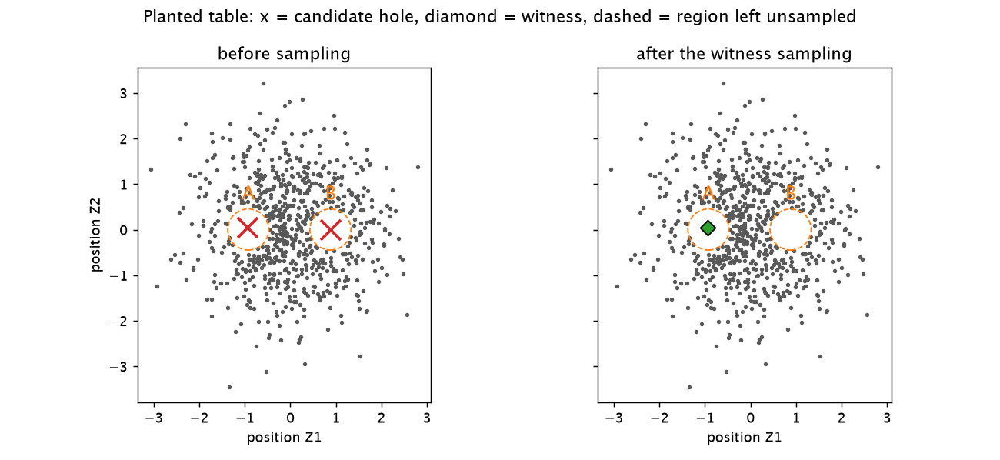
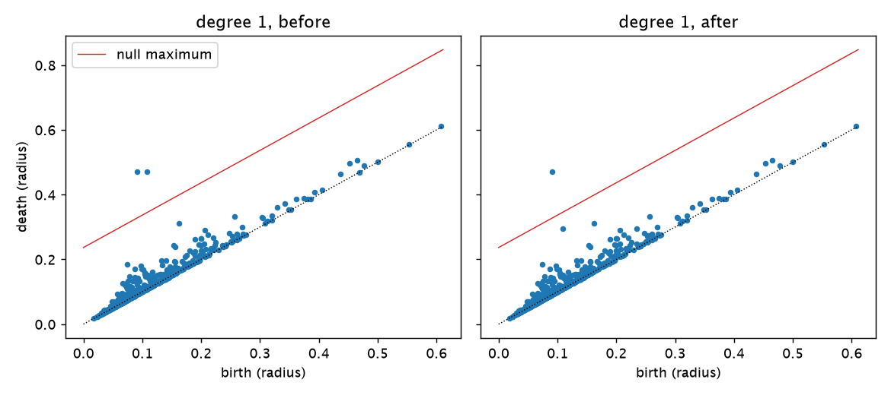
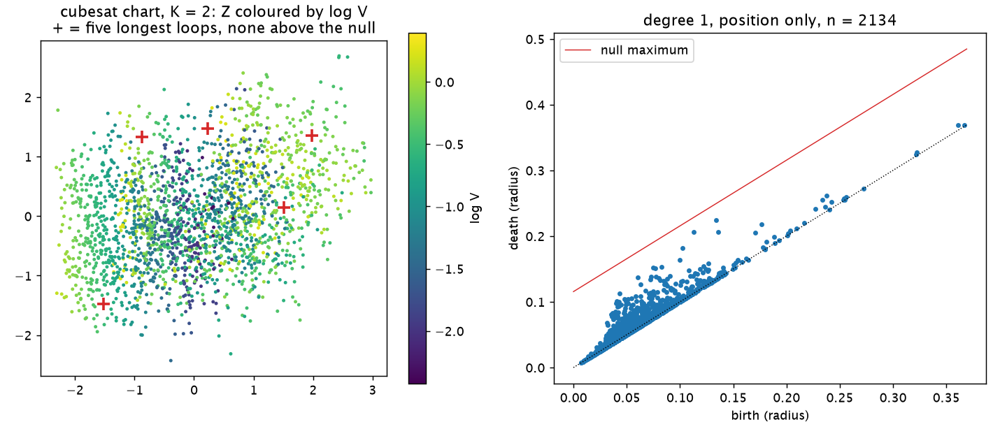

# WP50 D-3: the instance, a planted table and the cubesat chart of record

Read 2026-11-14 at `dev` a1879e6. Serves G3 and G4. Script: `instance/instance.py`; outputs: `instance/out/` (`results.json`
holds every number below; the diagrams as `.npz`; three figures as `.png`, readout images and not paper figures).

## Run it

From the repository root, with the topology libraries in the scratch environment of `uv run --with` (nothing is added to
`pyproject.toml` or `uv.lock`; `uv lock --check` passes):

```
uv run --frozen --with gudhi --with ripser --with persim --with matplotlib \
    python work-packages/WP50-rounds/spike/instance/instance.py
```

About two and a half minutes. Every random choice is seeded. Two reruns gave a byte-identical `results.json` and
byte-identical `.npz` diagrams (`cmp`, `md5`); the figures are redrawn and not compared byte for byte. Versions: gudhi 3.13.0,
ripser 0.6.15, persim 0.4.1, numpy 2.5.4, scipy 1.18.1 (`construction-and-tools.md`).

## What is computed

- The chart is the package's own: `HyperbolicTradeSpace.transform` gives `[Z | log V]`. On the planted table at K = 1; on
  the case at K = 2 (`CASE_K`), three metrics (pointing error, total mass, control effort: panel A of the case's ternary
  figure), so `Z` is two-dimensional and the chart three-dimensional. The fit is the case's own (`case.fit_study`,
  temperature selected by the case's rule, 15.4 here).
- The complex is the alpha complex (GUDHI) on the chosen distance, degrees 0, 1 (and 2 in three dimensions); Rips by ripser as a cross-check.
- A **candidate hole** is a class of degree 1 whose persistence exceeds the longest class degree 1 of a **hole-free null** of
  the same size, and its location is the circumcentre of the simplex that kills it. The null is a measurement device, not a
  test: on the planted table, subsamples of the same hole-free pool (30 draws); on the case, draws from a Gaussian kernel
  density fitted to the sample (20 draws, bandwidth factor 0.2), smooth by construction. The threshold is the largest of the
  draws, which is conservative. How far the case's reading depends on the null's smoothing is in the last table.

## The planted table, where a hole is known to exist

A hole-free table: 6,000 designs of `make_frontier_data(·, 3, random_state=0)`, fitted and charted. Two disks of position
(centres 1.80 apart on the `Z1` axis, radius 0.45, both inside the sample) are removed and the first 700 designs kept. Disk
B stands for a region the attainable set lacks (the oracle returns no design there); disk A is attainable (the oracle
returns a design: the nearest eight designs' median level, plus 0.15 of a standard normal as the measurement).

| Quantity | Before sampling | After the witness sampling |
|---|---|---|
| Degree 1 classes | 659 | 665 |
| Above the null (0.237) | 2 | 1 |
| Longest persistence | 0.379 (loop around B) and 0.362 (loop around A) | 0.379 (B); next 0.187, below the null |
| Total persistence above the null | 0.741 | 0.379 |
| Circumcentre of the killing triangle, distance to the planted centre | A: 0.038; B: 0.010 | |
| Cross-check, ripser (Rips, diameters) | 0.678, 0.663 | |

The sampling rule: propose the circumcentre of each candidate's killing triangle; if no design is returned, try eleven more
within half the radius at which the class dies (twelve attempts: the stated effort). Result (`results.json`, `sampling_log`): A, a witness
on the first attempt at predicted level -0.035, measured 0.159; B, no witness in twelve attempts. After the one witness the
class of A is gone (the new longest class is 0.187, below the null) and the class of B stands unchanged (persistence
0.379). That is outcome one for A and outcome two for B. The planted truth for B is outcome three (the region infeasible);
the procedure, which sees only that no design came back, cannot tell the two apart without a certificate of infeasibility,
and the readout says so.





### What the choice of distance does (the planted table)

The cloud `(Z, s log V)` with the level weight `s`; the null is recomputed at each `s` (10 draws); degree 1.

| s | Longest degree 1 classes | Null | Above the null |
|---|---|---|---|
| 0 (position only) | 0.379, 0.362, 0.149 | 0.198 | 2 |
| 0.5 | 0.315, 0.311, 0.182 | 0.201 | 2 |
| 1 | 0.363, 0.291, 0.281 | 0.274 | 3 |
| sqrt(3) | 0.324, 0.313, 0.306 | 0.332 | 0 |
| 2 sqrt(3) | 0.331, 0.302, 0.294 | 0.378 | 0 |

The same 700 designs and the same two disks. As the level axis is stretched the cloud thins in that direction, the null's
longest loop grows, and by `s = sqrt(3)` the two planted loops no longer clear it (at `s = 1` a third class does).
The reading depends on `s`; position-only is the most sensitive for holes of position. The threshold differs between
this table and the first (0.198 against 0.237 at `s = 0`) only because of 10 draws against 30.

## The cubesat chart of record (K = 2, three metrics, 2,134 designs)

| Reading | Longest classes | Null maximum | Above the null |
|---|---|---|---|
| Position `Z`, degree 1 | 0.093, 0.091, 0.079, 0.077, 0.076 | 0.116 | 0 of 2,057 |
| Position `Z`, degree 0 (gaps) | 0.358, 0.248, 0.228 | 0.568 | 0 |
| Near-frontier band (`log V > -0.5`, 993 designs), degree 1 | 0.120, 0.110, 0.103 | 0.152 | 0 |
| Chart `(Z, log V)`, degree 1 / degree 2 | 0.118 / 0.051 | 0.170 / 0.115 | 0 / 0 |
| Chart `(Z, sqrt(3) log V)`, degree 1 / degree 2 | 0.152 / 0.062 | 0.180 / 0.106 | 0 / 0 |
| Four-metric chart (4 coordinates), ripser, 400 landmarks, degree 1 / degree 2 | 0.333 / 0.134 | 0.405 / 0.208 | 0 / 0 |

On the null's smoothing (position, degree 1, longest observed 0.093): the null's maximum is 0.177 at bandwidth factor 0.1,
0.113 at 0.2 and 0.131 at 0.4 (12 draws each). No classes are above it at any of the three.

**What this says and does not say.** No class of the case's chart outlives a hole-free smooth null at any of six readings.
The designs of the case are a random draw (the paper's Section "case construction"), not a strategic one, the kind of
sampling after which the supervisor expects holes to emerge; the white space the paper describes there is the sparse tail of the draw,
and the diagram sees it as short loops at the scale of the null. This does not show the case has no white space: it shows
that, at this null, nothing is encircled strongly enough to be called a candidate. The five longest loops'
circumcentres are drawn in the figure (all inside the sample's hull; none above the null).



**The seam.** The two terms of the K = 2 fit take 871 and 1,263 designs. Position `Z` is the same either side; only the level
bends, with slopes 0.54 and 0.35 per unit `Z`, so the chart distance and the path along the surface differ by at most 14 percent.

## Refit: the definition survives, as far as it was measured

A second K = 2 fit on a random half of the rows at the same temperature, applied to all 2,134 designs.

| Quantity | Value |
|---|---|
| Largest change of any design's `Z` | 0.0 (the Helmert basis is fixed by the dimension) |
| Largest change of any design's `log V` | 0.066 |
| Bottleneck distance, degree 1, alpha diagrams of the chart | 0.015 |
| Bottleneck distance, degree 1, Rips diagrams on 400 designs (diameter scale) | 0.040 |
| Bound `2 d_GH <= 2 x (largest row change of the chart)` for the Rips diagrams | 0.133 |

The Rips diagrams moved by less than the bound. The bound is Chazal, de Silva and Oudot's (`construction-and-tools.md`); the
instance checks it once, on this refit, and does not establish it.

## Limits of the instance

- One planted table, one seed, two disks of one size; one case; the planted oracle is a function of position only.
- The null of the case is a smooth density; a different null would move the threshold. The three bandwidths above bound the
  question for that family only.
- Witnesses on the planted table are generated from the planted generator, not measured on a configuration; the case's
  evaluation of a chart position as a configuration (the regressor of the paper's Section 7) is not run. The case has a
  simulation oracle (`examples/adcs/experiments/cubesat_oracle.py`); using it to settle a candidate is the readout's first
  option for the later release, and was not done here.
- Degree 2 on the case is read in three dimensions only.
