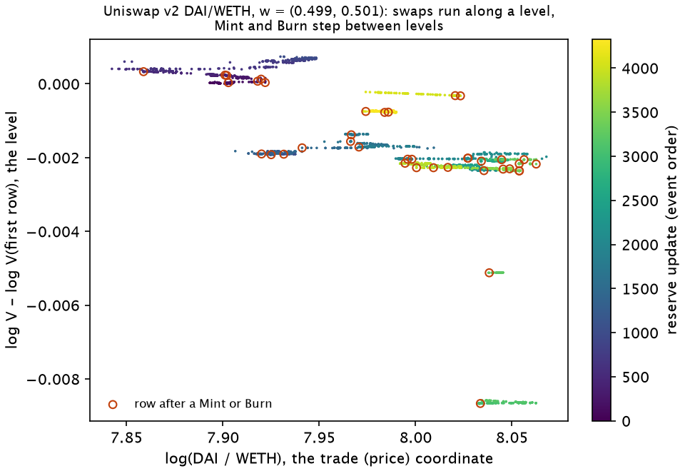

# WP72 market maker: the invariant fit on a constant-product pool (D-4)

## The data

**His pointer, [danlessa/uniswap](https://github.com/danlessa/uniswap)** (commit `cd768a7`, MIT licence, Copyright
2019 BlockScience Inc), holds a cadCAD model of the Uniswap v1 ETH/DAI exchange and the analysis notebook
`uniswap-ethdai-exchange.ipynb`. It holds no table of reserves: the notebook builds one by a BigQuery query on the
public Ethereum logs (`bigquery-public-data.ethereum_blockchain.logs`, exchange
`0x09cabec1ead1c0ba254b09efb3ee13841712be14`, 2018-11-02 to 2019-09-23; 2,694 AddLiquidity, 1,787 RemoveLiquidity and
92,106 purchase events in its stored output) and saves it to a pickle that is not committed; the stored outputs show
only the head and tail of a daily summary. Rebuilding that table needs a Google Cloud account for BigQuery. Its
figure `lawsofmotion.png` is the picture of the mechanism: a liquidity event u1 scales both reserves by 1 + u1 and
crosses the hyperbolas x1 x2 = z; a swap u2 moves the state along one hyperbola.

**The table used** is a Uniswap v2 pair's own event log, read from the public chain through a public JSON-RPC
endpoint ([eth.drpc.org](https://drpc.org), no account): the DAI/WETH pair
[`0xa478…eb11`](https://etherscan.io/address/0xa478c2975ab1ea89e8196811f51a7b7ade33eb11), blocks 12,959,744 to
12,989,743 (4 to 9 August 2021). A v2 pair emits `Sync(reserve0, reserve1)` at every change of its reserves and, in
the same transaction, `Swap`, `Mint` (liquidity added) or `Burn` (liquidity removed)
([Uniswap v2 whitepaper](https://app.uniswap.org/whitepaper.pdf)), so the reserves are read per event, not summed
from deltas, and swaps and liquidity events are labelled by the contract itself. 4,327 reserve updates: 4,221 swaps,
14 Mint, 25 Burn, 67 bare `sync` calls (none changed the reserves). The ledger is public record and states no
licence. URL, block range, sizes and SHA-256 of the fetched logs and the derived table: `amm-manifest.toml`; fetch:
`fetch_amm.py`; analysis: `amm.py`; numbers: `results_amm.md`.

A stretch is the run of rows between two non-swap events; there are 105 with two or more rows. Metrics: the two
reserves in token units, logged.

## What the fit finds

| estimator | w (DAI, WETH) | |
|---|---|---|
| invariant fit, stretches given | (0.4989, 0.5011) | within_share 6.3e-5, flatness 5.2e-3 |
| invariant fit, order fallback (no labels) | (0.5008, 0.4992) | 975 breaks; 38 of the 39 Mint and Burn among them |
| invariant fit, no groups | (0.5200, 0.4800) | minimum variance of the whole table |
| PCA within stretches, minor axis | (0.4989, 0.5011) | eigenvalues 4.9e-10 and 1.8e-5 |
| PCA pooled, minor axis | (0.5201, 0.4799) | |
| frontier fit, tau = 152.6 | (0.0000, 1.0000) | the boundary of a thin cloud |

- **The exponents are found, not given:** (0.4989, 0.5011), within 0.0011 of (1/2, 1/2). Within a stretch the
  standard deviation of the level is half a per cent of the standard deviation along the level set.
- **The residual is the fee.** In exact integer arithmetic the product of the reserves rises at every one of the
  4,220 swaps with a predecessor: the 0.3 per cent fee stays in the pool. The per-swap rises sum to 2.0e-3 in log V
  over the window and correlate with the price inside a stretch (median correlation 0.16), which tilts the
  least-variance direction by 0.001; the within-stretch variance of log V is 2.9e-10 at (1/2, 1/2) and 2.4e-10 at the
  fitted w.
- **The level jumps at liquidity events.** The median swap changes log V by 1e-8 (largest 1.4e-4); a Mint or Burn by
  1.9e-5 at the median and 6.6e-3 at most. Over the window log V spans 0.0094 and log(DAI/WETH) 0.225: the pool is
  a thin band in the log plane, its width set by liquidity and its length by price.
- **Without labels**, the order fallback recovers w to 0.0008 and its breaks include 38 of the 39 Mint and Burn
  events, among 975 breaks in all: a fee step on a large swap is as large as a small deposit (28 of the 39 liquidity
  events move log V less than the largest single swap), so the cut between swap and liquidity event is not
  recoverable from the level alone at this threshold.
- **The baselines.** PCA within stretches is the invariant fit here (its minor axis lands on the simplex). Pooled,
  both drift to (0.52, 0.48): the price moved between stretches, so the groups sit at different positions along the
  level set and the pooled scatter is no longer the within-stretch one. The frontier fit puts all weight on WETH, a
  vertex: on a band this thin, the boundary of the cloud says nothing about the level.

## Figure

Shows: the chart of the fit, the trade coordinate against the level; each stretch is a horizontal run, and the rows
after a Mint or Burn sit at the ends of the steps between runs. Does not show: time in seconds, or the sizes of the
swaps. Good for: seeing the two controls of the mechanism as the two axes of the chart, the swap along Z and the
liquidity event along log V.
