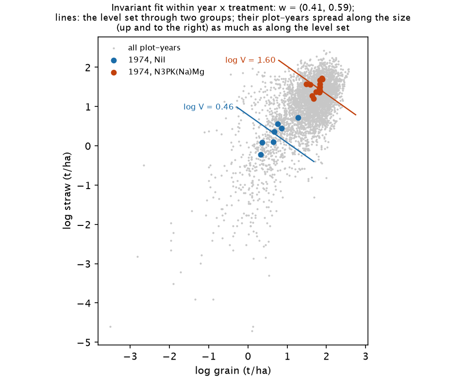
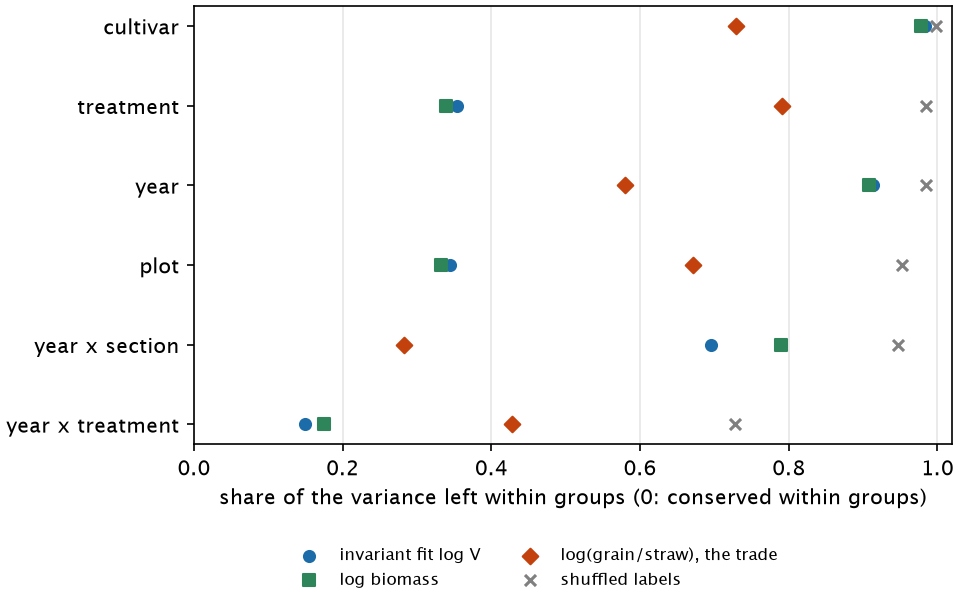

# WP72 wheat: the invariant fit on Broadbalk grain and straw (D-3)

Source: the committed derived table `examples/wheat/derived/grain_straw.csv`, 3,753 plot-years of Broadbalk winter
wheat, 1968 to 2022, from Glendining and Poulton (2023), *Broadbalk Wheat annual grain and straw yields 1968-2022*,
Electronic Rothamsted Archive, [doi:10.23637/rbk1-yld6822-01](https://doi.org/10.23637/rbk1-yld6822-01), CC BY 4.0;
the download's hashes are in `examples/wheat/manifest.toml`. Script: `wheat.py`; numbers: `results_wheat.md`.

Metrics: grain and straw in t/ha, logged, no scaler, so the exponents read in the units of the yields (a standard
scaler rescales them by the pull-back of L9). A group is a set of plot-years taken to share the level. The table has
no replicate plots: a year and treatment holds the treatment's strip in the sections of different rotation, 3.8
plot-years on average.

## What the fit finds

| grouping | w (grain, straw) | within_share | shuffled labels | flatness | share: log biomass | share: log(grain/straw) |
|---|---|---|---|---|---|---|
| none | (0.831, 0.169) | | | 1.06 | | |
| cultivar | (0.814, 0.186) | 0.984 | 0.998 | 1.18 | 0.978 | 0.729 |
| year | (0.823, 0.177) | 0.913 | 0.985 | 1.19 | 0.908 | 0.580 |
| treatment | (0.602, 0.398) | 0.354 | 0.984 | 1.34 | 0.339 | 0.791 |
| plot | (0.810, 0.190) | 0.345 | 0.953 | 0.91 | 0.333 | 0.672 |
| year x section | (1.000, 0.000) | 0.695 | 0.947 | 0.80 | 0.790 | 0.283 |
| year x treatment | (0.414, 0.586) | 0.150 | 0.728 | 1.28 | 0.175 | 0.428 |

`within_share` is the share of the variance of log V left within groups (0: the level is the group's; 1: the groups
explain nothing); the shuffled-label column is its median over 20 permutations of the labels, the value with no
group structure (small groups lower it by chance). `flatness` is the within-group spread of the level along the unit
vector of w over the within-group spread along the level set: 0 for a conserved quantity, above 1 when the rows of a
group differ more in size than in trade.

- **Year and treatment carry the level.** Within year x treatment, 15 per cent of the variance of log V is left,
  against 73 per cent for shuffled labels, with w = (0.41, 0.59). Log biomass does almost as well (17.5 per cent); so
  does any near-balanced w. Treatment alone leaves 35 per cent, plot 35, year 91, cultivar 98.
- **The level is not conserved within a group.** The flatness is 1.28 within year x treatment and above 0.8 in every
  grouping: inside a group the plot-years spread along the size as much as, or more than, along the level set. PCA
  of the within-group scatter puts its minor axis off the simplex in every grouping: the least-varying direction
  within groups is a contrast of grain against straw, not a level.
- **Within a year and section the shape is shared.** Year x section (one rotation position, one cultivar, every
  treatment) leaves 28 per cent of the variance of log(grain/straw) and 79 per cent of log biomass: the harvest index
  is the group's, the size varies with the treatment. The fit goes to the vertex (1, 0), grain alone, the
  minimum-variance point of the simplex when no balanced combination is conserved.
- **Two terms.** Within year x treatment the two-term fit (kappa = 1) returns W = (1, 0) and (0, 1) with b = 0.72,
  log(grain + 2.06 straw): within-group variance 0.0635 against 0.0691 for the monomial and 0.0675 for log biomass
  (grain + straw), a reduction of 8 per cent.
- **Baselines on the whole table.** The frontier fit (no scaler, tau = 10.7, a tenth above) gives (0.286, 0.714), the
  boundary of the cloud. PCA's major axis is (0.584, 0.812), the size; its minor axis (-0.812, 0.584) is off the
  simplex. With no groups the invariant fit gives (0.831, 0.169), the minimum-variance combination, which is not a
  level: the size dominates the table's variance.

## Biomass: a level or a size

In the fit's own numbers biomass is a size. It is mostly set by the group: 82 per cent of the variance of log biomass
lies between year-and-treatment groups, and the fitted level does no better than log biomass. It is not conserved
within any grouping in the table: the within-group spread along the level is at least as large as the spread along
the trade (flatness 0.8 to 1.3; the market maker's is 0.005). The grain-to-straw trade appears between groups
(cultivar, year, section), and within a year and section it is the ratio, not the size, that the plot-years share.
The table has no rows that hold the size fixed and vary the split, which is what an invariant in the market maker's
sense needs.

## Figures

Shows: every plot-year in the log plane, two year-and-treatment groups with the fitted level set through each. Does
not show: the other 970 groups, or a test. Good for: seeing that a group's plot-years lie along the size direction
(up and to the right) as much as along its level set.

Shows: for each grouping, how much of each quantity's variance is left within groups. Does not show: the exponents,
or which groups. Good for: reading which grouping carries the level (year x treatment) and which carries the shape
(year x section).
